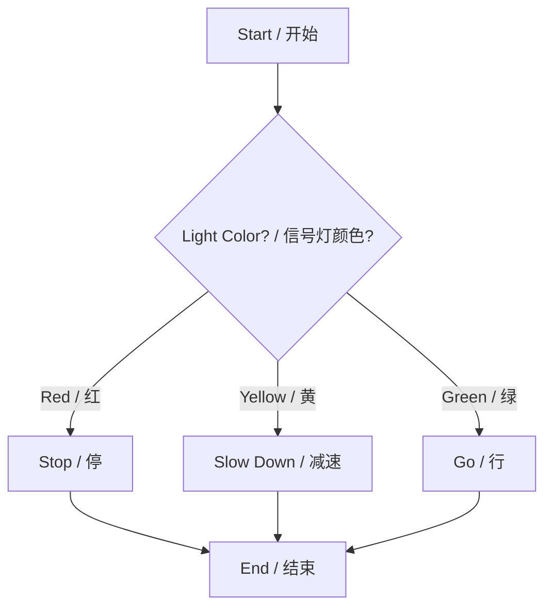
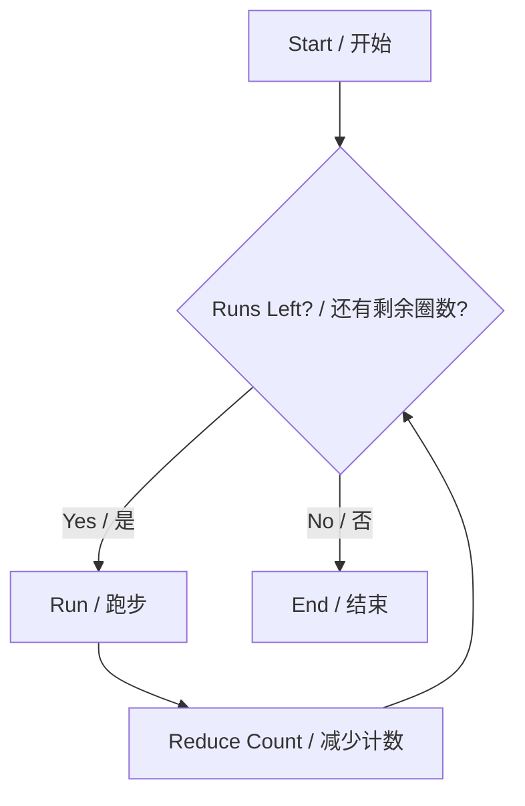

# Linux and Command Line Basics

# Linux 与命令行基础

---

<br>

## Section 1: GUI vs. CLI and the Terminal / 第一章：图形界面、命令行与终端

Before we dive into Linux, it is important to understand how humans interact with computers. There are two primary interfaces:
在深入学习 Linux 之前，了解人类如何与计算机交互非常重要。主要有两种交互界面：

*   **GUI (Graphical User Interface / 图形用户界面)**: This is what you use every day on Windows or macOS. You interact with visual elements like windows, icons, and buttons using a mouse.
    **GUI（图形用户界面）**：这是你在 Windows 或 macOS 上每天使用的界面。你使用鼠标与窗口、图标和按钮等视觉元素进行交互。
*   **CLI (Command Line Interface / 命令行界面)**: An interface where you interact with the computer exclusively by typing text commands.
    **CLI（命令行界面）**：一种完全通过输入文本命令与计算机进行交互的界面。

### What is a Terminal? / 什么是终端？

A **terminal** is a text-based tool that lets you control a computer or server by typing commands instead of clicking icons. It is a typical example of a CLI. In professional software development and server management, the terminal is an indispensable tool.
**终端 (Terminal)** 是一种基于文本的工具，它允许你通过输入命令而不是点击图标来控制计算机或服务器。它是 CLI 的典型代表。在专业的软件开发和服务器管理中，终端是不可或缺的工具。

> **Q: What's your intuitive guess about the advantages and disadvantages of GUI and CLI?**
> **问：凭直觉猜测，GUI 和 CLI 的优缺点分别是什么？**
> 
> *   **GUI**: Easy to learn, highly visual, but can be slow and tedious for repetitive or complex work. (易于学习，直观，但对于重复性或复杂的工作来说可能很慢且繁琐。)
> *   **CLI**: Extremely fast, powerful, and easily automatable, but has a steep learning curve and is hard for beginners. (速度极快，功能强大且易于自动化，但学习曲线陡峭，对初学者有一定难度。)

---

<br>

## Section 2: Connecting to Remote Servers / 第二章：连接远程服务器

Most of the time, Linux runs on remote servers rather than your personal laptop. To control these servers, we use specific applications and protocols.
大多数情况下，Linux 运行在远程服务器上，而不是你的个人笔记本电脑上。为了控制这些服务器，我们使用特定的应用程序和协议。

### The Tool: Termius / 工具：Termius

**Termius** is a popular, cross-platform terminal application. It is the tool we use to connect to and manage Linux servers seamlessly.
**Termius** 是一款流行的跨平台终端应用程序。它是我们用来无缝连接和管理 Linux 服务器的工具。

To create a new host connection in Termius (or any SSH client), you need four essential elements:
要在 Termius（或任何 SSH 客户端）中创建新的主机连接，您需要四个核心要素：
1.  **IP Address (IP 地址)**: The network address of the server.
2.  **Port (端口)**: The specific channel for the connection (default for SSH is usually 22).
3.  **Username (用户名)**: Your account name on the server.
4.  **Password (密码)**: Your secret key to authenticate.

### Network Protocols: SSH and SFTP / 网络协议：SSH 与 SFTP

*   **SSH (Secure Shell)**: An encrypted network protocol used to securely access, manage, and transfer files between computers over unsecured networks. It ensures your commands and data cannot be intercepted easily.
    **SSH (安全外壳协议)**：一种加密的网络协议，用于在不安全的网络上安全地访问、管理计算机并在计算机之间传输文件。它确保您的命令和数据不会轻易被拦截。
*   **SFTP (SSH File Transfer Protocol / Secure File Transfer Protocol)**: A secure version of File Transfer Protocol that runs over SSH. Termius offers a built-in SFTP feature for easy visual file management (uploading and downloading).
    **SFTP (SSH 文件传输协议 / 安全文件传输协议)**：基于 SSH 运行的安全版本的文件传输协议。Termius 提供内置的 SFTP 功能，方便进行可视化的文件管理（上传和下载）。

---

<br>

## Section 3: Understanding File Systems and Paths / 第三章：理解文件系统与路径

> **Q: What are the two software components closest to users in a computer?**
> **问：在计算机中，最贴近用户的两个软件组件是什么？**
> 
> 1.  **File systems (文件系统)**: Where your data lives. (你的数据存放的地方。)
> 2.  **Application systems (应用系统)**: The programs you run. (你运行的程序。)

> **Q: What are the important things when controlling a computer?**
> **问：控制计算机时，最重要的是什么？**
> 
> *   **Position**: "where you are" (Location in the file system)
>     **位置**：“你在哪里”（在文件系统中的位置）
> *   **Intention**: "what you want to do" (The command you want to execute)
>     **意图**：“你想做什么”（你想执行的命令）

### Absolute vs. Relative Paths / 绝对路径与相对路径

To define your "Position" or locate a file, we use paths.
为了定义你的“位置”或定位一个文件，我们使用路径。

**1. Absolute Path (绝对路径)**
The full, complete path starting from the root directory to a specific file or folder. It works no matter where you currently are in the system.
从根目录开始到特定文件或文件夹的完整路径。无论你当前在系统中的哪个位置，它都有效。
*   *Linux*: `/home/zhangfeng/download/test.txt`
*   *Windows*: `D:\download\test.txt`

**2. Relative Path (相对路径)**
The path from your *current working directory* to a file or folder.
从你*当前工作目录*到文件或文件夹的路径。
*   *Linux*: `../download/test.txt` (`..` means one directory up)
*   *Windows*: `..\test.txt`

> **Q: Why do we need "relative paths"?**
> **问：为什么我们需要“相对路径”？**
> 
> *   They are **shorter and faster** to type than absolute paths. (它们比绝对路径更短，输入更快。)
> *   They are **portable**. If you move or copy a whole folder, relative links inside it still work. They make teamwork and navigation easier without relying on fixed root locations. (它们具有**可移植性**。如果移动或复制整个文件夹，其内部的相对链接仍然有效。它们使团队合作和导航变得更容易，而无需依赖固定的根目录位置。)

---

<br>

## Section 4: Essential Linux Commands / 第四章：Linux 基础命令

Now let's translate our "intentions" into actual Linux CLI commands.
现在让我们将“意图”转化为实际的 Linux CLI 命令。

### 1. Navigating and Viewing / 导航与查看

*   `pwd`: **P**rint **W**orking **D**irectory. Tells you your exact absolute path (where you are).
    **打印工作目录**。告诉你确切的绝对路径（你在哪里）。
*   `ls`: **L**i**s**t files and folders in the current directory.
    **列出**当前目录中的文件和文件夹。
*   `cd <path>`: **C**hange **D**irectories. Moves you to a new location.
    **切换目录**。将你移动到一个新位置。
    *   `cd ..`: Change to the parent directory (move up one level). / 切换到父目录（向上一级）。
    *   `cd ~`: Change to your user's home directory. / 切换到用户的主目录。

### 2. Creating and Viewing Files / 创建与查看文件

*   `mkdir <folder_name>`: **M**a**k**e **dir**ectory. Creates a new folder.
    **创建目录**。创建一个新文件夹。
*   `touch new_file.txt`: Creates a new, empty file named `new_file.txt`.
    创建一个名为 `new_file.txt` 的空文件。
*   `cat new_file.txt`: Con**cat**enate and print. Prints out *all* contents of the file to the terminal at once.
    打印。一次性将文件的**所有**内容打印到终端上。
*   `less new_file.txt`: Allows you to view the contents of a file page by page (useful for large files).
    分页查看文件内容（对于大文件非常有用）。

### 3. Modifying and Deleting / 修改与删除

*   `cp`: **C**o**p**y files or directories. / **复制**文件或目录。
    *   `cp original_file.txt copy_file.txt` (Copy a file / 复制文件)
    *   `cp -r original_folder copy_folder` (Copy a folder and all its contents **r**ecursively / **递归地**复制文件夹及其所有内容)
*   `mv`: **M**o**v**e files or directories. Also used to rename them! / **移动**文件或目录。也常用于重命名！
    *   `mv copy_file.txt move_file.txt` (Rename/Move a file / 重命名或移动文件)
    *   `mv copy_folder move_folder` (Rename/Move a folder / 重命名或移动文件夹)
*   `rm`: **R**e**m**ove files. / **删除**文件。
    *   `rm tmp.txt` (Remove a single file / 删除单个文件)
    *   `rm -r tmp_folder` (Remove a folder and all its contents recursively. *Use with caution!* / 递归删除文件夹及其所有内容。*谨慎使用！*)

> **Q: What differences do you feel between using Windows GUI and Linux CLI?**
> **问：在使用 Windows GUI 和 Linux CLI 之间，你感觉有什么不同？**
> *(Think about speed, visibility, and control! / 思考一下关于速度、可见性和控制力方面的差异！)*

---

<br>

## Section 5: Text Editing and Terminal Tips / 第五章：文本编辑与终端技巧

### Text Editing with `nano` / 使用 `nano` 编辑文本

While GUI systems have Notepad or Word, Linux terminals have text-based editors. **nano** is one of the most user-friendly terminal text editors.
虽然 GUI 系统有记事本 (Notepad) 或 Word，但 Linux 终端有基于文本的编辑器。**nano** 是对用户最友好的终端文本编辑器之一。

*   To open or create a file to edit: `nano filename.txt`
    打开或创建一个文件进行编辑：`nano filename.txt`
*   **Save your work**: Press `Ctrl + O` (Write Out), then press `Enter` to confirm the file name.
    **保存工作**：按 `Ctrl + O`，然后按 `Enter` 键确认文件名。
*   **Exit nano**: Press `Ctrl + X`.
    **退出 nano**：按 `Ctrl + X`。

### Terminal Superpowers (Tips) / 终端进阶技巧

Mastering these two features will make you much faster in the CLI:
掌握这两个功能会让你在 CLI 中的操作速度大幅提升：

1.  **The `Tab` Key (Auto-complete) / `Tab` 键（自动补全）**:
    If you type the first few letters of a file name or command and press the `Tab` key, Linux will automatically complete the rest for you. If there are multiple options, pressing `Tab` twice will list them.
    如果你输入文件名或命令的前几个字母，然后按下 `Tab` 键，Linux 会自动为你补全剩余部分。如果有多个选项，按两次 `Tab` 会列出所有可能。
2.  **The `history` Command / `history` 命令 (历史记录)**:
    Type `history` and press Enter to see a numbered list of all the commands you have run before. You can also press the **Up** and **Down** arrow keys on your keyboard to scroll through your previous commands.
    输入 `history` 并按回车键，可以查看你之前运行过的所有命令的编号列表。你也可以通过键盘上的**上**、**下**方向键来快速滚动查找之前的命令。
# Python Programming Fundamentals

# Python 编程基础

---

<br>


> **Q: What makes a good programming language?**
> **问：什么是一门好的编程语言？**
> 
> A good programming language balances **Readability** (easy for humans to understand), **Efficiency** (runs fast enough for its purpose), **Versatility** (can build different types of applications), and a **Strong Community** (lots of libraries and support). Python excels particularly in readability and community support, making it an excellent language for both beginners and professionals.
> 一门好的编程语言需要在**可读性**（易于人类理解）、**高效性**（运行速度满足需求）、**通用性**（能开发各种应用）以及**强大的社区**（丰富的库和支持）之间取得平衡。Python 在可读性和社区支持方面表现尤为突出，是初学者和专业人士的绝佳选择。

---

<br>

## Section 1: Python Basic Syntax Fundamentals / 第一章：Python 基础语法

### 1.1 Python Execution Modes / Python 的执行模式

Python code can be executed in two primary ways depending on your needs: Interactive Mode and Script Mode.
根据需求，Python 代码主要有两种执行方式：交互模式和脚本模式。

**Interactive Mode (交互模式)**
This mode is like a conversation with Python. You type a line, and Python responds immediately.
这种模式就像是和 Python 对话。你输入一行代码，Python 立即给出响应。

```python
$ python3
>>> print("Hello World!")
Hello World!
>>> exit()
```
* **Features / 特点**: Immediate feedback (即时反馈); Good for quick testing (适合快速测试); Type commands directly (直接输入命令).

**Script Mode (脚本模式)**
For larger programs, you write all your code in a file (script) and tell Python to execute the whole file at once.
对于较大的程序，你会将所有代码写在一个文件（脚本）中，然后让 Python 一次性执行整个文件。

```bash
$ nano hello.py  # Create file using a text editor like nano / 使用 nano 等文本编辑器创建文件
$ python3 hello.py
```
* **Features / 特点**: Save code permanently (永久保存代码); Better for complex programs (更适合复杂的程序); Use text editor (nano/vim) (使用文本编辑器).

<br>

### 1.2 Core Syntax Rules / 核心语法规则

**Indentation Rules / 缩进规则**
Unlike other languages that use brackets `{}` to group code, Python uses indentation (spaces). The standard is the **4-space principle**.
与其他使用大括号 `{}` 来组织代码的语言不同，Python 使用缩进（空格）。标准做法是**4空格原则**。

```python
# Correct / 正确
if True:
    print("This is properly indented")

# Error / 错误
if True:
print("This will cause IndentationError") # 会引发缩进错误
```

> **Q: Why do we need the "4-space principle"?**
> **问：为什么我们需要“4空格原则”？**
> 
> Indentation forces developers to write clean, readable code. The 4-space rule creates a visually distinct hierarchy, making it easy to see which blocks of code belong together, preventing nested code from becoming an unreadable mess.
> 缩进强制开发者编写整洁、可读的代码。4个空格的规则在视觉上创造了清晰的层级关系，让人很容易看清哪些代码块属于同一组，防止嵌套的代码变成一团乱麻。

**Code Comments / 代码注释**
Comments are notes left in the code for humans; the computer ignores them.
注释是留在代码中供人类阅读的笔记；计算机会忽略它们。

```python
# Single-line comment / 单行注释

'''
Multi-line comment
Spanning multiple lines
多行注释
跨越多行
'''

def calculate():
    """Docstring comments for functions / 用于函数的文档字符串注释"""
```

> **Q: Why do we need "Code Comments"?**
> **问：为什么我们需要“代码注释”？**
> 
> Comments explain the *why* behind the code. They help your future self remember your logic and help teammates understand your work without deciphering every line.
> 注释解释了代码背后的*原因 (Why)*。它们能帮助未来的你回忆起当时的逻辑，也能帮助团队成员理解你的工作，而无需逐行破译代码。

**Statement Separation / 语句分隔**
```python
# Use semicolon ";". Valid but not recommended / 使用分号 ";"。合法但不推荐
x=1; y=2; print(x+y)

# Preferred (line break) / 推荐方式（换行）
x = 1
y = 2
print(x + y)
```

<br>

### 1.3 Reserved Keywords / 保留关键字

Python has 35 reserved keywords (as of Python 3.7). **Important:** These cannot be used as variable or function names!
Python 有 35 个保留关键字（截至 Python 3.7）。**重要提示：** 这些关键字不能用作变量名或函数名！

|          |         |        |         |         |
|----------|---------|--------|---------|---------|
| False    | None    | True   | and     | as      |
| assert   | async   | await  | break   | class   |
| continue | def     | del    | elif    | else    |
| except   | finally | for    | from    | global  |
| if       | import  | in     | is      | lambda  |
| nonlocal | not     | or     | pass    | raise   |
| return   | try     | while  | with    | yield   |

<br>

### 1.4 Your First Python Program / 你的第一个 Python 程序

**Execution Steps on a Server / 服务器上的执行步骤**:
1. Login to Linux Server using Termius. / 使用 Termius 登录到 Linux 服务器。
2. Create file: `nano hello.py` / 创建文件。
3. Write code: `print('Hello World!')` / 编写代码。
4. Save: `Ctrl+O` → Press "enter" → `Ctrl+X` / 保存并退出。
5. Run: `python3 hello.py` / 运行代码。

<br>

### 1.5 Common Errors & Debugging / 常见错误与调试

When programming, you will inevitably make mistakes. Learning to read errors is a superpower.
在编程时，你不可避免地会犯错。学会阅读错误信息是一项超能力。

1. **NameError (命名错误)**: Using a variable or function that doesn't exist.
   ```python
   prin("Missing t")  # NameError: name 'prin' is not defined
   ```
2. **IndentationError (缩进错误)**: Breaking the spacing rules.
3. **TypeError (类型错误)**: Mixing incompatible data types.
   ```python
   "5" + 3  # TypeError: can only concatenate str (not "int") to str
   ```

**Debugging Techniques / 调试技巧**: Read errors carefully, check line numbers, use `print()` statements to track variables, and utilize AI assistants (like Kimi/ChatGPT) to explain confusing errors. / 仔细阅读错误，检查行号，使用 `print()` 追踪变量，并利用 AI 助手解释令人困惑的错误。

---

<br>

## Section 2: Variables & Data Types / 第二章：变量与数据类型

### 2.1 The Nature of Variables / 变量的本质

Think of variables as labeled boxes in a warehouse.
把变量想象成仓库里贴着标签的盒子。

```python
box_label = "item_count"  # Variable name / 变量名 (标签)
box_content = 17          # Stored value / 存储的值 (内容)
```

* **Binding (绑定)**: Variables are references (pointers) to objects in memory. / 变量是对内存中对象的引用（指针）。
* **Garbage Collection (垃圾回收)**: Python automatically cleans up data that no variables point to. / Python 会自动清理没有变量指向的数据。
* **Reassignment (重新赋值)**: 
  ```python
  x = 10    # Create object 10, bind to x / 创建对象 10，绑定到 x
  x = "cat" # Create new object "cat", rebind x / 创建新对象 "cat"，重新绑定 x
  ```

<br>

### 2.2 Variable Naming Rules / 变量命名规则

Variables can contain numbers, letters (`abcABC`), and underscores (`_`), but **cannot start with a number**.
变量可以包含数字、字母和下划线，但**不能以数字开头**。

```python
# Valid but discouraged examples / 合法但不推荐的例子 (不符合 PEP8 标准)
_privateVar = 1
MAX_LIMIT = 100
tempVar2 = 3.14

# Invalid examples / 非法例子
3attempt = 5              # SyntaxError (Cannot start with number)
special-chars = "text"    # SyntaxError (Hyphens act like minus signs)
```

**PEP8 Pro Practices / PEP8 专业实践 (Python Enhancement Proposal 8)**: Use `snake_case` (lowercase with underscores) for variables. / 变量使用 `snake_case`（全小写加下划线）。
* `studentname` → `student_name`
* `calcVal` → `calculate_value`

<br>

### 2.3 Dynamic Typing / 动态类型系统

Python figures out the data type automatically when you run the code.
Python 会在运行代码时自动推断数据类型。

```python
dynamic_var = 100          # int (整数)
print(type(dynamic_var))   # <class 'int'>

dynamic_var = "Python"     # str (字符串)
print(type(dynamic_var))   # <class 'str'>
```

**Static (C++) vs Dynamic (Python) / 静态类型 (C++) 与 动态类型 (Python)**:
In C++, you must declare the type, and it is locked forever. In Python, variables can change types freely.
在 C++ 中，你必须声明类型，且类型永久锁定。在 Python 中，变量可以自由更改类型。

> **Q: "Insufficient Computing Power" V.S. "Computing Power Redundancy" ?**
> **问：“算力不足” 与 “算力冗余” 是什么意思？**
> 
> Historically, computers had *insufficient computing power*. Languages like C++ used static typing because it allows the machine to run as fast and efficiently as possible, saving memory and CPU cycles. Today, we often have *computing power redundancy* (excess power). Python uses dynamic typing, which requires more computing power under the hood, but drastically saves *developer time*. We trade abundant computer power for precious human time.
> 历史上，计算机面临着*算力不足*的问题。像 C++ 这样的语言使用静态类型，因为它允许机器尽可能快速高效地运行，节省内存和 CPU。今天，我们通常拥有*算力冗余*（过剩的算力）。Python 使用动态类型，虽然底层需要消耗更多的算力，但极大地节省了*开发者的开发时间*。我们用丰富的计算机算力来换取宝贵的人类时间。

<br>

### 2.4 Core Data Types / 核心数据类型

Python has four primary primitive types: Integer, Float, String, and Boolean.
Python 有四种主要的原始类型：整型、浮点型、字符串和布尔型。

**1. Integer Representations (整型)**
```python
binary_num = 0b1010     # 10 (binary / 二进制)
octal_num = 0o177       # 127 (octal / 八进制)
hex_num = 0x1af         # 431 (hexadecimal / 十六进制)
number = 33             # 33 (decimal / 十进制)
```

**2. Floating-Point Precision (浮点型精度问题)**
Computers struggle to represent decimals perfectly in binary.
计算机在二进制中很难完美地表示小数。
```python
print(0.1 + 0.2 == 0.3)           # False
print(f"{0.1 + 0.2:.17f}")        # 0.30000000000000004

# Solution using Decimal library / 使用 Decimal 库解决
from decimal import Decimal
print(Decimal('0.1') + Decimal('0.2'))  # Exact 0.3
```

**3. Strings (字符串)**
```python
s1 = 'Single quotes'
s2 = "Double quotes"
s3 = '''Triple quotes preserve
line breaks and "both" quote types''' # 三引号保留换行和引号
```

**4. Boolean (布尔型)**
```python
A = True
B = False
print(A and B) # False
print(A or B)  # True
```

<br>

### 2.5 Type Conversions / 类型转换

**Explicit Conversion / 显式转换**
```python
age = int("25")       # String to integer
pi = float("3.1415")  # String to float
price = str(9.99)     # Float to string

# Truthy conversions (What is considered True/False?) / 真值转换
bool(0)     # False (Zero is false / 0 为假)
bool("")    # False (Empty string is false / 空字符串为假)
bool("a")   # True  (Any content is true / 有内容即为真)
```

**Automatic Conversion / 自动转换**
```python
3 + 5.0         # int promoted to float -> 8.0 / 整型自动提升为浮点型
True + 10       # bool treated as int(1) -> 11 / True 被当作数字 1 计算
```

---

<br>

## Section 3: Python Operator System / 第三章：Python 运算符系统

### 3.1 Arithmetic Operators / 算术运算符

| Operator (运算符) | Description (描述)      | Example (示例)  | Result (结果) |
|-------------------|-------------------------|-----------------|---------------|
| `+`               | Addition (加)           | `5 + 3`         | 8             |
| `-`               | Subtraction (减)        | `7 - 2`         | 5             |
| `*`               | Multiplication (乘)     | `3 * 4`         | 12            |
| `/`               | True Division (真除法)  | `10 / 3`        | 3.333...      |
| `//`              | Floor Division (整除)   | `10 // 3`       | 3             |
| `%`               | Modulus (取模/求余数)   | `10 % 3`        | 1             |
| `**`              | Exponentiation (幂运算) | `2 ** 3`        | 8             |

<br>

### 3.2 Comparison Operators / 比较运算符

**Numeric / 数值比较**: `a > b`, `a == b`, `a != b` (Not equal).

**String Comparison Rules / 字符串比较规则**:
1. Compare character by character using ASCII values. / 使用 ASCII 码逐字符比较。
2. Shorter strings are considered smaller if everything else matches. / 如果前面都一样，较短的字符串更小。
3. Case-sensitive. / 区分大小写。

```python
print('Apple' < 'Banana')  # True (A=65 < B=66)
print('cat1' > 'cat')      # True (longer > shorter)
print('cat' > 'CAT')       # True (lowercase a(97) > uppercase A(65))
print('10' < '2')          # True (character '1'(49) vs '2'(50))
```

<br>

### 3.3 Logical Operators / 逻辑运算符

| X     | Y     | X and Y (与) | X or Y (或) | not X (非) |
|-------|-------|-------------|------------|------------|
| True  | True  | True        | True       | False      |
| True  | False | False       | True       | False      |
| False | True  | False       | True       | True       |
| False | False | False       | False      | True       |

**Short-Circuiting / 短路计算**: Python stops evaluating logical statements as soon as the outcome is known. / 一旦结果已知，Python 就会停止计算逻辑表达式。
```python
def check():
    print("Called!")
    return False

print(True or check())  # True is enough for 'or', check() is never called! / 短路，无输出
print(False and check())# False ruins 'and', check() is never called! / 短路，无输出
```

**Precedence Table (Order of Operations) / 优先级表**
Parentheses `()` always have the highest priority. / 括号 `()` 永远拥有最高优先级。
1. `**` Exponentiation (指数)
2. `+x`, `-x` (正负号)
3. `*`, `/`, `//`, `%` (乘除取余)
4. `+`, `-` (加减)
5. `<, >, ==, !=` Comparisons (比较)
6. `not` (非)
7. `and` (与)
8. `or` (或)

<br>

### 3.4 Assignment Operators / 赋值运算符

**Compound Operators / 复合运算符**
```python
counter = 5
counter += 3    # Equivalent to: counter = counter + 3
counter **= 2   # 8^2 = 64
```

**Mutable Object Pitfall / 可变对象陷阱**
```python
list1 = list2 = []  # Both variables point to the exact same list memory / 指向同一内存
list1.append(5)
print(list2)  # [5] (Modifying one affects the other / 牵一发而动全身)
```

<br>

### 3.5 Precedence Practice / 优先级实战练习

```python
result = 5 + 3 * 2 ** 2 // (4 % 3) - 1
# Step-by-step evaluation / 逐步计算:
# 1. Parentheses: (4 % 3) = 1
# 2. Exponent: 2 ** 2 = 4
# 3. Multiplication/Division (Left to right): 3 * 4 = 12 -> 12 // 1 = 12
# 4. Addition/Subtraction: 5 + 12 - 1 = 16
```

---

<br>

## Section 4: String Operations / 第四章：字符串操作

### 4.1 Indexing & Slicing / 索引与切片

* **Positive Index**: `0` to `Length-1`
* **Negative Index**: `-1` (last character) to `-Length`

**Slice Syntax / 切片语法**: `string[start:end:step]` (end index is NOT included / 不包含结束索引).

```python
text = "programming"
print(text[3:7])    # 'gram'
print(text[::-1])   # 'gnimmargorp' (Reverse string trick / 字符串反转)
print(text[::2])    # 'pormig' (Step by 2 / 步长为2)
```

<br>

### 4.2 String Methods Library / 字符串内置方法

```python
# Split & Join / 分割与拼接
csv = "apple,banana,cherry"
items = csv.split(",")     # ['apple', 'banana', 'cherry']
new_str = "-".join(items)  # "apple-banana-cherry"

# Stripping (Removing whitespace) / 去除空白符 (\n=换行, \t=制表符)
s = "   hello world  \t\n"
print(s.strip())    # "hello world" (Removes from both sides)
print(s.lstrip())   # "hello world  \t\n" (Left only)

# Searching / 查找
s = "Python Programming"
print(s.find('thon'))   # Returns 2 (index). Returns -1 if not found.

# Case Conversion / 大小写转换
print("Hello".lower())       # 'hello'
print("world".upper())       # 'WORLD'
print("title case".title())  # 'Title Case'
```

> **Q: What are the real-world applications of string operations?**
> **问：字符串操作在现实世界中有哪些应用？**
> 
> String operations are critical for **Data Cleaning** (removing extra spaces or fixing capitalization in datasets), **Log Parsing** (extracting error codes or timestamps from server logs), **Web Scraping** (finding specific text on websites), and **Natural Language Processing (NLP)** (breaking sentences into words for AI models).
> 字符串操作对于**数据清洗**（去除数据集中多余空格或修正大小写）、**日志解析**（从服务器日志中提取错误代码或时间戳）、**网页抓取**（在网页上查找特定文本）以及**自然语言处理 (NLP)**（将句子分解为单词供 AI 模型使用）至关重要。

<br>


### 4.3 Formatting Methods / 格式化方法

Modern Python relies heavily on formatting strings to insert variables dynamically.
现代 Python 高度依赖格式化字符串来动态插入变量。

**1. %-formatting (Legacy / 传统格式)**
```python
name = "Alice"
print("Hello, %s! You have %d messages." % (name, 5))
```

**2. str.format() (Versatile / 多功能)**
```python
print("{} + {} = {}".format(2, 3, 2+3))
print("{1} appears before {0}".format("apple", "banana")) # Ordering
```

**3. f-strings (Modern & Best, Python 3.6+ / 现代且最佳)**
```python
price = 19.99
print(f"Total: ${price * 1.1:.2f}") # .2f formats to 2 decimal places
print(f"Binary: {42:b}")            # '101010'
```

**Beginner friendly fallback / 适合新手的回退拼接方法:**
```python
name = 'John'
number = 5
print("Hello, " + name + "! You have " + str(number) + " messages.")
```

<br>

### 4.4 Escape Characters & Raw Strings / 转义字符与原始字符串

**Common Escapes / 常见转义字符**:
* `\n`: Newline (换行)
* `\t`: Tab (制表符)
* `\\`: Literal Backslash (反斜杠)
* `\"`: Double quote (双引号)

**Raw Strings / 原始字符串**: Place an `r` before the quote. It ignores escape characters. Excellent for file paths!
在引号前加 `r`。它会忽略转义字符。非常适合处理文件路径！

```python
path_raw = r"C:\new_folder\test.txt" 
print(path_raw)  # Prints exactly as written, no newline from \n
```

<br>

### 4.5 Multi-line Strings / 多行字符串

Using triple quotes allows strings to span multiple lines without needing `\n`.
使用三引号允许字符串跨越多行，而无需手动添加 `\n`。

```python
long_text = """First line
Second line
Third line"""
```
# Control Flow

# 控制流

Control flow is the heart of any program—it determines which code statements run first, which run next, whether to repeat them, and whether to skip them based on specific conditions.

控制流是任何程序的核心——它决定了哪些代码语句先运行，哪些后运行，是否需要重复执行，以及是否需要根据特定条件跳过某些语句。

> **Q: Why is control flow fundamental to programming?**
> **问：为什么控制流对编程至关重要？**
> 
> **Answer / 回答**: Without control flow, a program is just a rigid, top-to-bottom sequence of steps that does the exact same thing every time. Control flow gives programs "intelligence" or "logic." It allows a program to make decisions based on user input, handle errors gracefully, and repeat tasks efficiently. It turns a static script into a dynamic, interactive application.
> 如果没有控制流，程序只不过是一个死板的、自上而下的步骤序列，每次都执行完全相同的操作。控制流赋予了程序“智能”或“逻辑”。它允许程序根据用户输入做出决策，优雅地处理错误，并高效地重复任务。它将静态脚本变成了动态的交互式应用程序。

*(Note: You can draw and visualize control flow charts using the [Mermaid Live Editor](https://mermaid.live/edit))*
*(注：您可以使用 [Mermaid Live Editor](https://mermaid.live/edit) 来绘制和可视化控制流图)*

---

<br>

---

## Section 1: Control Flow Overview / 第一章：控制流概览

This section introduces the high-level concepts of how programs make decisions and repeat actions.
本章将介绍程序如何做出决策和重复操作的高层概念。

### 1.1 Conditional Statements / 条件语句

Conditionals allow programs to take different paths based on different situations.
条件语句允许程序根据不同的情况采取不同的执行路径。

**Traffic Light Example / 交通信号灯示例:**
```python
light_color = input("Traffic light color (red/yellow/green): ")

if light_color == "red":
    print("STOP")
elif light_color == "yellow":
    print("SLOW DOWN")
elif light_color == "green":
    print("GO")
else:
    print("INVALID COLOR")
```

<br>

### 1.2 Flowchart - Decision Making / 流程图 - 决策过程



<br>

### 1.3 While Loops / While 循环

Loops allow us to repeat a block of code as long as a condition remains true.
只要条件保持为真，循环就允许我们重复执行一段代码。

**Morning Run Example / 晨跑示例:**
```python
import time
runs_remaining = 3

while runs_remaining > 0:
    time.sleep(1) # Suppose you are superman, 400m in 1 second / 假设你是超人，1秒跑400米
    print("Morning run #" + str(4 - runs_remaining) + " completed!")
    runs_remaining = runs_remaining - 1

print("All runs finished!")
```

<br>

### 1.4 Flowchart - Loop Execution / 流程图 - 循环执行



<br>

### 1.5 Why Control Flow Matters / 为什么控制流很重要

Control flow matters because it enables programs to:
1. Make decisions to handle different situations.
2. Repeat tasks efficiently without writing the same code over and over.
3. Make code highly adaptable to real-world scenarios.

控制流之所以重要，是因为它使程序能够：
1. 做出决策以处理不同的情况。
2. 高效地重复任务，而无需一遍遍地编写相同的代码。
3. 使代码高度适应现实世界的场景。

**Automatic Door Control Example / 自动门控制示例:**
```python
# Since we don't have a physical sensor, we simulate one using input()
# 因为我们没有物理传感器，所以使用 input() 来模拟一个

import time

def object_detected():
    signal = input('Detected object? (y/n): ')
    if signal == 'y':
        print('Detected!')
        result = True
    else:
        print('No object!')
        result = False
    time.sleep(1)
    return result

def keep_open():
    print('Opening door! / 开门！')
    time.sleep(1)

def close_door():
    print('Closing door! / 关门！')
    time.sleep(1)

sensor_active = True

# Infinite monitoring loop / 无限监控循环
while sensor_active:
    if object_detected():
        keep_open()
    else:
        close_door()
        # You could add logic here to set sensor_active = False to exit the program
        # 你可以在这里添加逻辑将 sensor_active 设为 False 以退出程序
```

<br>

### 1.6 Vending Machine Example / 自动售货机示例

```python
coins = 0
while coins < 5:
    insert_coins = int(input("Insert coin (1-3): "))
    coins = coins + insert_coins
    print("Total inserted: " + str(coins))
print("Here's your drink!")
```

> **Questions and Solutions / 思考与解答:**
> 
> **Q: How can we limit the number of inserted coins each time?**
> **问：我们如何限制每次投入的硬币数量（只能是 1-3 之间）？**
> **A**: Add an `if` statement to check the input *before* adding it to the total:
> **答**: 在将输入加到总数之前，添加一个 `if` 语句来验证输入：
> ```python
> if 1 <= insert_coins <= 3:
>     coins = coins + insert_coins
> else:
>     print("Invalid coin! Please insert 1, 2, or 3.")
> ```
> 
> **Q: How can we get the extra coins (change) back?**
> **问：我们如何找零（退回多余的硬币）？**
> **A**: After the loop finishes, calculate the difference between the total coins and the cost (5):
> **答**: 在循环结束后，计算总硬币数与商品价格（5）之间的差额：
> ```python
> change = coins - 5
> if change > 0:
>     print("Here is your change: " + str(change))
> ```

<br>

### 1.7 Common Patterns / 常见模式

**Flag-controlled loops / 标志控制循环:** Use a boolean variable (True/False) to start/stop the loop.
使用布尔变量（真/假）作为标志来启动/停止循环。
```python
running = True
while running:
    user_input = input("Continue? (y/n): ")
    if user_input == "n":
        running = False
```

**Counter-controlled loops / 计数器控制循环:** Use a number to track how many times the loop has run.
使用一个数字来跟踪循环执行的次数。
```python
attempts = 3
while attempts > 0:
    # Do something / 执行某些操作
    attempts = attempts - 1
```

<br>

### 1.8 Take-home Message / 核心要点

1. Use `if-elif-else` for decisions. / 使用 `if-elif-else` 做决策。
2. Use `while` for repeating tasks. / 使用 `while` 重复任务。
3. Pay attention to Condition evaluation (True/False). / 注意条件评估（真/假）。
4. Use loop control variables (i, counter, flag). / 善用循环控制变量（i, 计数器, 标志）。
5. **Avoid infinite loops!** Always remember to update your condition inside the loop. / **避免死循环！** 永远记得在循环内部更新你的条件变量。

---

<br>

## Section 2: Conditionals in Python / 第二章：Python 中的条件语句

### 2.1 `if` Statement Basics / `if` 语句基础

Think of `if` as the program's "what if" question. The colon `:` is mandatory, and the code block must be indented with exactly 4 spaces.
把 `if` 想象成程序的“如果怎样”问题。冒号 `:` 是必须的，且代码块必须严格缩进 4 个空格。

```python
age = 18
if age >= 18:
    print("You can vote!") # Must be indented! / 必须缩进！
```

<br>

### 2.2 Indentation Demo / 缩进演示

Never mix tabs and spaces. Always stick to the 4-space rule.
永远不要混用 Tab 键和空格。始终坚持 4 空格原则。

```python
# Correct / 正确
if True:
    print("Right")  # ← 4 spaces / 4 个空格

# Wrong / 错误 (Will raise IndentationError / 会抛出缩进错误)
# if True:
# print("Wrong")    # ← No indentation / 没有缩进
```

<br>

### 2.3 Comparison Operators / 比较运算符

Used to compare two values. / 用于比较两个值。

```python
height = 175
print(height > 160)  # True
print(height == 170) # False

# Real-life example / 现实生活案例
bus_height_limit = 200
luggage_height = 210
if luggage_height > bus_height_limit:
    print("Cannot take bus / 无法上车")
```

<br>

### 2.4 Logical Operators / 逻辑运算符

Used to combine multiple conditions. / 用于组合多个条件。
* `and`: Both must be True / 必须两边都为真
* `or`: At least one must be True / 至少有一边为真
* `not`: Reverses the boolean value / 反转布尔值

```python
is_raining = True
has_umbrella = False

if is_raining and has_umbrella:
    print("Go outside / 可以出门")
else:
    print("Stay home / 留在家里")
```

<br>

### 2.5 Common Mistake Fix / 常见错误修正

Mixing up assignment and comparison is the most common beginner mistake.
混淆“赋值”和“比较”是初学者最常犯的错误。

```python
# Wrong / 错误: Single '=' is for assignment! (Will cause SyntaxError here)
# if temperature = 30:
#     print("Hot")

# Correct / 正确: Double '==' is for comparison!
temperature = 30
if temperature == 30:
    print("Hot")
```

<br>

### 2.6 Multi-Condition Flow (`elif`) / 多条件分支

Use `elif` (else if) when you have more than two mutually exclusive outcomes.
当你有两个以上互斥的结果时，使用 `elif` (else if)。

```python
age = 15

if age < 13:
    print("Child ticket / 儿童票")
elif age < 18:
    print("Teen ticket / 青少年票")
else:
    print("Adult ticket / 成人票")
```

<br>

### 2.7 Nested Conditions / 嵌套条件

You can put `if` statements inside other `if` statements. However, try to limit nesting to 3 levels max for readability.
你可以把 `if` 语句放在另一个 `if` 语句里面。但是，为了保证代码可读性，建议嵌套层数最多不超过 3 层。

```python
age = 20
is_student = True

if age < 18:
    print("50% discount")
else:
    # This is level 2 / 这是第二层
    if is_student:
        print("30% discount")
    else:
        print("No discount")
```

<br>

### 2.8 Ticket System Logic / 售票系统逻辑解析

```python
age = 25
is_student = False
has_membership = True

if age < 5:
    print("Free ticket")
elif age < 18:
    print("Child ticket")
elif is_student:
    print("Student discount")
elif has_membership:
    print("Membership discount")
else:
    print("Regular ticket")
```

> **Questions and Solutions / 思考与解答:**
> 
> **Q: What if you are a 19-year-old student without membership?**
> **A:** The code prints `"Student discount"`. Because `age < 5` is False, `age < 18` is False, but `is_student` is True. The `elif` catches it and stops checking the rest.
> **答：** 输出 `"Student discount"`。因为年龄不满足前两个条件，但 `is_student` 为真，程序在此截断并跳出。
> 
> **Q: What if you are a 19-year-old student WITH membership?**
> **A:** It STILL prints `"Student discount"`. The `if-elif` chain executes only the *first* condition that evaluates to True. Once `elif is_student` triggers, it ignores the membership check entirely!
> **答：** 仍然输出 `"Student discount"`。`if-elif` 链只会执行**第一个**满足的分支。一旦验证为学生，就会完全忽略后面的会员检查！
> 
> **Q: How can we get BOTH the Student discount and the Membership discount?**
> **A:** You must structure the code differently. Either use consecutive independent `if` statements to accumulate a discount variable, or combine them:
> **答：** 必须改变代码结构。要么使用连续独立的 `if` 语句来累加折扣变量，要么使用逻辑运算符组合它们：
> ```python
> # Solution using combination / 使用组合逻辑的解决方案:
> if is_student and has_membership:
>     print("Super Discount: Student + Member!")
> elif is_student:
>     print("Student discount")
> # ...
> ```

<br>

### 2.9 Truth Value Testing / 真值测试

In Python, many objects can be evaluated in a boolean context.
在 Python 中，许多对象都可以直接放在布尔上下文中进行评估。

* **Common False values (假值):** `False`, `None`, `0`, `""` (empty string), `[]` (empty list).
* Everything else is generally True.

```python
name = ""
# Because name is empty, it acts like False. 'not False' becomes True.
# 因为 name 是空的，所以它相当于 False。'not False' 就变成了 True。
if not name:
    print("Name is required! / 必须输入名字！") 
```

<br>

### 2.10 Short-form Conditional Expression / 简写条件表达式（三元运算符）

Useful for simple variable assignments, but can make complex logic hard to read.
对于简单的变量赋值很有用，但会使复杂的逻辑变得难以阅读（不推荐初学者滥用）。

```python
temperature = 28

# Short form (Ternary operator) / 简写形式（三元运算符）
message = "Hot" if temperature > 25 else "OK"
print(message)

# Preferred for beginners (More readable) / 推荐初学者的写法（更易读）
if temperature > 25:
    message = 'Hot'
else:
    message = 'OK'
print(message)
```

---

<br>

## Section 3: Loop Structures in Python / 第三章：Python 中的循环结构

### 3.1 For Loop Basics / For 循环基础

A `for` loop is used to iterate over a sequence (like a list, string, or range). Think of it like going through a shopping list item by item.
`for` 循环用于遍历一个序列（如列表、字符串或范围）。把它想象成逐项检查购物清单。

```python
groceries = ["apple", "milk", "bread"]
for item in groceries:
    print("Don't forget to buy:", item)
```

<br>

### 3.2 The `range()` Function / `range()` 函数

`range()` generates a sequence of numbers. It is incredibly common in `for` loops.
`range()` 会生成一个数字序列。它在 `for` 循环中极为常见。

```python
# 1 Argument: Ends at 4 (5 is exclusive) / 1 个参数：到 4 结束（不包含 5）
for num in range(5):
    print(num)  # 0, 1, 2, 3, 4

# 2 Arguments: Start at 2, End at 4 / 2 个参数：从 2 开始，到 4 结束
for num in range(2, 5):
    print(num)  # 2, 3, 4

# 3 Arguments: Start, End, Step (jump size) / 3 个参数：开始，结束，步长
for num in range(0, 10, 2):
    print(num)  # 0, 2, 4, 6, 8
```

<br>

### 3.3 String Traversal with Index / 带有索引的字符串遍历

Use `enumerate()` when you need both the character and its position (index).
当你同时需要字符及其位置（索引）时，使用 `enumerate()`。

```python
word = "hello"
for index, letter in enumerate(word):
    print("Character at position " + str(index) + ": " + letter)
```

<br>

### 3.4 While Loop Mechanics / While 循环机制

Like a persistent alarm clock, it keeps running until the condition becomes False.
就像一个持续响铃的闹钟，它会一直运行直到条件变为 False。

```python
countdown = 3
while countdown > 0:
    print(countdown)
    countdown = countdown - 1  # Crucial! / 这一步至关重要！
print("Go!")
```

<br>

### 3.5 Termination Condition Design / 终止条件设计

**Dangerous Example / 危险示例（死循环）:**
```python
# temperature = 25
# while temperature > 20:
#     print("AC running")
# Forgot to decrease temperature! This will run forever! 
# 忘了降低温度！这将永远运行下去！
```

<br>

### 3.6 Safe Loop Writing Technique / 安全编写循环的技巧

Always write your initial value and termination logic *first*, before filling in the rest of the code.
始终*优先*编写初始值和终止逻辑，然后再填写其余代码。

```python
# 1. Set initial value / 设定初始值
counter = 0
# 2. Define termination limit / 定义终止限制
MAX_ATTEMPTS = 3

while counter < MAX_ATTEMPTS:
    print("Attempt:", counter + 1)
    
    # 3. ALWAYS update the counter / 永远记得更新计数器
    counter = counter + 1
```

<br>

### 3.7 The `break` Statement / `break` 语句

`break` acts as an emergency exit. It instantly breaks out of the *entire* loop.
`break` 就像紧急出口。它会立即跳出*整个*循环。

```python
passwords = ["123", "admin", "letmein"]
for pwd in passwords:
    if pwd == "admin":
        print("Security alert! Access blocked.")
        break  # Loop ends immediately here / 循环在此立刻结束
    print("Checking:", pwd)
```

<br>

### 3.8 The `continue` Statement / `continue` 语句

`continue` skips the rest of the *current* iteration and jumps back to the top of the loop to continue with the next item.
`continue` 会跳过*当前*迭代的剩余部分，直接回到循环顶部，继续处理下一个项目。

```python
# Skip odd numbers, print only evens / 跳过奇数，只打印偶数
for num in range(10):
    if num % 2 != 0: # If odd / 如果是奇数
        continue     # Skip to next number / 跳到下一个数字
    print(num, "is even")
```

<br>

### 3.9 The `else` Clause in Loops / 循环中的 `else` 子句

A unique Python feature. The `else` block runs ONLY if the loop completes normally (without hitting a `break`).
这是 Python 独有的特性。只有当循环正常完成（没有触发 `break`）时，`else` 块才会执行。

```python
numbers = [2, 4, 6]
for n in numbers:
    if n % 2 != 0:
        print("Found an odd number!")
        break
else:
    # Runs because the loop finished without breaking
    # 因为循环没有被中断地完成了，所以这行会执行
    print("All numbers are even!") 
```

<br>

### 3.10 Nested Loops: Multiplication Table / 嵌套循环：乘法表

```python
for i in range(1, 4):      # Outer loop (Rows) / 外层循环（行）
    for j in range(1, 4):  # Inner loop (Columns) / 内层循环（列）
        print(str(i) + 'x' + str(j) + '=' + str(i*j), end="\t")
    print()  # New line after each row / 每行结束后换行
```

<br>

### 3.11 Understanding Indentation Levels / 理解缩进层级

```python
# Outer loop (level 1 / 第一层)
for x in range(2):
    # Inner loop (level 2 / 第二层)
    for y in range(2):
        # Nested block (level 3 / 第三层)
        if x == y:
            print("Match at " + str(x) + ',' + str(y))
    # Back to level 1 / 回到第一层
    print("----")
```

---

<br>

## Section 4: Control Flow - Practical Examples / 第四章：控制流实战案例

### 4.1 Smart Grade Rating System / 智能成绩评级系统

**Basic Structure / 基础结构:**
```python
score = float(input("Enter score (0-100): "))

if score >= 90:
    print("Grade A")
elif score >= 80:
    print("Grade B")
elif score >= 70:
    print("Grade C")
else:
    print("Grade D")
```

<br>

### 4.2 Adding Loop for Multiple Inputs / 添加循环以处理多次输入

Wrapping the logic in a `while True` loop allows the program to run continuously until the user types 'q'.
将逻辑包装在 `while True` 循环中，程序可以连续运行，直到用户输入 'q'。

```python
while True:
    score_input = input("Enter score (q to quit): ")
    
    if score_input.lower() == 'q':
        break # Exit the loop / 退出循环
        
    score = float(score_input)
    if score >= 90:
        print("Grade A")
    # ... (rest of logic) ...
```

<br>

### 4.3 Number Guessing Game (Core) / 猜数字游戏（核心逻辑）

```python
import random
target = random.randint(1, 100)

while True:
    guess = int(input("Guess (1-100): "))
    
    if guess == target:
        print("Correct!")
        break
    elif guess > target:
        print("Too high")
    else:
        print("Too low")
```

<br>

### 4.4 Tracking Attempts & Win/Loss / 追踪尝试次数与胜负判断

Let's combine concepts to create a complete, robust game.
让我们结合所有概念，创建一个完整且健壮的游戏。

**Final Complete Code Demo / 最终完整代码演示:**
```python
import random
target = random.randint(1, 100)
attempts = 0
max_attempts = 5

print("Welcome to the Guessing Game! You have 5 tries.")

while attempts < max_attempts:
    guess = int(input("Guess (1-100): "))
    attempts = attempts + 1
    
    if guess == target:
        print("Correct!")
        break # Exit loop early if they win / 如果猜中，提前跳出循环
    elif guess > target:
        print("Too high")
    else:
        print("Too low")

# Outside the loop, check if they won or lost
# 在循环外部，检查最终是赢是输
if guess == target:
    print("Victory in " + str(attempts) + " tries!")
else:
    print("Game Over! Failed! Number was " + str(target))
```

---

<br>

## Section 5: Special Considerations / 第五章：特殊注意事项

### 5.1 Multi-line Conditional Statements / 多行条件语句

When conditions get too long, wrap them in parentheses `()` and break them across lines for readability.
当条件变得太长时，将它们用括号 `()` 括起来，并跨行换行以提高可读性。

```python
# Recommended style / 推荐风格
if (temperature > 100 
    and humidity < 70 
    and is_sunny == True):
    print("Heat warning!")
```

<br>

### 5.2 Splitting Long Logical Expressions / 拆分冗长的逻辑表达式

It is often better to calculate complex logic in separate boolean variables first.
通常更好的做法是先在独立的布尔变量中计算复杂的逻辑。

```python
# Hard to read / 难以阅读
# if (num > 0 and num%2 == 0 and num < 100 and name != "admin"):

# Professional approach / 专业的做法
is_positive_even = (num > 0 and num % 2 == 0)
within_limit = (num < 100)
valid_user = (name != "admin")

if is_positive_even and within_limit and valid_user:
    print("Access granted.")
```

<br>

### 5.3 Debugging with Print Statements / 使用 Print 语句进行调试

If your loop isn't acting right, print your variables!
如果你的循环行为异常，把变量打印出来看看！

```python
counter = 0
while counter < 3:
    print("DEBUG: Current counter ->", counter)  # Debug line / 调试行
    counter = counter + 1
```

<br>

### 5.4 Using TODO Comments / 使用 TODO 注释

Use `# TODO:` to mark code that needs to be finished later. Professional IDEs will highlight these.
使用 `# TODO:` 来标记稍后需要完成的代码。专业的 IDE 会高亮显示这些注释。

```python
def calculate_discount(price):
    # TODO: Add seasonal discount logic / TODO: 添加季节性折扣逻辑
    # TODO: Implement user tier system / TODO: 实现用户等级系统
    return price * 0.9  # Temporary 10% discount / 临时的 9 折优惠
```

<br>

### 5.5 Syntax Errors to Watch Out For / 需要注意的语法错误

**1. Missing Colon / 缺失冒号:**
```python
# Incorrect / 错误
# while x < 5
#     print(x)

# Correct / 正确
while x < 5:
    print(x)
    x = x + 1
```

**2. Indentation Errors / 缩进错误:**
```python
# Wrong mixing of levels / 错误的层级混用
# while n > 0:  
# print(n)      # Python doesn't know this belongs to the loop! (Python不知道这属于循环！)
#     n = n - 1

# Correct / 正确
while n > 0:
    print(n)
    n = n - 1
```

<br>

### 5.6 Floating Point Comparison / 浮点数比较

**Never** use `==` to compare floating-point decimals. Because computers calculate in binary, `0.1 + 0.2` actually equals `0.30000000000000004`.
**永远不要**使用 `==` 来直接比较浮点小数。由于计算机在底层使用二进制进行计算，`0.1 + 0.2` 实际上等于 `0.30000000000000004`。

```python
# Unreliable / 不靠谱的做法
result = 0.1 + 0.2
if result == 0.3:
    print("Equal") # This will NOT print! / 这行不会被打印！

# Safe approach (Tolerance testing) / 安全的做法（误差容忍测试）
tolerance = 1e-9 # 0.000000001
if abs(result - 0.3) < tolerance:
    print("Effectively equal / 结果等效相等")
```

# Functions & Modules

# 函数与模块

Welcome to one of the most important milestones in your programming journey! Up until now, you may have been writing code straight down, line by line. But as programs get larger, this becomes difficult to manage. In this chapter, we will learn how to organize, reuse, and share our code using **Functions** and **Modules**.

欢迎来到你编程之旅中最重要的里程碑之一！到目前为止，你可能一直都是从上到下、逐行编写代码。但随着程序变得越来越庞大，这种方式会变得难以管理。在本章中，我们将学习如何使用 **函数（Functions）** 和 **模块（Modules）** 来组织、重用和分享我们的代码。

<br>

---

## Section 1. Introduction to Functions & Modules

## 第 1 节：函数与模块简介

### 1.1. Functions: Like a Microwave Preset Button / 函数：就像微波炉的预设按钮

Think about how you use a microwave. When you want to make popcorn, you don't manually set the power level to 80% and the timer to 3 minutes. Instead, you just press the "Popcorn" preset button.

想想你是如何使用微波炉的。当你想爆爆米花时，你不会去手动把火力调到 80% 并把时间设定为 3 分钟，而是直接按下“爆米花”的预设按钮。

In programming, **functions** are exactly like these preset buttons. They are named blocks of code designed to do one specific job. Once you define a function, you can "press the button" (call the function) whenever you need it.

在编程中，**函数**就和这些预设按钮一模一样。它们是被命名的代码块，专门用来完成某一项特定的工作。一旦你定义好了一个函数，你就可以在任何需要的时候“按下按钮”（即调用函数）。

```python
# Defining our microwave preset function
def start_microwave(preset):
    if preset == "popcorn":
        print('Heating for 180 seconds...')
    elif preset == "beverage":
        print('Heating for 45 seconds...')

# "Pressing" the button
start_microwave("popcorn")

```

<br>

### 1.2. Why Do We Need Functions? / 为什么我们需要函数？

Imagine you are writing a game where a character makes sandwiches. Without functions, you have to type out the instructions every single time:

想象一下你正在编写一个游戏，游戏里的角色需要制作三明治。如果没有函数，你每次都得把这些指令重新打一遍：

```python
# Making 3 sandwiches without functions
print("1. Get bread")
print("2. Add filling")
print("3. Close sandwich")
print("------")
print("1. Get bread")
print("2. Add filling")
print("3. Close sandwich")
print("------")
print("1. Get bread")
print("2. Add filling")
print("3. Close sandwich")

```

This violates a core rule of programming: **DRY (Don't Repeat Yourself)**. If you suddenly want to add "Cut sandwich in half" to the recipe, you have to change your code in three different places!

这违反了编程中的一个核心原则：**DRY（Don't Repeat Yourself / 不要重复自己）**。如果你突然想在食谱里加上“把三明治切成两半”，你就得在代码里的三个不同地方进行修改！

<br>

### 1.3. Creating Our First Function / 创建我们的第一个函数

Let's solve the sandwich problem by packaging those steps into a function:

让我们把这些步骤打包进一个函数里，以此来解决三明治的问题：

```python
def make_sandwich():
    print("1. Get bread")
    print("2. Add filling")
    print("3. Close sandwich")
    print("------")

# Now we just call the function 3 times!
make_sandwich()
make_sandwich()
make_sandwich()

```

<br>

### 1.4. Making Functions Flexible (Parameters) / 让函数更灵活（参数）

A function that only makes plain sandwiches is boring. We can make our functions flexible by passing them information. We call these pieces of information **parameters**.

一个只会做一种普通三明治的函数是很无聊的。我们可以通过传递信息来让函数变得灵活。我们把这些传递的信息称为**参数（parameters）**。

```python
def make_sandwich(filling):
    print("Making " + str(filling) + " sandwich:")
    print("1. Get bread")
    print("2. Add " + str(filling))
    print("3. Close sandwich")
    print("------")

make_sandwich("ham")
make_sandwich("cheese")

```

<br>

### 1.5. Modules: The Game Sound Library / 模块：游戏音效库

If functions are preset buttons, **Modules** are the whole appliance! A module is simply a Python file containing a set of functions that you want to include in your application.

如果说函数是预设按钮，那么模块（Modules）就是整台机器！模块简单来说就是一个 Python 文件，里面包含了你想在你的程序中引用的一系列函数。

Imagine you are building a video game. Instead of writing all the sound code in your main game file, you can `import` a pre-made module:

想象你正在开发一款电子游戏。你可以使用 `import`（导入）一个预先写好的模块，而不用把所有音效代码都写在游戏主文件里：

```python
# sound_module.py (A separate file)
def play_jingle():
    print("🎵 Happy tune playing! 🎵")

# main.py (Your main program)
import sound_module
sound_module.play_jingle()

```

<br>

### 1.6. Building Our Own Module / 构建我们自己的模块

You can organize your own code easily. Create a file named `kitchen.py`:

你可以轻松地组织自己的代码。创建一个名为 `kitchen.py` 的文件：

```python
# kitchen.py
def microwave_beep():
    print("BEEP! BEEP! BEEP!")

def oven_timer():
    print("DING! Food is ready!")

```

Now, in a different file in the same folder, you can use these tools:

现在，在同一个文件夹下的另一个文件里，你就可以使用这些工具了：

```python
import kitchen
kitchen.microwave_beep()
kitchen.oven_timer()

```

**Key Takeaways from Section 1 / 本节核心要点:**

1. Functions are like preset shortcuts. / 函数就像是预设的快捷方式。
2. Parameters make functions flexible. / 参数让函数具有灵活性。
3. Modules help organize code into separate files. / 模块帮你把代码整理到不同的文件中。
4. `import` lets you reuse code across different programs. / `import`（导入）让你能够在不同程序间重用代码。

<br>

---

## Section 2. Function Basic Syntax

## 第 2 节：函数基础语法

### 2.1. What is a Function Structurally? / 从结构上看，函数是什么？

Think of a function like a recipe or a small factory:

可以把函数看作是一份食谱或一家小工厂：

1. **Receive ingredients** (Parameters/Arguments) / **接收原料**（参数）
2. **Follow steps** (The internal code block) / **遵循步骤**（内部的代码块）
3. **Give a result** (Return value) / **交付成果**（返回值）

<br>

### 2.2. Function Structure in Python / Python 中的函数结构

Every Python function follows this strict syntax:

每一个 Python 函数都遵循这种严格的语法：

```python
def magic_oven(ingredient):  # Function header (def keyword, name, and parameters)
    output = str(ingredient) + " cookie"  # Function body (indented code)
    return output  # Giving back the result

```

* `def`: Tells Python you are defining a function. / 告诉 Python 你正在定义一个函数。
* `: ` (Colon): Placed at the end of the header. It tells Python "the instructions are starting now." / （冒号）：放在函数头的末尾。它告诉 Python“指令现在开始了”。
* **Indentation**: The code inside the function *must* be indented (usually 4 spaces). / **缩进**：函数内部的代码**必须**缩进（通常为 4 个空格）。

<br>

### 2.3. Multiple Parameters: Shape-Shifting Greetings / 多个参数：会变形的问候语

A function can take as many parameters as you need. Just separate them with commas.

一个函数可以接收任意数量的参数。只需要用逗号把它们隔开即可。

```python
def flexible_greet(name, greeting):
    print(str(greeting) + ' ' + str(name) + '!')

flexible_greet("Charlie", "Good morning")
flexible_greet("Diana", "Ni hao")

```

**Warning:** The order matters! If you type `flexible_greet("Good morning", "Charlie")`, it will print "Charlie Good morning!".

**警告：** 顺序很重要！如果你写成 `flexible_greet("Good morning", "Charlie")`，它会打印出“Charlie Good morning!”。

<br>

### 2.4. Return Values: The Calculator Function / 返回值：计算器函数

Sometimes we don't want a function to print something to the screen; we want it to calculate a value and give it back to us so we can use it later. We use the `return` keyword for this.

有时候我们并不希望函数在屏幕上打印内容；我们希望它计算出一个值并把它交还给我们，以便后续使用。为此我们使用 `return`（返回）关键字。

```python
def circle_area(radius):
    area = 3.14 * radius ** 2
    return area

# We save the returned value to a variable
pizza_area = circle_area(30)
pizza_price = pizza_area * 0.02
print("Pizza price is: $" + str(pizza_price))

```

<br>

### 2.5. Common Beginner Mistakes / 初学者常见错误

Watch out for these frequent syntax errors:

小心这些高频的语法错误：

**Case 1: Missing Colon / 情况 1：漏写冒号**

```python
# Wrong (SyntaxError)
def bad_function()
    print("Oops")

# Right
def good_function():
    print("Yay!")

```

**Case 2: Wrong Indentation / 情况 2：错误的缩进**

```python
# Wrong (IndentationError)
def messy_function():
print("No indent!")

# Right
def clean_function():
    print("Perfect!")

```

<br>

### 2.6. Multi-Parameter Function Demo: BMI Calculator / 多参数函数演示：BMI计算器

Let's build a practical function that calculates Body Mass Index (BMI).

让我们编写一个实用的函数来计算身体质量指数（BMI）。

```python
def calculate_bmi(weight, height):
    """Calculate Body Mass Index"""
    bmi = weight / (height ** 2)
    return bmi

# Weight in kg, height in meters
print("BMI:", calculate_bmi(70, 1.75)) 

```

> **🧠 Interactive Exercises & Explanations / 互动练习与解析:**
> * **Question 1: If we know BMI and weight, how do we find height? / 问题 1：如果我们知道 BMI 和体重，如何求身高？**
> * *Math derivation (数学推导):* Since $BMI = Weight / Height^2$, we can rearrange it to $Height^2 = Weight / BMI$. Therefore, $Height = \sqrt{Weight / BMI}$.
> （既然 $BMI = 体重 / 身高^2$，我们可以变形为 $身高^2 = 体重 / BMI$。因此，$身高 = \sqrt{体重 / BMI}$。）
> 
> 
> * **Question 2: What is the difference between `x**1/2` and `x**(1/2)`? / 问题 2：`x**1/2` 和 `x**(1/2)` 有什么区别？**
> * Order of operations! `x**1/2` means $(x^1) / 2$, which just cuts $x$ in half.
> （运算顺序的区别！`x**1/2` 意思是 $(x^1) / 2$，也就是把 $x$ 劈成两半。）
> * `x**(1/2)` correctly forces the fraction to calculate first, performing a square root ($\sqrt{x}$).
> （`x**(1/2)` 会正确地强制先计算分数部分，从而执行开平方根操作 ($\sqrt{x}$)。）
> 
> 
> * **Question 3: How check if the height formula is correct? / 问题 3：如何验证身高公式是否正确？**
> * Plug in known values! If `calculate_bmi(70, 1.75)` gives roughly `22.85`, then calculating $\sqrt{70 / 22.85}$ should give us back `1.75`.
> （代入已知数值测试！如果 `calculate_bmi(70, 1.75)` 得到的大约是 `22.85`，那么计算 $\sqrt{70 / 22.85}$ 应该能让我们重新得到 `1.75`。）
> 
> 
> 
> 

<br>

---

## Section 3. Advanced Parameters & Return Values

## 第 3 节：进阶参数与返回值

### 3.1. Positional vs Keyword Arguments / 位置参数与关键字参数

When passing multiple arguments into a function, Python matches them by their position by default. But you can also explicitly state which parameter you are targeting.

当向函数传递多个参数时，Python 默认会根据它们的位置进行匹配。但你也可以明确指出你想给哪个参数赋值。

```python
def make_pizza(size, toppings):
    print("Making " + str(size) + "cm pizza with " + str(toppings))

# Positional (Order matters)
make_pizza(30, "mushrooms")

# Keyword (Order doesn't matter!)
make_pizza(toppings="cheese", size=20)

```

**Why use keyword arguments?** It makes your code highly readable. Imagine seeing `make_pizza(25, ["pepperoni"])`. It's somewhat confusing. `make_pizza(size=25, toppings=["pepperoni"])` is crystal clear.

**为什么要用关键字参数？** 它能让你的代码极具可读性。想象一下看到 `make_pizza(25, ["pepperoni"])`，可能有点让人迷惑。而 `make_pizza(size=25, toppings=["pepperoni"])` 则一目了然。

<br>

### 3.2. Default Parameters / 默认参数

You can give a parameter a default value. If the user doesn't provide that argument, Python will automatically use the default.

你可以给参数一个默认值。如果用户没有提供该参数，Python 会自动使用这个默认值。

```python
def calculate_shipping(weight, base_fee=5.0):
    price = weight * 1.2 + base_fee
    return price

print(calculate_shipping(3.5))       # Uses the default base_fee of 5.0
print(calculate_shipping(2.0, 4.0))  # Overrides the default with 4.0

```

<br>

### 3.3. Multiple Return Values (Tuple Unpacking) / 多个返回值（元组解包）

In many programming languages, a function can only return one thing. In Python, a function can return multiple values separated by commas. Python packages them into a "Tuple".

在许多编程语言中，函数只能返回一样东西。但在 Python 中，函数可以返回由逗号分隔的多个值。Python 会把它们打包成一个“元组（Tuple）”。

```python
def box_calculator(length, width, height):
    volume = length * width * height
    surface = 2 * (length*width + length*height + width*height)
    return volume, surface  # Returns multiple values!

# Direct unpacking: Python assigns volume to 'vol' and surface to 'surf'
vol, surf = box_calculator(2, 2, 2)
print("Perfect cube volume: " + str(vol))

```

<br>

### 3.4. Variable Scope (Local vs. Global) / 变量作用域（局部与全局）

Variables inside a function are **Local**. They only exist inside that function. Variables created outside all functions are **Global**.

函数内部的变量是**局部变量（Local）**。它们只存在于该函数内部。在所有函数外部创建的变量则是**全局变量（Global）**。

```python
temperature = 25  # Global variable

def adjust_temp():
    temperature = 18  # This creates a NEW, Local variable!
    print("Inside function: " + str(temperature) + "C")

adjust_temp()
print("Outside function: " + str(temperature) + "C")  # Still 25!

```

If you *must* change a global variable from inside a function, you must use the `global` keyword to tell Python: "Don't create a local copy, use the outside one."

如果你**必须**从函数内部去修改一个全局变量，你必须使用 `global` 关键字来告诉 Python：“不要创建局部副本，去用外面那个变量。”

```python
score = 0
def update_points():
    global score
    score = score + 10  # Now modifies the global variable

```

<br>

### 3.5. Naming Best Practices / 命名最佳实践

A good function name should tell you exactly what it does.

一个好的函数名应该能准确告诉你它在做什么。

* **Good / 好的示例:** `calculate_tax()`, `get_user_profile()`, `convert_to_fahrenheit()`
* **Bad / 坏的示例:** `tax()` (Is it calculating tax? Paying tax? / 是在算税还是在交税?), `user()` (Verb is missing / 缺少动词), `temp_conv()` (Abbreviations get confusing / 缩写容易造成困惑).
* **Checklist / 检查清单:** Use lowercase words separated by underscores (`snake_case`), start with a verb, and keep it under 3 words.
（使用由下划线分隔的小写单词即`蛇形命名法`，以动词开头，并尽量控制在 3 个单词以内。）

<br>

---

## Section 4. The Python Modules System

## 第 4 节：Python 模块系统

### 4.1. Basic Module Import Methods / 基本模块导入方法

Python comes with a "Standard Library"—a massive collection of built-in modules. You just have to import them.

Python 附带了一个“标准库”——一个巨大的内置模块集合。你只需要将它们导入即可使用。

**Method 1: Full Module Import / 方法 1：导入整个模块**

```python
import math
print(math.sqrt(25))  # We must specify math. before the function

```

**Method 2: Specific Function Import / 方法 2：导入特定函数**

```python
from random import randint
print(randint(1, 50)) # No need to type random. before the function

```

*Warning:* Be careful with `from X import *`. It can cause "name collisions" where an imported function overwrites a function you wrote with the same name!

*警告：* 请慎用 `from X import *`。它可能会导致“命名冲突”，也就是说，导入的函数可能会覆盖掉你自己写的同名函数！

<br>

### 4.2. Upgrading our Print Statements (f-strings) / 升级我们的 Print 语句（f-strings）

Let's calculate the hypotenuse using the `math` library. Up until now, we've been using `+` to combine strings and variables. Let's learn a modern Python trick called **f-strings**.

让我们使用 `math` 库来计算直角三角形的斜边。到目前为止，我们一直在用 `+` 号来拼接字符串和变量。现在我们来学习一个现代 Python 的小技巧，叫做 **f-strings（格式化字符串）**。

By putting an `f` before a string, you can inject variables directly inside curly braces `{}`.

通过在字符串前加一个字母 `f`，你就可以将变量直接注入到大括号 `{}` 里面。

```python
import math

a = 3
b = 4
c = math.sqrt(a**2 + b**2)

# Old way:
# print("The hypotenuse is: " + str(c))

# New f-string way (Cleaner and faster):
print(f"The hypotenuse is: {c}")

```

<br>

### 4.3. Standard Libraries Demo / 标准库演示

Python's standard modules can do amazing things right out of the box:

Python 的标准模块开箱即用，能实现非常棒的功能：

**The `random` library / `random`（随机）库:**

```python
from random import choice
participants = ["Alice", "Bob", "Charlie", "Diana"]
winner = choice(participants)
print(f"Congratulations {winner}!")

```

**The `time` library / `time`（时间）库:**

```python
import time
for i in range(3, 0, -1):
    print(i)
    time.sleep(1) # Pauses the program for 1 second
print("Blast off! 🚀")

```

<br>

### 4.4. Understanding Namespaces / 理解命名空间

Think of modules as separate **toolboxes**.

可以把模块当成独立的**工具箱**。

If you have a hammer in your Garage toolbox and a hammer in your Kitchen toolbox, you need to specify which one you want.

如果你车库的工具箱里有一把锤子，厨房的工具箱里也有一把锤子，你就必须指明你要的是哪一把。

```python
import math
import mymath  # Hypothetical custom module

math.sqrt(16)   # Grabs sqrt from the math toolbox
mymath.sqrt(16) # Grabs sqrt from your custom toolbox

```

<br>

---

## Section 5. Practical Python Examples for Beginners

## 第 5 节：适合初学者的实用 Python 案例

Let's combine everything we've learned into three real-world projects.

让我们把前面学到的所有知识结合起来，做三个现实世界的小项目。

### Example 1: Auto-generated Password Program / 案例 1：自动生成密码程序

**Goal:** Create a function that generates a random, secure password of a given length.

**目标：** 创建一个函数，能够生成指定长度的随机、安全密码。

```python
import random

def generate_password(length=8):
    # Characters we want to choose from
    chars = "abcdefghijkmnpqrstuvwxyz23456789"
    this_password = ''
    i = 1
    
    while(i <= length):
        this_password = this_password + random.choice(chars)
        i = i + 1
        
    return this_password

print(generate_password(10)) # Generates a 10-character password

```

> **🧠 Exercise: How can we add random uppercase and lowercase characters? / 练习：如何添加随机的大写和小写字符？**
> *Solution (答案):* We can use the `random.random()` function (which gives a decimal between 0 and 1) to simulate a coin toss.
> （我们可以使用 `random.random()` 函数（它会给出一个 0 到 1 之间的小数）来模拟抛硬币。）
> ```python
>         char = random.choice(chars)
>         if random.random() > 0.5:
>             char = char.upper() # 50% chance to make it uppercase
>         this_password = this_password + char
> 
> ```
> 
> 

<br>

### Example 2: Simple Calculator / 案例 2：简易计算器

**Goal:** A function that performs basic math operations based on a string input.

**目标：** 一个能根据传入的字符串符号来执行基础数学运算的函数。

```python
def calculator(a, b, operator="+"):
    if operator == "+":
        return a + b
    elif operator == "-":
        return a - b
    elif operator == "*":  # Added multiplication!
        return a * b
    elif operator == "/":  # Added division!
        if b == 0:
            return "Error: Cannot divide by zero"
        return a / b

print(f"5 * 3 = {calculator(5, 3, '*')}")

```

<br>

### Example 3: Temperature Conversion System / 案例 3：温度转换系统

**Goal:** Convert between Celsius and Fahrenheit. / **目标：** 在摄氏度和华氏度之间进行转换。
Formula (公式): $F = (C \times 9/5) + 32$

```python
def c_to_f(c):
    return (c * 9/5) + 32

print(f"0C is {c_to_f(0)}F")

```

> **🧠 Exercise: Write the function `f_to_c` and verify it. / 练习：编写函数 `f_to_c` 并验证其正确性。**
> *Solution (答案):* We have to reverse the math. Subtract 32, then multiply by 5/9.
> （我们必须把数学公式反过来。先减去 32，再乘以 5/9。）
> ```python
> def f_to_c(f):
>     return (f - 32) * 5/9
> 
> ```
> 
> 
> *How to verify correctness? / 如何验证其正确性？* A "round-trip" test. If we convert 100°C to Fahrenheit, and then convert that result back to Celsius, we should get exactly 100 back.
> （做一个“往返”测试。如果我们把 100°C 转换成华氏度，然后再把结果转回摄氏度，我们应该能完美地得到 100。）
> ```python
> temp_f = c_to_f(100)       # becomes 212.0
> test_c = f_to_c(temp_f)    # becomes 100.0
> print(test_c == 100)       # Prints True! Our math is correct.
> 
> ```
> 
> 

---

**Congratulations! / 恭喜你！** You have mastered the fundamentals of Python Functions and Modules. You now have the skills to write reusable, clean, and organized code. Keep practicing by organizing your future scripts into functions!

你已经掌握了 Python 函数与模块的基础知识。你现在已经具备了编写可重用、整洁且结构清晰的代码的技能。在未来的学习中，请继续练习把你写下的脚本组织成一个个函数吧！


# Data Structures

# 数据结构

Welcome to another essential milestone in your programming journey! Whenever you need to manage multiple pieces of data—like a list of users, a collection of unique tags, or a phone book of contacts—you will need **Data Structures**. In this chapter, we will learn how to store, organize, and manipulate data using **Lists**, **Tuples**, **Dictionaries**, and **Sets**.

欢迎来到你编程之旅中另一个不可或缺的里程碑！每当你需要管理多条数据时——比如用户列表、唯一标签的集合，或者联系人电话簿——你都会用到**数据结构（Data Structures）**。在本章中，我们将学习如何使用**列表（Lists）**、**元组（Tuples）**、字典（Dictionaries）**和**集合（Sets）来存储、组织和操作数据。

<br>

---

## Section 1. Lists

## 第 1 节：列表 (Lists)

### 1.1. What is a List? / 什么是列表？

Think of a list like a shopping list that can hold multiple items. In Python, a list is an ordered, changeable collection of data.

把列表想象成一个可以容纳多个物品的购物清单。在 Python 中，列表是一个有序且可更改的数据集合。

```python
# Shopping list example / 购物清单示例
groceries = ["apples", "milk", "eggs", "bread"]
print("My shopping list:" + str(groceries))

```

<br>


### 1.2. Four Ways to Create Lists / 创建列表的四种方法

**1. Square brackets `[]` / 方括号 `[]**`

```python
colors = ["red", "green", "blue"]

```

<br>


**2. `list()` constructor / `list()` 构造函数**

```python
numbers = list((1, 2, 3))  # Converts tuple to list / 将元组转换为列表

```

<br>


### 1.3. More Creation Methods / 更多创建方法

**3. List comprehension / 列表推导式**

```python
squares = [x**2 for x in range(5)]
# [0, 1, 4, 9, 16]

```
<br>


**4. Convert from string / 从字符串转换**

```python
word = list("hello")
# ['h', 'e', 'l', 'l', 'o']

```

<br>


### 1.4. Accessing Elements / 访问元素

You can access items using positive indexing (from the start) or negative indexing (from the end).

你可以使用正向索引（从头开始）或负向索引（从尾开始）来访问元素。

```python
games = ["Mario", "Zelda", "Pokémon"]
print(games[0])  # Mario
print(games[-1]) # Pokémon (negative index / 负向索引)

```

<br>


### 1.5. Slicing Lists / 列表切片

Get sub-lists with `[start:end]`.

使用 `[start:end]` 获取子列表。

```python
months = ["Jan", "Feb", "Mar", "Apr", "May"]
print(months[1:3])  # ['Feb', 'Mar']
print(months[:2])   # First two / 前两个: ['Jan', 'Feb']
print(months[3:])   # Last two / 后两个: ['Apr', 'May']

```

<br>


### 1.6. Adding Items / 添加元素

Use `append()` to add to the end, and `insert()` to add at a specific position.

使用 `append()`（追加）添加到末尾，使用 `insert()`（插入）添加到特定位置。

```python
todo = ["wake up"]
todo.append("brush teeth")  # Add to end / 添加到末尾
todo.insert(1, "make bed")  # Insert at position 1 / 在位置 1 插入
print(todo)  # ['wake up', 'make bed', 'brush teeth']

```

> **🧠 Interactive Exercises & Explanations / 互动练习与解析:**
> * **Question: What happens if we run `todo.insert(0,'start')` ? `todo.insert(len(todo),'end1')` ? `todo.insert(-1,'end2')` ? / 问题：如果我们运行这些插入语句会怎样？**
> * *Solution (答案):*
> * `todo.insert(0, 'start')`: Inserts 'start' at the very beginning. (在最开头插入 'start'。)
> * `todo.insert(len(todo), 'end1')`: Inserts 'end1' at the very end, effectively the same as `append()`. (在最末尾插入 'end1'，效果等同于 `append()`。)
> * `todo.insert(-1, 'end2')`: Inserts 'end2' right *before* the current last item. (在当前的最后一个元素**之前**插入 'end2'。)
> 
> 

<br>


### 1.7. Removing Items / 移除元素

Use `remove()` to delete by value, and `pop()` to remove by index (or the last item).

使用 `remove()` 按值删除，使用 `pop()` 按索引删除（默认删除最后一个）。

```python
pets = ["cat", "dog", "hamster"]
pets.remove("dog")  # Remove by value / 按值删除
last = pets.pop()   # Remove last item / 移除最后一个元素
print(pets)         # ['cat']
print(last)         # 'hamster'

```

> **🧠 Interactive Exercises & Explanations / 互动练习与解析:**
> * **Question 1: If `pets=["dog", "bird", "dog", 'cat', "dog"]`, what happens after `pets.remove("dog")` ? / 问题 1：移除 "dog" 后的结果是什么？**
> * *Solution (答案):* `remove()` only deletes the *first* matching value. The list becomes `["bird", "dog", "cat", "dog"]`. (`remove()` 只会删除**第一个**匹配的值。列表将变成 `["bird", "dog", "cat", "dog"]`。)
> * **Question 2: What does `pets.index('dog')` return? / 问题 2：查找 "dog" 的索引会返回什么？**
> * *Solution (答案):* `index()` returns the position of the *first* occurrence. Using the original list, it will return `0`. (`index()` 返回**首次**出现的位置。在原列表中，它会返回 `0`。)
> 
> 

<br>


### 1.8. Sorting Lists / 列表排序

Use the `sort()` method to arrange items in order.

使用 `sort()` 方法将元素按顺序排列。

```python
scores = [88, 92, 75, 100]
scores.sort()
print(scores)  # [75, 88, 92, 100]

# Reverse sort / 降序排列
scores.sort(reverse=True)
print(scores)  # [100, 92, 88, 75]

```

<br>


### 1.9. Practice: Student Grades System / 实践：学生成绩系统

Store multiple students' scores in separate lists:

将多名学生的分数存储在不同的列表中：

```python
students = ["Alice", "Bob", "Charlie"]
scores = [88, 92, 75]

```

<br>


### 1.10. Calculate Average / 计算平均分

```python
total = sum(scores)
average = total / len(scores)
print("Class average: " + str(average))
# Output: Class average: 85.0

```

> **🧠 Interactive Exercises & Explanations / 互动练习与解析:**
> * **Question: How to convert the "+" string concatenation to an f-string format (`f""`)? / 问题：如何把 "+" 的字符串拼接转换成 f-string 格式（`f""`）？**
> * *Solution (答案):* `print(f"Class average: {average}")`
> 
> 

<br>


### 1.11. Sort Scores / 分数排序

Combine data to sort students by their scores:

组合数据以按分数对学生进行排序：

```python
combined = []
i = 0
while i < len(scores):
    combined.append([scores[i], students[i]])
    i = i + 1

combined.sort()

print("Ranking:")
for one in combined:
    print(str(one[1]) + ": " + str(one[0]))

```

> **🧠 Interactive Exercises & Explanations / 互动练习与解析:**
> * **Question: How to sort in reverse order (highest to lowest)? / 问题：如何倒序（从高到低）排序？**
> * *Solution (答案):* Change the sort line to `combined.sort(reverse=True)`. (将排序的代码行修改为 `combined.sort(reverse=True)`。)
> 
> 

---

<br>


## Section 2. Tuples

## 第 2 节：元组 (Tuples)

### 2.1. Tuples vs Lists: Immutability Demo / 元组与列表：不可变性演示

```python
# Lists are mutable (changeable) / 列表是可变的
fruits = ["apple", "banana", "cherry"]
fruits[0] = "avocado"
print(fruits)  # Changes successfully / 成功修改

# Tuples are immutable (unchangeable) / 元组是不可变的
colors = ("red", "green", "blue")

colors[0] = "pink"
# report error / 会报错

```

**Key difference (核心区别):**
📌 Tuples use `()` while lists use `[]` / 元组使用 `()` 而列表使用 `[]`
📌 Tuple elements cannot be changed after creation / 元组元素在创建后无法被修改

<br>


### 2.2. Why Immutability Matters? / 为什么不可变性很重要？

Real-life examples of unchangeable data:

现实生活中不可变数据的例子：

* Geographic coordinates (latitude, longitude) / 地理坐标（经度、纬度）
* RGB color codes / RGB 颜色代码
* Date components (year, month, day) / 日期组成（年、月、日）

```python
# Valid tuple usage / 元组的合理用法
black = (0, 0, 0)
current_position = (37.7749, -122.4194)

```

<br>


### 2.3. Tuple Unpacking / 元组解包

Basic unpacking / 基础解包：

```python
dimensions = (1920, 1080)
width, height = dimensions
print("Screen: " + str(width) + "x" + str(height))

```

Swapping variables / 交换变量：

```python
a = 5
b = 10
a, b = b, a

```

<br>


### 2.4. Advanced Unpacking Tricks / 进阶解包技巧

Ignoring values / 忽略某些值：

```python
coordinates = (45, -73, 100)
lat, lon, _ = coordinates

```

Multiple assignment / 多重赋值：

```python
# Get first and last items / 获取第一个和最后一个元素
numbers = (3, 1, 4, 1, 5, 9)
first, *middle, last = numbers

```

> **🧠 Interactive Exercises & Explanations / 互动练习与解析:**
> * **Question: What is the content of "middle" ? / 问题："middle" 的内容是什么？**
> * *Solution (答案):* The `*` collects the remaining items into a list. `middle` will be `[1, 4, 1, 5]`. (`*` 会把剩余的元素收集到一个列表中。`middle` 会是 `[1, 4, 1, 5]`。)
> 
> 

<br>


### 2.5. Single-element Tuple Trap / 单元素元组陷阱

Common mistake / 常见错误：

```python
not_a_tuple = (42)
print(type(not_a_tuple))  # <class 'int'>

```

Correct way / 正确方式：

```python
proper_tuple = (42,)
print(type(proper_tuple))  # <class 'tuple'>

```

**Visual reminder (视觉提示):**
❗ Always add comma for single items ❗ / ❗ 单个元素时永远记得加上逗号 ❗

> **🧠 Interactive Exercises & Explanations / 互动练习与解析:**
> * **Question: What is `proper_tuple[0]` ? `proper_tuple[1]` ? / 问题：`proper_tuple[0]` 和 `proper_tuple[1]` 分别是什么？**
> * *Solution (答案):* `proper_tuple[0]` is `42`. `proper_tuple[1]` will throw an `IndexError` because there is no second element! (`proper_tuple[0]` 是 `42`。`proper_tuple[1]` 会抛出索引越界错误 `IndexError`，因为没有第二个元素！)
> 
> 

<br>


### 2.6. Returning Multiple Values / 返回多个值

Simple example / 简单示例：

```python
def circle_calc(radius):
    area = 3.14 * radius ** 2
    circumference = 2 * 3.14 * radius
    return (area, circumference)

results = circle_calc(5)
print("Area: " + str(results[0]) + ", Circumference: " + str(results[1]))

```

Better usage with unpacking / 使用解包的更好用法：

```python
area, circ = circle_calc(7)
print("Area is " + str(area) + " units")

```

<br>


### 2.7. When to Use Tuples? / 什么时候使用元组？

Perfect for / 非常适合：

1. Data that shouldn't change (constants) / 不应被更改的数据（常量）
2. Dictionary keys (unlike lists!) / 作为字典的键（列表可不行！）
3. Function return values / 函数返回值
4. Protecting important data / 保护重要数据

```python
# Valid dictionary key / 有效的字典键
locations = {
    (40.7128, -74.0060): "New York",
    (51.5074, -0.1278): "London"
}

```

<br>


### 2.8. Tuple Operations Summary / 元组操作总结

Essential methods / 核心方法：

```python
my_tuple = (1, 2, 3)

print(len(my_tuple))      # 3
print(2 in my_tuple)      # True
print(my_tuple.index(2))  # 1
print(my_tuple.count(2))  # 1

```

**Remember:** No append/remove/pop methods!
**请记住：** 没有任何 append/remove/pop 方法！

---

<br>


## Section 3. Dictionaries

## 第 3 节：字典 (Dictionaries)

### 3.1. Phone Book Analogy 📞 / 电话簿类比 📞

```python
# Think of dictionaries like phone contacts:
# 把字典想象成电话联系人：
phone_book = {
    "Alice": "555-1234",
    "Bob": "555-5678",
    "Charlie": "555-9012"
}
print(phone_book["Alice"])  # Outputs / 输出: 555-1234

```

<br>


### 3.2. Three Ways to Create Dictionaries / 创建字典的三种方法

**Method 1: Curly Braces `{}` / 方法 1：花括号 `{}**`

```python
student = {"name": "Emma", "age": 20, "major": "CS"}

```

**Method 2: `dict()` Constructor / 方法 2：`dict()` 构造函数**

```python
colors = dict(red="#FF0000", green="#00FF00")

```

**Method 3: List of Tuples / 方法 3：元组列表**

```python
weekdays = dict([(1, "Mon"), (2, "Tue"), (3, "Wed")])

```


<br>


### 3.3. Adding & Changing Entries / 添加与修改条目

```python
animal_sounds = {}
animal_sounds["dog"] = "Woof!"  # Add new entry / 添加新条目
animal_sounds["cat"] = "Mew"    # Add another / 添加另一个
animal_sounds["cat"] = "Meow"   # Update existing / 更新现有条目
print(animal_sounds)  # {'dog': 'Woof!', 'cat': 'Meow'}

```

<br>


### 3.4. Removing Entries / 移除条目

```python
del animal_sounds["dog"]        # Delete entry / 删除条目
removed = animal_sounds.pop("cat")
print(removed)  # "Meow"
print(animal_sounds)  # Empty now / 现在为空

```

<br>


### 3.5. Safe Value Access with get() / 使用 get() 安全访问值

```python
grades = {"Math": 90, "Science": 85}
print(grades.get("History", "Subject not found"))
# Outputs / 输出: Subject not found

```

<br>


### 3.6. Building a Simple Translator / 构建一个简单的翻译器

*File: `translator.py*`

```python
translator = {
    "hello": "hola",
    "goodbye": "adiós",
    "thank you": "gracias"
}

word = input("Enter English word: ").lower()
translation = translator.get(word, "Translation not available")
print("Spanish: " + str(translation))

```


<br>

### 3.7. Handling Unknown Words / 处理未知单词

```python
if translation == "Translation not available":
    print("Please check spelling!")
    print("Current dictionary words:" + str(list(translator.keys())))

```

<br>


### 3.8. Dictionary Methods Summary / 字典方法总结

```python
my_dict = {"a": 1, "b": 2}
print(my_dict.keys())    # dict_keys(['a', 'b'])
print(my_dict.values())  # dict_values([1, 2])
print(my_dict.items())   # dict_items([('a', 1), ('b', 2)])

```

<br>


### 3.9. Real-World Example: Movie Ratings / 现实世界案例：电影评分

*File: `movie_rating.py*`

```python
movies = {
    "Moana": 7.5,
    "Toy Story": 8.6,
    "Frozen": 8.5
}

movie = input("Enter movie title: ")
print("Rating: " + str(movies.get(movie, "Not in database")) + "/10")

```

<br>


### 3.10. Dictionary Power Tips 💡 / 字典高阶技巧 💡

1. Keys can be numbers/strings/tuples / 键可以是数字、字符串或元组
2. Values can be ANY data type / 值可以是**任何**数据类型
3. Fast lookup speed / 查找速度极快
4. Great for organizing related data / 非常适合组织相关联的数据

```python
mixed_example = {
    1: "Number key",
    (2,3): "Tuple key",
    "list": ["can", "be", "value"]
}

```

---

<br>


## Section 4. Sets

## 第 4 节：集合 (Sets)

### 4.1. What Makes Sets Special? / 集合有什么特别之处？

* **Unique Elements (唯一性)**: Automatically removes duplicates (自动移除重复项)
* **Unordered (无序性)**: No index-based access (没有基于索引的访问)
* **Mutable (可变性)**: Can add/remove elements (可以添加或删除元素)
* **Math Operations (数学运算)**: Built-in set operations (内置集合运算)

<br>


### 4.2. Automatic Deduplication Demo / 自动去重演示

```python
# List vs Set comparison / 列表与集合对比
fruits_list = ['apple', 'banana', 'apple', 'orange']
fruits_set = {'apple', 'banana', 'apple', 'orange'}

print("List: " + str(fruits_list))  # Keeps duplicates / 保留重复项
print("Set: " + str(fruits_set))    # Auto-removes duplicates / 自动移除重复项

```

<br>


### 4.3. Real-World Deduplication Example / 现实世界的去重案例

```python
# Removing duplicate votes / 移除重复选票
votes = ['Alice', 'Bob', 'Alice', 'Charlie', 'Bob']
unique_voters = set(votes)

print("Total votes: " + str(len(votes)))
print("Unique voters: " + str(len(unique_voters)))

```

<br>


### 4.4. Set Operations: Intersection / 集合操作：交集

```python
# Common elements in both sets / 两个集合共有的元素
art_students = {'Tom', 'Alice', 'Bob', 'Eve'}
music_students = {'Alice', 'Eve', 'John'}

both = art_students & music_students
print("Students in both clubs: " + str(both))

```

<br>


### 4.5. Set Operations: Union / 集合操作：并集

```python
# Combine sets (no duplicates) / 合并集合（无重复项）
week1_customers = {'Alice', 'Bob'}
week2_customers = {'Bob', 'Charlie'}

all_customers = week1_customers | week2_customers
print("All customers: " + str(all_customers))

```

<br>


### 4.6. Set Operations: Difference / 集合操作：差集

```python
# Elements in first set not in second / 存在于第一个集合但不在第二个集合中的元素
available_colors = {'red', 'blue', 'green'}
used_colors = {'blue', 'yellow'}

remaining = available_colors - used_colors
print("Remaining colors: " + str(remaining))

```

<br>


### 4.7. Voting System Case Study / 投票系统案例研究

*File: `vote.py*`

```python
# Counting unique votes / 统计唯一的选票
votes = []
while True:
    vote = input("Enter candidate name (or 'done'): ")
    if vote.lower() == 'done':
        break
    votes.append(vote)

unique_votes = set(votes)
print("Candidates: " + ', '.join(unique_votes))

```

> **🧠 Interactive Exercises & Explanations / 互动练习与解析:**
> * **Question: How can we get the number of votes for each candidate? Hint: use dict / 问题：我们如何获取每位候选人的得票数？提示：使用字典。**
> * *Solution (答案):*
> 
> 
> ```python
> vote_counts = {}
> for v in votes:
>     vote_counts[v] = vote_counts.get(v, 0) + 1
> print(vote_counts)
> 
> ```
> 
> 

<br>


### 4.8. Friend Finder System / 寻找好友系统

```python
# Finding common friends / 寻找共同好友
alice_friends = {'Bob', 'Charlie', 'Diana'}
bob_friends = {'Charlie', 'Diana', 'Eve'}

common = alice_friends & bob_friends
print("Common friends: " + str(common))

# Adding new friend / 添加新好友
alice_friends.add('Eve')
print("Updated friends: " + str(alice_friends))

```

<br>


### 4.9. Set Methods Cheat Sheet / 集合方法速查表

| Method / 方法 | Example / 示例 | Description / 描述 |
| --- | --- | --- |
| `add()` | `s.add('x')` | Add element / 添加元素 |
| `remove()` | `s.remove('x')` | Remove element / 删除元素 |
| `clear()` | `s.clear()` | Empty the set / 清空集合 |
| `copy()` | `new_set = s.copy()` | Create duplicate / 创建副本 |

*Note: Lists also have `clear()` and `copy()`!*
*注：列表（List）同样也有 `clear()` 和 `copy()` 方法！*

<br>


### 4.10. Why Use Sets? / 为什么使用集合？

1. **Fast membership testing**: `'a' in set` / **快速成员测试**：`'a' in set`
2. **Mathematical operations**: Easy intersections/unions / **数学运算**：轻松求交集/并集
3. **Data cleaning**: Quick duplicate removal / **数据清洗**：快速去重
4. **Relationship modeling**: Social networks, groups / **关系建模**：社交网络、群组

> **🧠 Interactive Exercises & Explanations / 互动练习与解析:**
> * **Question: Write a program to get all unique letters in your name? / 问题：编写一段程序来获取你名字中所有不重复的字母？**
> * *Solution (答案):*
> 
> 
> ```python
> my_name = "Alexandria"
> unique_letters = set(my_name.lower())
> print(unique_letters)
> 
> ```
> 
> 

---

<br>


## Section 5. Data Structures in Action

## 第 5 节：数据结构实战

### 5.1. Student Information System Demo / 学生信息系统演示

Let's look at how variables behave with functions.

让我们看看变量在函数中是如何表现的。

```python
a = []
def add():
    a.append(1)

add()
print(a)  # [1]

```

```python
a = set()
def add():
    a.add(1)

add()
print(a)  # {1}

```

```python
a = {}
def add():
    a[1]=1

add()
print(a)  # {1: 1}

```

```python
a = 0
def add():
    # Will print 0 / 会打印 0
    print(a)

add()
print(a)  # 0

```

```python
a = 0
def add():
    a = a + 1 # UnboundLocalError! (Without global keyword) / 报错！(缺少 global 关键字)

add()
print(a)

```

> **🧠 Interactive Exercises & Explanations / 互动练习与解析:**
> * **Question: What happened here? Mutable vs Immutable variables. / 问题：这里发生了什么？可变变量与不可变变量。**
> * *Explanation (解析):* Variable "assignment" and "modifying its contents" (for mutable types like list, dict, set) are two completely different things!
> Assignment (e.g., `a = a + 1`) means replacing the entire box. To do this inside a function, Python requires the `global` keyword.
> Modifying contents (e.g., `a.append(1)`) means changing what’s inside the box. Since the box itself isn't replaced, no `global` keyword is needed.
> （变量的“赋值”和“修改其内容”（针对如列表、字典、集合等可变类型）是两码事！
> 赋值（如 `a = a + 1`）意味着替换掉整个盒子。如果在函数内部执行此操作，Python 需要 `global` 全局关键字。
> 修改内容（如 `a.append(1)`）意味着仅仅改变盒子内部的东西。由于盒子本身并没有被替换，因此不需要 `global` 关键字。）
> 
> 

<br>


### 5.2. Storing Students / 存储学生信息

```python
# Create empty list / 创建空列表
students = []

# Create student dictionary / 创建学生字典
student1 = {
    "name": "Alice",
    "age": 20,
    "major": "Computer Science"
}
students.append(student1)

```

<br>


### 5.3. Adding Students / 添加学生

```python
def add_student():
    name = input("Enter name: ")
    age = int(input("Enter age: "))
    major = input("Enter major: ")
    
    new_student = {
        "name": name,
        "age": age,
        "major": major
    }
    students.append(new_student)
    print("Student added!")

```

<br>


### 5.4. Sorting Students / 学生排序

> **🧠 Interactive Exercises & Explanations / 互动练习与解析:**
> * **Question: How to add two students, and then order the students by age? / 问题：如何添加两名学生，然后按年龄对学生进行排序？**
> * *Solution (答案):*
> 
> 
> ```python
> add_student()
> add_student()
> # Using a lambda function as the sort key / 使用 lambda 函数作为排序键
> students.sort(key=lambda s: s["age"])
> print(students)
> 
> ```
> 
> 


<br>

### 5.5. Word Frequency Analyzer / 词频分析器

**1. Splitting Text / 分割文本**

```python
text = "apple banana orange apple pear orange apple ok yes yes ok no no want"
words = text.lower().split()

print(words)

```

<br>


### 5.6. Counting Words / 统计单词

```python
word_counts = {}

for word in words:
    if word in word_counts:
        word_counts[word] += 1
    else:
        word_counts[word] = 1

print(word_counts)

```

<br>


### 5.7. Finding TOP5 Words / 找出出现频率前五的单词

> **🧠 Interactive Exercises & Explanations / 互动练习与解析:**
> * **Question: How can we get the top 5 words? / 问题：我们如何获取前 5 个高频词？**
> * *Solution (答案):*
> We can convert the dictionary to a list of tuples, sort it by frequency in descending order, and slice the first 5 elements.
> （我们可以将字典转换为元组列表，按频率降序排序，然后切片获取前 5 个元素。）
> 
> 
> ```python
> # Convert dictionary items to a list of lists/tuples: [[count, word], ...]
> # 将字典项转换为列表/元组的列表：[[频率, 单词], ...]
> count_list = []
> for word, count in word_counts.items():
>     count_list.append([count, word])
> 
> # Sort in reverse (highest counts first) / 降序排序（高频词在前）
> count_list.sort(reverse=True)
> 
> print("Top 5 words:", count_list[:5])
> 
> ```
> 
> 

---

<br>


**Congratulations! / 恭喜你！** You have successfully learned how to store and manipulate complex data in Python using Data Structures. These tools (Lists, Tuples, Dictionaries, and Sets) are the foundation of all advanced programming concepts!

你已经成功学会了如何使用数据结构在 Python 中存储和操作复杂的数据。这些工具（列表、元组、字典和集合）是所有进阶编程概念的基石！
# File Operations
# 文件操作

<br>

---

## Section 1: File Operations Basics / 第一章：文件操作基础

### 1.1 What is a File? / 什么是文件？

A file is essentially a data container stored on a permanent storage device, such as a hard disk. You can think of it metaphorically as a water bottle—just as a bottle stores liquid for later use, a file stores data so it can be retrieved and manipulated by programs. 

文件本质上是存储在硬盘等持久化存储设备上的数据容器。你可以把它形象地比作一个水瓶——就像瓶子用来储存液体以备后用一样，文件用来存储数据，以便程序随后检索和操作。

There are two main types of files you will encounter:
主要有两种类型的文件：
*   **Text files (文本文件)**: These are human-readable files that contain plain text characters (e.g., `.txt`, `.csv`, `.py`).
*   **Binary files (二进制文件)**: These use special formats designed for computers to read and process, such as images, compiled programs, or word documents (e.g., `.jpg`, `.docx`, `.exe`).

<br>

### 1.2 File Paths Explained / 文件路径详解

To open a file, your computer needs to know exactly where it is located. We use "paths" to describe this location, much like a home address.
要打开一个文件，计算机需要知道它的确切位置。我们使用“路径”来描述这个位置，就像家庭住址一样。

*   **Absolute path (绝对路径)**: The complete, full address starting from the root of the file system. 
*   **Relative path (相对路径)**: The address relative to your current working directory.

```python
# Absolute path (full address) / 绝对路径（完整地址）
"/home/student/documents/diary.txt"

# Relative path (from current location) / 相对路径（相对于当前位置）
"../pictures/vacation.jpg"
```

<br>

### 1.3 Opening Files: The `open()` Function / 打开文件：`open()` 函数

In Python, you interact with files using the built-in `open()` function. You must specify the "mode" in which you want to open the file.
在 Python 中，通过内置的 `open()` 函数与文件进行交互。你必须指定打开文件的“模式”。

```python
# File Opening Modes / 文件打开模式
f = open("list.txt", "r")   # Read mode: Read existing content / 读模式：读取现有内容
f = open("new.txt", "w")    # Write mode: Overwrites existing file or creates a new one / 写模式：覆盖现有文件或创建新文件
f = open("log.txt", "a")    # Append mode: Adds new content to the end of the file / 追加模式：在文件末尾添加新内容
```

<br>

### 1.4 Reading Files / 读取文件

Python provides several methods to read data from a file, collectively known as the `read()` family.
Python 提供了几种从文件中读取数据的方法，统称为 `read()` 系列函数。

```python
file = open("classlist.txt", "r")

print(file.read())       # Reads the entire file content as a single string / 将整个文件内容作为一个字符串读取
file.seek(0)             # Resets the "cursor" back to the beginning of the file / 将文件“光标”重置回开头

print(file.readline())   # Reads only the first/next line / 仅读取第一行/下一行
file.seek(0)   

print(file.readlines())  # Reads all lines and returns them as a list of strings / 读取所有行并作为字符串列表返回

file.close()             # Always remember to close the file! / 永远记得关闭文件！
```

<br>

### 1.5 Writing Files / 写入文件

When writing data, you can choose to write individual strings or multiple lines from a list.
在写入数据时，你可以选择写入单个字符串，或者从列表中写入多行内容。

```python
# Writing individual strings / 写入单个字符串
file = open("groceries.txt", "w")
file.write("Milk\n")          # \n represents a newline / \n 代表换行符
file.write("Eggs\nBread\n")
file.close()

# Writing multiple lines from a list / 写入列表中的多行
items = ["Apples\n", "Coffee\n"]
file = open("shopping.txt", "w")
file.writelines(items)        # Writes a list of strings directly / 直接写入字符串列表
file.close()
```

<br>

### 1.6 Practical Cases / 实战案例

**Case 1: Read a Class List / 案例 1：读取班级名单**
```python
# Assuming 'classlist.txt' contains Alice, Bob, and Charlie on separate lines
# 假设 'classlist.txt' 分行包含 Alice, Bob 和 Charlie

file = open("classlist.txt", "r")
students = file.readlines()
file.close()

for student in students:
    # strip() removes the hidden newline (\n) characters / strip() 用于移除隐藏的换行符
    print("Hello " + student.strip() + "!")
```

**Case 2: Create a Shopping List / 案例 2：创建购物清单**
```python
file = open("groceries.txt", "w")
file.write("Shopping List:\n")
file.write("- Milk\n- Eggs\n- Bread")
file.close()
```

**Case 3: Append to a Diary / 案例 3：追加日记内容**
```python
# Using 'a' mode ensures we don't delete previous entries
# 使用 'a' 模式确保我们不会删除以前的记录
file = open("diary.txt", "a")
file.write("\n2024-06-01: Learned file operations!")
file.close()
```

<br>

### 1.7 Important Reminders / 重要提醒

1.  **Always close files!** (`file.close()`) / **永远记得关闭文件！** 
2.  **Double-check file modes** (Don't accidentally use `w` when you mean `a`). / **仔细检查文件模式**（不要在想追加内容时误用了 `w` 覆盖模式）。
3.  **Use relative paths for portability** so your code works on other computers. / **使用相对路径以提高代码的可移植性**，从而使代码可以在其他计算机上运行。
4.  **Test with small files first** before processing massive datasets. / **先用小文件进行测试**，然后再处理大型数据集。

---

<br>

## Section 2: The `with` Statement / 第二章：`with` 语句

### 2.1 What is `with`? / 什么是 `with`？

The `with` statement in Python provides a special syntax for resource management. It acts as a context manager, meaning it makes your code cleaner, safer, and automatically handles cleanup tasks (like closing files) behind the scenes.

Python 中的 `with` 语句提供了一种用于资源管理的特殊语法。它充当上下文管理器的角色，这意味着它可以让你的代码更简洁、更安全，并且能在后台自动处理清理任务（比如关闭文件）。

<br>

### 2.2 Why Use `with`? / 为什么要使用 `with`？

**The Problem without `with` / 不使用 `with` 的问题:**
```python
f = open('diary.txt', 'r')
content = f.read()
# If an error occurs here, the code crashes and f.close() is never reached!
# 如果这里发生错误，代码会崩溃，永远不会执行到 f.close()！
```
If a file remains open unexpectedly, several dangerous things can happen:
如果文件意外保持打开状态，可能会发生以下几种危险情况：
1. Data may not be fully written to the disk (the most dangerous scenario!). / 数据可能没有完全写入磁盘（最危险的情况！）。
2. File handle leakage (exhaustion of system file descriptors). / 文件句柄泄漏（耗尽系统的文件描述符）。
3. The file may be locked, making it inaccessible to other programs. / 文件可能被锁定，导致其他程序无法访问。
4. Relying on Python's automatic garbage collection to close it is unreliable. / 依赖 Python 的自动垃圾回收机制来关闭它是不靠谱的。

**The Solution with `with` / 使用 `with` 的解决方案:**
```python
with open('diary.txt', 'r') as f:
    content = f.read()
# The file automatically closes right here, even if errors occurred above!
# 即使上面发生了错误，文件也会在这里自动关闭！
```
This guarantees cleanup and creates highly secure code.
这保证了资源的清理，并创建了高度安全的代码。

<br>

### 2.3 Syntax and Handling Multiple Files / 语法与多文件处理

**Basic Syntax / 基本语法:**
```python
with open('secrets.txt', 'r') as secret_file:
    print(secret_file.read())
```

**Handling Multiple Files / 处理多个文件:**
You can manage two or more files simultaneously, which is perfect for copying data safely.
你可以同时管理两个或更多文件，这非常适合安全地复制数据。
```python
with open('original.txt', 'r') as src: 
    with open('backup.txt', 'w') as dst:
        dst.write(src.read())
```

<br>

### 2.4 Practical Cases for Context Managers / 上下文管理器实战案例

**Case 1: Read Config File / 案例 1：读取配置文件**
```python
with open('config.cfg', 'r') as config_file:
    settings = config_file.readlines()

print("Server timeout:", settings[0])
print("Max users:", settings[1])
```

**Case 2: Safe File Copy (Binary) / 案例 2：安全的文件复制（二进制）**
*Note the 'rb' and 'wb' modes for reading/writing binary files like images.*
*注意处理图片等二进制文件时需要使用 'rb' 和 'wb' 模式。*
```python
with open('cat.jpg', 'rb') as source_cat:
    with open('cat_backup.jpg', 'wb') as backup_cat:
        backup_cat.write(source_cat.read())
```

**Case 3: Program Logging / 案例 3：程序日志记录**
```python
with open('app.log', 'a') as log_file:
    log_file.write('Program started\n')
    # ... Your main code here / 你的主要代码 ...
    log_file.write('Operation completed\n')
```

<br>

### 2.5 `with` Superpowers / `with` 的核心优势

1. **Automatic cleanup**: No more forgetting `close()`. / **自动清理**：再也不用担心忘记写 `close()`。
2. **Error-safe operations**: Closes files even during crashes. / **防错操作**：即使程序崩溃也能安全关闭文件。
3. **Cleaner code**: Less boilerplate code to read. / **代码更整洁**：减少了冗余的样板代码。
4. **Multiple resource handling**: Easy to nest. / **多资源处理**：极易嵌套使用。

*Use `with` for file operations, database connections, and network resources!*
*在进行文件操作、数据库连接和网络资源调用时，请务必使用 `with`！*

---

<br>

## Section 3: File System Operations / 第三章：文件系统操作

Beyond reading and writing content, Python's `os` module allows you to interact with the underlying operating system to manage files and folders.
除了读写内容之外，Python 的 `os` 模块允许你与底层操作系统交互，以管理文件和文件夹。

### 3.1 Path Operations with `os.path` / 使用 `os.path` 进行路径操作

Checking paths helps avoid errors (like trying to open a file that doesn't exist).
检查路径有助于避免错误（比如试图打开一个不存在的文件）。

```python
import os

# Check if file/folder exists / 检查文件/文件夹是否存在
print(os.path.exists("diary.txt"))  # Output: True or False

# Check if it is specifically a file or a directory / 检查具体是文件还是目录
print(os.path.isfile("photos/"))    # Output: False
print(os.path.isdir("photos/"))     # Output: True
```

<br>

### 3.2 Get File Size / 获取文件大小

You can measure the size of a file in bytes. (Remember: 1024 bytes = 1 KB).
你可以以字节（bytes）为单位测量文件大小。（切记：1024 字节 = 1 KB）。

```python
size = os.path.getsize("secrets.txt")
print("File size: " + str(size) + " bytes") 
```

<br>

### 3.3 Create Directories / 创建目录

```python
os.mkdir("experiments")  # Creates a simple directory / 创建一个普通目录
# os.mkdir("projects/2024") # Error! The parent 'projects' must exist first / 错误！父目录 'projects' 必须先存在

# Pro tip: Use os.makedirs() to create nested folders automatically
# 进阶提示：使用 os.makedirs() 可以自动创建嵌套的文件夹
```

<br>

### 3.4 List and Rename Directory Contents / 列出目录内容与重命名

```python
# See what's inside a folder (returns names only, not full paths)
# 查看文件夹中的内容（仅返回名称，不返回完整路径）
files = os.listdir("photos/")
print(files)

# Change names safely / 安全地更改名称
os.rename("old.txt", "new.txt")      # Rename file / 重命名文件
os.rename("temp/", "backup/")        # Rename directory / 重命名目录
```

<br>

### 3.5 Real-world Scenarios / 综合实战案例

**Case 1: Auto-create Daily Folder / 案例 1：自动创建每日文件夹**
Perfect for organizing lab results or daily logs automatically based on the current date.
非常适合根据当前日期自动整理实验结果或每日日志。
```python
from datetime import datetime

today = datetime.now().strftime("%Y%m%d")
os.mkdir("lab_" + today)
print("Created: lab_" + today)
```

**Case 2: Batch Rename Photos / 案例 2：批量重命名照片**
Using Python's string `replace()` function, we can rename hundreds of files in seconds.
利用 Python 字符串的 `replace()` 函数，我们可以在几秒钟内重命名数百个文件。
```python
# Quick string replace review / 快速复习字符串替换:
# a = "aaabbb"
# b = a.replace('bbb', 'ccc')  -> Output: "aaaccc"

for file in os.listdir("photos/"):
    if file.startswith("photo"):
        new_name = file.replace("photo", "vacation")
        # Combine the folder path with the filenames / 将文件夹路径与文件名结合
        os.rename("photos/" + file, "photos/" + new_name)
```

**Case 3: Find All Text Files / 案例 3：查找所有文本文件**
```python
text_files = []

for item in os.listdir("text/"):
    # Check string slicing: item[len(item)-4:len(item)] == '.txt'
    # A better, Pythonic way is using item.endswith('.txt')
    # 检查字符串切片，或者更好的 Python 式写法是使用 item.endswith('.txt')
    if item.endswith('.txt'):   
        text_files.append(item)

print("Found text files:", text_files)
```

---

<br>

## Section 4: Encoding in Python / 第四章：Python 中的编码

### 4.1 Why Encoding Matters / 为什么编码很重要？

Computers fundamentally only understand 0s and 1s. An "encoding" is essentially a translation dictionary that converts human-readable text into numeric binary formats and vice-versa. 
计算机底层只认识 0 和 1。“编码”本质上是一本翻译字典，用于在人类可读的文本和数字二进制格式之间进行相互转换。

<br>

### 4.2 Common Encodings / 常见编码格式

1.  **ASCII**: The fundamental alphabet. It contains 128 characters (English letters, numbers, and basic symbols). 
    **ASCII**：基础字符集。包含 128 个字符（英文字母、数字和基本符号）。
    ```python
    print(ord('A'))  # Output: 65 (ASCII numerical code)
    print(chr(65))   # Output: 'A' (Character representation)
    ```
2.  **UTF-8**: The global standard. It supports all languages worldwide using a variable-length encoding (1 to 4 bytes per character) and is Python 3's default.
    **UTF-8**：全球通行标准。它支持全球所有语言，采用可变长度编码（每个字符 1-4 个字节），也是 Python 3 的默认编码。
    ```python
    汉字 = "中文"
    print(len(汉字.encode('utf-8')))  # Output: 6 (3 bytes per Chinese character)
    ```
3.  **GBK**: A legacy encoding standard for Simplified Chinese. It uses a fixed 2 bytes per Chinese character, commonly found in older Windows systems.
    **GBK**：简体中文的传统编码标准。每个中文字符固定占用 2 个字节，常见于较老的 Windows 系统中。
    ```python
    print(len("中文".encode('gbk')))  # Output: 4 (2 bytes per character)
    ```

<br>

### 4.3 Setting Parameters & Handling Errors / 设置参数与处理错误

To avoid `UnicodeDecodeError` (can't decode bytes) or `UnicodeEncodeError` (can't encode characters), always specify the encoding explicitly when opening text files.
为了避免解码错误或编码错误，在打开文本文件时一定要显式地指定编码格式。

```python
# The safe way to open files / 打开文件的安全方式
file = open('data.txt', 'r', encoding='utf-8')
content = file.read()
file.close()

# Handling problematic characters / 处理有问题的字符
# Ignore them entirely / 完全忽略它们
f1 = open('data.txt', 'r', encoding='utf-8', errors='ignore')

# Replace them with a question mark (?) / 用问号 (?) 替换它们
f2 = open('data.txt', 'r', encoding='utf-8', errors='replace')
```

<br>

### 4.4 Real-world Encoding Cases / 编码实战应用

**Case 1: GBK to UTF-8 Conversion / 案例 1：GBK 转 UTF-8**
Converting legacy Chinese text files into the modern standard.
将传统的中文文本文件转换为现代标准格式。
```python
# Step 1: Read GBK file / 第一步：读取 GBK 文件
with open('old_data.txt', 'r', encoding='gbk') as source:
    content = source.read()

# Step 2: Save as UTF-8 / 第二步：保存为 UTF-8
with open('new_data.txt', 'w', encoding='utf-8') as target:
    target.write(content)
```

**Case 2: Reading Chinese CSV / 案例 2：读取中文 CSV 文件**
Depending on where the CSV came from, you must match the encoding.
根据 CSV 文件的来源，你必须匹配相应的编码格式。
```python
# Assuming data.csv contains: 姓名,年龄 (Name, Age)
with open('data.csv', 'r', encoding='gbk') as file:
    for line in file:
        name, age = line.strip().split(',')
        print("Name: " + name + ", Age: " + age)
```

**Pro Tip**: If you don't know a file's encoding, use the `chardet` library!
**进阶技巧**：如果你不知道文件的编码格式，可以使用 `chardet` 库！
```python
import chardet
rawdata = open('mystery.txt', 'rb').read()
result = chardet.detect(rawdata)
print(result['encoding'])
```

---

<br>

## Section 5: Practical Applications / 第五章：综合实战应用

Let's combine everything we've learned into functional, real-world scripts.
让我们把学到的所有知识结合起来，编写功能完善的实战脚本。

### 5.1 Log Analyzer / 服务器日志分析器

**1. Count 404 Errors / 统计 404 错误数量**
```python
def count_404(log_file):
    counter = 0
    with open(log_file, 'r') as f:
        for line in f:
            if ' 404 ' in line:
                counter += 1
    return counter

print("Total 404 errors:", count_404('nginx.log'))
```

**2. Filter Logs by Time / 按时间段筛选日志**
```python
def filter_by_time(log_file, start_time, end_time):
    results = []
    with open(log_file, 'r') as f:
        for line in f:
            # Assuming log format: [01/Jan/2023:12:05:00]
            timestamp = line.split('[')[1].split(']')[0]
            if start_time <= timestamp and timestamp <= end_time:
                results.append(line)
    return results

matches = filter_by_time('nginx.log', '01/Jan/2023:12:00', '01/Jan/2023:12:30')
print(f"Found {len(matches)} entries in time range.")
```

<br>

### 5.2 Backup Tool / 系统备份工具

**1. Basic Directory Copy / 基础目录备份**
```python
import shutil
from datetime import datetime

def simple_backup(source_dir):
    timestamp = datetime.now().strftime("%Y%m%d_%H%M")
    backup_name = "backups/" + source_dir + "_backup_" + timestamp
    shutil.copytree(source_dir, backup_name)
    print("Backup created: " + backup_name)

simple_backup('important_files')
```

**2. Validate Backup Integrity / 验证备份完整性**
```python
def verify_backup(source, backup):
    with open(source, 'r') as f1, open(backup, 'r') as f2:
        if f1.read() == f2.read():
            print('Backup verification successful (yes).')
        else:
            print('Backup verification failed (no).')

verify_backup('nginx.log', 'nginx_bac.log')
```

<br>

### 5.3 Text and File Encryption (Caesar Cipher) / 文本与文件加密（凯撒密码）

**1. Core Encryption/Decryption Logic / 核心加解密逻辑**
```python
def caesar_encrypt(text, shift=3):
    encrypted = []
    for char in text:
        encrypted.append(chr(ord(char) + shift))
    return ''.join(encrypted)

def caesar_decrypt(ciphertext, shift=3):
    decrypted = []
    for char in ciphertext:
        decrypted.append(chr(ord(char) - shift))
    return ''.join(decrypted)

secret = caesar_encrypt("Hello Students!")
print("Encrypted:", secret)
print("Decrypted:", caesar_decrypt(secret))
```

**2. File Encryption Wrappers / 文件级加密封装**
```python
def encrypt_file(input_file, output_file):
    with open(input_file, 'r') as f_in, open(output_file, 'w') as f_out:
        original_text = f_in.read()
        encrypted = caesar_encrypt(original_text)
        f_out.write(encrypted)

def decrypt_file(input_file, output_file):
    with open(input_file, 'r') as f_in, open(output_file, 'w') as f_out:
        encrypted_text = f_in.read()
        decrypted = caesar_decrypt(encrypted_text)
        f_out.write(decrypted)

# Usage / 使用方法
encrypt_file('nginx.log', 'nginx.log.enc')
decrypt_file('nginx.log.enc', 'nginx.log.enc.dec')
```

<br>
# Errors and Exception Handling

错误与异常处理

---

<br>

## Section 1. Errors in Python / 第一章：Python 中的错误

### 1.1 When Coding Meets Real Life / 当编程遇上现实生活

Errors are an inevitable part of programming, much like unexpected events in real life. Understanding them is the first step to writing robust code.
错误是编程中不可避免的一部分，就像现实生活中的意外事件一样。理解它们是编写健壮代码的第一步。

**Example 1: The Missing Classroom / 案例 1：消失的教室**

```python
open("non_existent_file.txt") 
# Like searching for classroom 404 that doesn't exist
# 就像在寻找一个根本不存在的 404 教室

```

*Explanation / 解释：* This triggers a `FileNotFoundError`. The program is trying to interact with a resource that is not there. / 这会引发 `FileNotFoundError`（文件未找到错误）。程序正在尝试访问一个不存在的资源。

**Example 2: Zero Division Drama / 案例 2：零除闹剧**

```python
total_people = 0
cake_slices = 8 / total_people
# Like preparing cake slices when no one comes to the party
# 就像在没有人来参加派对的情况下准备分发蛋糕

```

*Explanation / 解释：* This triggers a `ZeroDivisionError`. Mathematically and programmatically, dividing by zero is impossible. / 这会引发 `ZeroDivisionError`（零除错误）。在数学和编程中，除以零都是不可能的。

<br>

### 1.2 Meet Python's Error Messages / 认识 Python 的错误信息

Here are the 5 most common errors you will encounter:
以下是你最常遇到的 5 种错误：

1. **SyntaxError (语法错误)**
*Code:* `while True` (Missing colon / 缺少冒号)
*Meaning:* You broke the grammatical rules of Python. / 你违反了 Python 的语法规则。
2. **NameError (名称错误)**
*Code:* `print(new_variable)`
*Meaning:* You are trying to use a variable that hasn't been created yet. / 你正在尝试使用一个尚未被创建的变量。
3. **TypeError (类型错误)**
*Code:* `1 + 'a'`
*Meaning:* You are combining incompatible data types (e.g., adding a number to a string). / 你正在组合不兼容的数据类型（例如，将数字与字符串相加）。
4. **FileNotFoundError (文件未找到错误)**
*Code:* `fi = open('okokokokok.txt','r')`
*Meaning:* The file path provided does not lead to an existing file. / 提供的文件路径没有指向一个存在的文件。
5. **IndentationError (缩进错误)**
*Code:*
```python
while True:
print('yes') # Missing 4 spaces / 缺少 4 个空格

```


*Meaning:* Python relies on indentation for structure. Missing spaces ruin the structure. / Python 依赖缩进来区分代码结构。缺失空格会破坏这种结构。


<br>

### 1.3 & 1.4 Let's Read Error Messages Together! / 让我们一起阅读错误信息

When Python crashes, it provides a "Traceback". This is your roadmap to fixing the bug.
当 Python 崩溃时，它会提供一个 "Traceback"（回溯）。这是你修复 bug 的路线图。

```python
Traceback (most recent call last):
  File "demo.py", line 3, in <module>
    print(undefined_var)
NameError: name 'undefined_var' is not defined

```

**Breakdown / 信息拆解：**

1. **Traceback (回溯)**: The start of the error roadmap. / 错误路线图的起点。
2. **File "demo.py"**: Tells you *where* the error happened. / 告诉你错误发生在哪一个文件。
3. **line 3**: The exact line number of the crash. / 崩溃的确切行号。
4. **NameError**: The type of error. / 错误的类型。
5. **undefined_var**: The specific variable causing the issue. / 导致问题的具体变量。

<br>

### 1.5 Practice Questions / 练习题

**Question 1: What's the error here? / 这里是什么错误？**

```python
def greet():
print("Hello!")  # Missing indentation
greet()

```

> **Answer / 答案:** `IndentationError`. The code inside a function must be indented. / 缩进错误。函数内部的代码必须缩进。

**Question 2: What's the error here? / 这里是什么错误？**

```python
age = "20"
years_to_drive = age - 16

```

> **Answer / 答案:** `TypeError`. You cannot subtract an integer (`16`) from a string (`"20"`). / 类型错误。你不能从字符串（`"20"`）中减去整数（`16`）。

---

<br>

## Section 2. Exception Handling in Python / 第二章：Python 中的异常处理

### 2.1 Basic Try-Except Structure / 基础的 Try-Except 结构

Exception handling prevents your program from crashing when an error occurs.
异常处理可以防止你的程序在发生错误时崩溃。

```python
try:
    # Code that might fail / 可能失败的代码
    result = 10 / 0
except ZeroDivisionError:
    # What to do if it fails / 如果失败了该怎么办
    print("Oops! Can't divide by zero! / 糟糕！不能除以零！")

```

* `try`: Contains the risky code. / 包含有风险的代码。
* `except`: Catches and handles specific errors. Like a seatbelt for your code! / 捕获并处理特定的错误。就像你代码的安全带！

<br>

### 2.2 Case: Let's Break a Calculator! / 案例：搞坏计算器！

What if someone tries to calculate BMI with zero height?
如果有人试图用零身高来计算 BMI 会怎样？

```python
try:
    weight = 70
    height = 0
    bmi = weight / height
except ZeroDivisionError:
    print("Alert! Did you enter height as zero?")
    print("警告！你输入的身高是零吗？")

```

This catches the **specific** error and provides feedback instead of a program crash.
这会捕获**特定**的错误并提供反馈，而不是让程序崩溃。

<br>

### 2.3 Case: File Detective Game / 案例：文件侦探游戏

What if a student list file is missing?
如果学生名单文件丢失了怎么办？

```python
try:
    with open("ghost_file.txt") as f:
        print(f.read())
except FileNotFoundError:
    print("Pssst... this file doesn't exist!")
    print("嘘... 这个文件不存在！")

```

<br>

### 2.4 The Safety Net (Catch-All) / 安全网（捕获所有异常）

When you aren't sure exactly what might go wrong, use the general `Exception`.
当你不确定究竟会出什么错时，使用通用的 `Exception`。

```python
try:
    magic_number = "100" + 5
except Exception as e:
    print(f"An error occurred: {e}") 
    # Outputs: An error occurred: can only concatenate str (not "int") to str

```

`Exception as e` catches the error and stores the detailed message in the variable `e`.
`Exception as e` 会捕获错误，并将详细信息存储在变量 `e` 中。

<br>

### 2.5 Friendly Error Messages / 友好的错误提示

Convert technical errors into human-friendly messages for your software users.
为你的软件用户将技术错误转换为友好的提示信息。

```python
try:
    user_age = int(input("Enter age / 输入年龄: "))
except ValueError:
    print("Hey! Numbers only please :) / 嘿！请只输入数字 :)")

```

<br>

### 2.6 Challenge Question / 挑战问题

**Guess: What will happen in this code? / 猜猜看：这段代码会发生什么？**

```python
try:
    guests = int(input("Number of guests: "))
    1 + '2'  # Intentional bug
    sugar_per_person = 50
    total_sugar = sugar_per_person * guests
    print("Needed sugar: " + str(total_sugar) + "g")
except ValueError:
    print("Numbers only for guests please!")
except Exception as e:
    print(e)

```

> **Answer / 答案:**
> 1. If the user types a word (e.g., "five"): `int()` fails immediately. It triggers a `ValueError`, printing `"Numbers only for guests please!"`. / 如果用户输入字母（如"five"）：`int()` 立即失败，触发 `ValueError`，打印 "Numbers only..."。
> 2. If the user types a valid number (e.g., `5`): `int()` succeeds, but the next line `1 + '2'` triggers a `TypeError`. Because `TypeError` is not a `ValueError`, it falls to the catch-all `except Exception as e`. It will print: `unsupported operand type(s) for +: 'int' and 'str'`. / 如果用户输入有效数字（如 `5`）：走到下一行 `1 + '2'` 时会触发 `TypeError`，被通用的 `Exception` 捕获，打印出类型不匹配的系统错误信息。
> 
> 

---

<br>

## Section 3. Handling Multiple Exceptions / 第三章：处理多个异常

### 3.1 & 3.2 Handling Different Error Types / 处理不同的错误类型

You can stack multiple `except` blocks to handle different scenarios uniquely.
你可以堆叠多个 `except` 块，以针对不同情况进行独特的处理。

```python
try:
    age = int(input("Age: "))
    print(str(100/age))
except ValueError:
    print("Numbers only! / 只能输入数字！")  
except ZeroDivisionError:
    print("Age can't be zero! / 年龄不能为零！") 

```

**Question: What will happen if we input 0? string? 4? / 如果我们输入 0？字符串？4 会怎样？**

> * **Input `0`:** Triggers `ZeroDivisionError`. Prints "Age can't be zero!".
> * **Input `"string"`:** Triggers `ValueError`. Prints "Numbers only!".
> * **Input `4`:** Calculation succeeds (`100/4`). Prints `25.0`.
> 
> 

<br>

### 3.3 How It Works / 运行机制

* Python checks the error against the `except` blocks top-to-bottom. / Python 自上而下检查 `except` 块中的错误。
* Only the **first matching** block executes; the rest are skipped. / 只有**第一个匹配**的块会执行；其余的将被跳过。

<br>

### 3.4 Tuple-style Catching / 元组形式的异常捕获

If you want to handle different errors with the *exact same response*, group them in a tuple.
如果你想用**完全相同的响应**来处理不同的错误，可以将它们放在一个元组中。

```python
try:
    with open("grades.txt") as f:
        print(f.read())
except (FileNotFoundError, PermissionError):
    print("File problem! Check if the file exists and you have access.")
    print("文件问题！请检查文件是否存在以及你是否有权限。")

```

<br>

### 3.5 Grade Calculator Conversion / 成绩计算器转换

**Original:**

```python
try:
    total = float(input("Total points: "))
    earned = float(input("Earned points: "))
    percentage = (earned/total)*100
except ValueError:
    print("Numbers only!")
except ZeroDivisionError:
    print("Total can't be zero!")

```

**Question: Change it into Tuple-style? / 将其改为元组形式？**

```python
try:
    total = float(input("Total points: "))
    earned = float(input("Earned points: "))
    percentage = (earned/total)*100
except (ValueError, ZeroDivisionError) as e:
    print(f"Invalid input error / 输入无效错误: {e}")

```

*(Note: While possible, separating them as in the original code is often better for giving users specific instructions). / (注意：虽然可以这么做，但像原代码那样分开处理通常更能给用户提供具体的指导)。*

<br>

### 3.6 Practice Example: Pet Age / 练习：宠物年龄

```python
try:
    human_years = int(input("Dog's age: "))
    dog_years = human_years * 7
    print("Dog age: " + str(dog_years))
except ValueError:
    print("Enter whole number!")
except Exception:
    print("Something unexpected happened!")

```

**Question: Change it into Tuple-style? Do we really need to do that? / 将其改为元组形式？我们真的需要这么做吗？**

> **Answer / 答案:** We *should not* do that here. `Exception` is a catch-all that already includes `ValueError`. Grouping them as `except (ValueError, Exception)` is redundant. Furthermore, it is a best practice to separate known, expected errors (`ValueError`) from unknown, unexpected crashes (`Exception`) so you can provide tailored feedback. / 我们**不应该**在这里这样做。`Exception` 已经是一个包含 `ValueError` 的通用捕获器。将它们组合成 `except (ValueError, Exception)` 是多余的。此外，最佳实践是将已知的错误与未知的崩溃分开，以便提供量身定制的反馈。

---

<br>

## Section 4. Exception Handling - finally and else / 第四章：异常处理的 finally 与 else

### 4.1 `finally`: Always Executes! / 总是执行！

The `finally` block runs **no matter what happens**—whether an error occurred or not. It is primarily used for cleanup tasks like closing files or closing database connections.
无论是否发生错误，`finally` 块**总是会运行**。它主要用于清理任务，如关闭文件或断开数据库连接。

<br>

### 4.2 File Handling with `finally` / 使用 finally 处理文件

**Guess: What will happen? / 猜猜看：会发生什么？**

```python
try:
    file = open("diary.txt", "r")
    print(file.read())
except FileNotFoundError:
    print("Diary not found!")
finally:
    # Note: If file failed to open, 'file' might not exist here.
    # In a real app, you should check if 'file' exists before closing it.
    print("File handler cleaned up")

```

> **Answer / 答案:** If `diary.txt` doesn't exist, it prints "Diary not found!", and then it immediately proceeds to the `finally` block and prints "File handler cleaned up". / 如果文件不存在，它会打印 "Diary not found!"，然后直接进入 `finally` 块，打印 "File handler cleaned up"。

<br>

### 4.3 & 4.4 The Special `else` Clause / 特殊的 else 子句

The `else` block runs **only if the `try` block was 100% successful** (no exceptions).
`else` 块**仅在 `try` 块 100% 成功时（无异常发生）** 才会运行。

**Why use `else`? / 为什么使用 else？**
It keeps your `try` block short and focused only on the code that might actually fail. It prevents you from accidentally catching errors in the code that follows the risky operation.
它使你的 `try` 块保持简短，且仅关注可能真正失败的代码。这可以防止你意外捕获后续安全代码中的错误。

<br>

### 4.5 Real-World Example: Safe Config Loader / 真实案例：安全的配置加载器

**Question: Who can explain the following program? / 谁能解释下面的程序？**

```python
config_file = False
try:
    config_file = open("game_config.cfg")
except FileNotFoundError:
    print("⚠ Config file missing! / 配置文件丢失！")
else:
    # Only runs if the file opened successfully
    # 仅在文件成功打开时运行
    settings = config_file.read()
    print("Game configuration loaded! / 游戏配置已加载！")
finally:
    # Always runs, ensures the file is closed if it was opened
    # 总是运行，确保如果文件被打开了，就一定会被关闭
    if config_file:
        config_file.close()
    print("Resource cleanup completed / 资源清理完成")

```

<br>

### 4.6 & 4.7 The Complete Pattern / 完整模式

The ultimate exception handling structure follows: `try` -> `except` -> `else` -> `finally`.
终极异常处理结构遵循：`try` -> `except` -> `else` -> `finally`。

**Question: Who can explain the following function? / 谁能解释下面的函数？**

```python
def safe_divide(a, b):
    try:
        result = a / b
    except ZeroDivisionError:
        print("Division by zero! / 零除错误！")
    else:
        print("Result is " + str(result))
    finally:
        print("Operation complete / 操作完成\n")

safe_divide(10, 2)
safe_divide(5, 0)

```

> **Explanation / 解释:**
> * For `safe_divide(10, 2)`: The `try` succeeds (result=5.0). The `except` is skipped. The `else` runs (prints Result). The `finally` runs (prints Complete). / 成功执行，跳过 except，执行 else 和 finally。
> * For `safe_divide(5, 0)`: The `try` fails. The `except` catches it (prints Division by zero). The `else` is skipped. The `finally` runs (prints Complete). / 发生错误，执行 except，跳过 else，执行 finally。
> 
> 

---

<br>

## Section 5. Exception Handling in Action / 第五章：异常处理实战

### 5.1 Network Requests: Connection Timeout / 网络请求：连接超时

```python
import requests
try:
    response = requests.get("https://www.baidu.com", timeout=3)
except requests.exceptions.ConnectTimeout:
    print("Oops! Connection took too long! / 糟糕！连接耗时太长！")

```

*It waits up to 3 seconds. If the server doesn't respond, the program handles the timeout gracefully instead of crashing. / 它最多等待 3 秒。如果服务器未响应，程序会优雅地处理超时，而不是直接崩溃。*

<br>

### 5.2 Retry Mechanism / 重试机制

**Question: How can we dynamically change the wait-time? (e.g., First time 3s, second 2s, third 1s) / 如何动态改变等待时间？**

```python
import time, requests

for attempt in range(3): # attempt will be 0, 1, 2
    try:
        requests.get("https://www.baidu.com", timeout=3)
        print("Success! / 成功！")
        break # Exit loop on success / 成功后退出循环
    except Exception:
        print("Attempt " + str(attempt+1) + " failed / 尝试失败")
        # Dynamic wait time: 3 minus the current attempt index (0, 1, 2)
        # 动态等待时间：3 减去当前的尝试索引
        wait_time = 3 - attempt 
        print(f"Waiting {wait_time} seconds... / 等待 {wait_time} 秒...")
        time.sleep(wait_time)

```

<br>

### 5.3 Checking Duplicate Usernames (Using `raise`) / 检查重复用户名 (使用 raise)

You can use `raise` to manually trigger an error when a business rule is violated.
当违反业务规则时，你可以使用 `raise` 手动触发错误。

**Question: How can we use a while-loop to add multiple users? / 如何使用 while 循环添加多个用户？**

```python
existing_users = ["alice", "bob", "charlie"]

while True:
    try:
        new_user = input("Choose username (or 'q' to quit): ")
        if new_user.lower() == 'q':
            break
            
        if new_user in existing_users:
            raise ValueError("Username taken! / 用户名已被占用！")
            
        existing_users.append(new_user)
        print(f"Welcome, {new_user}! / 欢迎！")
        
    except ValueError as e:
        print(e)

```

<br>

### 5.4 Password Strength Check / 密码强度检查

```python
def check_password(pwd):
    if len(pwd) < 8:
        raise Exception("Password too short! / 密码太短！")
    if not any(c.isdigit() for c in pwd):
        raise Exception("Add numbers! / 需包含数字！")

try:
    check_password("weak")
except Exception as e:
    print("Weak password: " + str(e))

```

<br>

### 5.5 Fahrenheit Input Validation / 华氏度输入验证

**Question: Celsius to Fahrenheit? / 摄氏度转华氏度？**

```python
try:
    celsius = float(input("Enter Celsius / 输入摄氏度: "))
except ValueError:
    print("Numbers only please! / 请只输入数字！")
else:
    # Formula: F = (C * 9/5) + 32
    fahr = (celsius * 9/5) + 32
    print(str(celsius) + "C = " + str(round(fahr, 1)) + "F")

```

<br>

### 5.6 Temperature Range Check & Combination / 温度范围检查与整合

**Question: Put "Range Check" into the "Fahrenheit-to-Celsius" program? / 将"范围检查"整合到温度转换程序中？**

Here is the robust, combined version:
这是健壮的整合版本：

```python
try:
    fahr = float(input("Enter Fahrenheit (-100 to 212F): "))
    
    # 1. Logic Validation (Range Check) / 逻辑验证（范围检查）
    if not (-100 <= fahr <= 212):
        raise ValueError("Unrealistic temperature! / 不切实际的温度！")
        
except ValueError as e:
    # 2. Handle both typing letters AND unrealistic numbers
    # 处理输入字母和输入超出范围数字两种错误
    if str(e) == "Unrealistic temperature! / 不切实际的温度！":
        print("Invalid input: " + str(e))
    else:
        print("Numbers only please! / 请只输入数字！")
        
else:
    # 3. Execution / 成功执行转换
    celsius = (fahr - 32) * 5/9
    print(str(fahr) + "F = " + str(round(celsius, 1)) + "C")

```
# Libraries and Multi-tasking

# 库与多任务处理

---

<br>

## Section 1: Understanding Libraries, Packages, and Modules / 第一章：理解库、包与模块

To write efficient Python code, you don't need to reinvent the wheel. Python offers a rich ecosystem of reusable code. Let's understand the hierarchy of these code structures.
为了编写高效的 Python 代码，你不需要重复造轮子。Python 提供了一个丰富的可复用代码生态系统。让我们来了解这些代码结构的层级关系。

### 1.1 Core Concepts / 核心概念

*   **Module (模块)**: A single `.py` file containing functions, classes, and variables. It is the basic unit of code organization.
    **模块**：单个 `.py` 文件，包含函数、类和变量。它是代码组织的基本单元。
*   **Package (包)**: A folder containing multiple modules. It organizes related modules together.
    **包**：包含多个模块的文件夹。它将相关的模块组织在一起。
*   **Library (库)**: A broader term focusing on functionality. A library is a collection of reusable code that may include multiple packages and modules (e.g., a library for machine learning or web scraping).
    **库**：一个更宽泛的术语，侧重于功能。库是可复用代码的集合，可能包含多个包和模块（例如，用于机器学习或网页抓取的库）。

<br>

### 1.2 Three Import Methods / 三种导入方法

Python provides different ways to bring these tools into your code depending on your needs.
Python 提供了不同的方法将这些工具引入到你的代码中，具体取决于你的需求。

**Method 1: Full Import / 方法 1：完整导入**
Get the whole toolbox. You must prefix the function with the module name.
获取整个工具箱。你必须在函数前加上模块名作为前缀。
```python
import math
print("2^5 = " + str(math.pow(2, 5)))
```

**Method 2: Specific Import / 方法 2：特定导入**
Grab just what you need. This saves typing the module name later.
只获取你需要的工具。这样后续调用时可以省去输入模块名。
```python
from random import randint
print("Random dice roll: " + str(randint(1, 6)))
```

**Method 3: Alias Import / 方法 3：别名导入**
Make it short. Very common for data science libraries.
为其起个简短的别名。这在数据科学库中非常常见。
```python
import pandas as pd
data = {'Birds': ['Eagle', 'Penguin'], 'Speed': [320, 8]}
df = pd.DataFrame(data)
print(df)
```

<br>

### 1.3 Import Method Comparison / 导入方法比较

| Method (方法) | Advantage (优势) | Use Case (适用场景) |
| :--- | :--- | :--- |
| **Full Import** (`import x`) | Prevents name conflicts / 防止命名冲突 | Large libraries, avoid namespace pollution / 大型库，避免命名空间污染 |
| **Specific Import** (`from x import y`) | Cleaner code, less typing / 代码更整洁，输入更少 | Only need 1-2 functions from module / 只需要模块中的 1-2 个函数 |
| **Alias Import** (`import x as y`) | Saves typing long names / 节省输入长名字的时间 | Frequently used libraries like pandas/numpy / 频繁使用的库，如 pandas 或 numpy |

---

<br>

## Section 2: Python Standard Library / 第二章：Python 标准库

### 2.1 Core Standard Library Modules / 核心标准库模块

The Standard Library comes pre-installed with every Python installation. No additional downloading is required.
标准库随每个 Python 安装包预装。无需额外下载。

*   `math` - Mathematical functions / 数学函数
*   `time` - Time-related functions / 时间相关函数
*   `random` - Random number generation / 随机数生成
*   `os` - Operating system interface (files/folders) / 操作系统接口（文件/文件夹操作）
*   `datetime` - Date and time manipulation / 日期与时间操作
*   `shutil` - High-level file operations (copy, move) / 高级文件操作（复制、移动）

> **Pro Tip:** Learn to use `help('modules')` or `help(math)` in the interactive shell for self-study!
> **进阶提示：** 学会在交互式终端中使用 `help('modules')` 或 `help(math)` 进行自学！

<br>

### 2.2 Deep Dive: `datetime` Module / 深入探究：`datetime` 模块

Handling time is crucial for logs, backups, and data tracking.
处理时间对于日志记录、备份和数据追踪至关重要。

**Getting Current Time / 获取当前时间:**
```python
import datetime

now = datetime.datetime.now()
print("Current time: " + str(now))
# Output format: Year-Month-Day Hour:Minute:Second.Microsecond
# 输出格式：年-月-日 时:分:秒.微秒
```

**Time Calculation with `timedelta` / 使用 `timedelta` 进行时间计算:**
You can easily add or subtract time using `timedelta`.
你可以使用 `timedelta` 轻松地加上或减去时间。
```python
future_date = now + datetime.timedelta(days=3)
print("Date after 3 days: " + str(future_date.date()))
```
*Note: `timedelta` accepts parameters like `days`, `hours`, `minutes`, `seconds`, and `weeks`.*
*注意：`timedelta` 接受诸如 `days` (天)、`hours` (小时)、`minutes` (分钟)、`seconds` (秒) 和 `weeks` (周) 等参数。*

---

<br>

## Section 3: Third-Party Libraries and pip / 第三章：第三方库与 pip

### 3.1 Introduction / 简介

Third-party libraries are extra tools you can download from **PyPI.org** (Python Package Index) to extend Python's capabilities.
第三方库是你可以从 **PyPI.org** (Python 包索引) 下载的额外工具，用于扩展 Python 的功能。
*   `pandas` - Data manipulation / 数据处理
*   `requests` - HTTP library for web communication / 用于网络通信的 HTTP 库

<br>

### 3.2 The `pip` Package Manager / `pip` 包管理器

`pip` is Python's built-in package manager. You run it from your command line (Terminal/CMD), not inside Python.
`pip` 是 Python 内置的包管理器。你需要在命令行（终端/CMD）中运行它，而不是在 Python 解释器内。

**Essential Commands / 核心命令:**
```bash
# Check version / 检查版本
$ pip3 --version

# Install a package / 安装包
$ pip3 install requests

# Install a specific version / 安装特定版本
$ pip3 install requests==2.31.0

# Upgrade a package / 升级包
$ pip3 install --upgrade requests

# List all installed packages / 列出所有已安装的包
$ pip3 list

# Show dependencies in requirements format / 以依赖文件格式显示已安装的包
$ pip3 freeze

# Show details of a specific package / 显示特定包的详细信息
$ pip3 show requests
```

<br>

### 3.3 Package Installation Optimization (Mirrors) / 包安装优化（镜像源）

Sometimes downloading from the official PyPI server is slow. You can use local mirror servers (like Tsinghua University or AliCloud) to speed up downloads.
有时从官方 PyPI 服务器下载很慢。你可以使用本地镜像服务器（如清华大学或阿里云）来加速下载。

**Temporary usage / 临时使用:**
```bash
$ pip3 install -i https://pypi.tuna.tsinghua.edu.cn/simple pandas
```

**Permanent Configuration / 永久配置:**
```bash
$ pip3 config set global.index-url https://pypi.tuna.tsinghua.edu.cn/simple
```

<br>

### 3.4 Using the `requests` Library / 使用 `requests` 库

```python
import requests

# Basic GET Request / 基础 GET 请求
response = requests.get("https://www.baidu.com")
print("Status Code: " + str(response.status_code)) # 200 means OK / 200 表示成功
print("Response Text: " + response.text[:100] + "...")
```

---

<br>

## Section 4: Practical Application - Weather Reporter / 第四章：实战应用 - 天气预报员

Let's combine web data fetching (`requests`) and time handling (`datetime`) to create a useful tool.
让我们结合网络数据抓取 (`requests`) 和时间处理 (`datetime`) 来创建一个有用的工具。

### 4.1 Fetching and Formatting Data / 获取与格式化数据

We will use the `wttr.in` service, which returns weather data in plain text.
我们将使用 `wttr.in` 服务，它以纯文本形式返回天气数据。

```python
import datetime
import requests

def get_weather(city):
    # %t = Temperature, %C = Condition
    # %t = 温度, %C = 天气状况
    url = "http://wttr.in/" + city + "?format=%t+%C"
    response = requests.get(url)
    return response.text

def weather_report(city):
    # Format time to Hour:Minute / 将时间格式化为 时:分
    time_now = datetime.datetime.now().strftime("%H:%M")
    weather = get_weather(city)
    return "[" + time_now + "] Weather in " + city + ": " + weather

print(weather_report("NewYork"))
print(weather_report("Beijing"))
```

> **Potential Issue (潜在问题):** Time zones! `datetime.datetime.now()` gets the *local* time of the computer running the script. If your server is in Beijing, querying New York's weather will still show Beijing's local time.
> **时区问题：** `datetime.datetime.now()` 获取的是运行脚本的计算机的*本地*时间。如果你的服务器在北京，查询纽约的天气显示的仍然是北京的本地时间。

---

<br>

## Section 5: Practical Application - File Backup Helper / 第五章：实战应用 - 文件备份助手

Automate your file management using the `os` and `shutil` standard libraries.
使用 `os` 和 `shutil` 标准库自动化你的文件管理。

### 5.1 The Backup Script / 备份脚本

```python
import os
import shutil

def backup_files(src_folder, dst_folder):
    # 1. Create destination if it doesn't exist / 如果目标文件夹不存在则创建
    if not os.path.exists(dst_folder):
        os.makedirs(dst_folder)
        print("Created backup directory: " + dst_folder)
    
    # 2. Iterate through files and copy / 遍历文件并复制
    for file in os.listdir(src_folder):
        if file.endswith(".txt"):  # Only backup .txt files / 仅备份 .txt 文件
            # Create full absolute/relative paths / 创建完整的绝对/相对路径
            src_path = os.path.join(src_folder, file)
            dst_path = os.path.join(dst_folder, file)
            
            # Copy the file / 复制文件
            shutil.copy2(src_path, dst_path)
            print("Successfully copied " + file + "!")

# Usage / 使用方法
# Make sure a folder named 'notes' exists before running!
# 运行前请确保存在名为 'notes' 的文件夹！
backup_files("notes", "backup")
```

**`shutil.copy()` vs `shutil.copy2()`:**
*   `copy()`: Copies the file content and permissions. / 仅复制文件内容和权限。
*   `copy2()`: Copies content, permissions, AND metadata (like creation and modification timestamps). Best for backups! / 复制内容、权限以及元数据（如创建和修改时间戳）。最适合用于备份！

---

<br>

## Section 6: Multi-tasking in Python / 第六章：Python 中的多任务处理

### 6.1 What is Multi-tasking? / 什么是多任务处理？

Multi-tasking allows your program to perform multiple operations concurrently (seemingly at the same time), improving efficiency when dealing with tasks that involve a lot of waiting (I/O-bound) or heavy calculation.
多任务处理允许你的程序并发地（看起来同时地）执行多个操作，在处理涉及大量等待（I/O密集型）或繁重计算的任务时提高效率。

**Three Main Approaches in Python / Python 中的三种主要方法:**
1.  **Threading (多线程)**: Best for I/O-bound tasks (network requests, disk reading).
2.  **Subprocess (子进程)**: Best for running external programs or OS commands.
3.  **Multiprocessing (多进程)**: Best for CPU-bound tasks (heavy mathematical computations).

<br>

### 6.2 Threading vs. Subprocess / 多线程 vs 子进程

| Feature (特性) | Threading (多线程) | Subprocess (子进程) |
| :--- | :--- | :--- |
| **Memory (内存)** | Shared (All threads share the same memory) / 共享内存 | Isolated (Each process has its own memory) / 内存隔离 |
| **Startup Speed (启动速度)** | Fast / 较快 | Slower / 较慢 |
| **Use Case (适用场景)** | I/O-bound tasks (e.g., downloading files) / I/O 密集型任务 | Running external apps (e.g., calling FFmpeg) / 运行外部程序 |
| **Communication (通信方式)** | Direct (Easy but risky due to race conditions) / 直接通信（容易产生竞争条件风险） | Explicit channels (Pipes, stdout, files) / 显式通道（管道、标准输出等） |

<br>

### 6.3 Deep Dive: Threading / 深入探究：多线程

Threading allows multiple tasks to run without stopping the main program. This brings us to the concept of Blocking vs. Non-blocking.
多线程允许在不停止主程序的情况下运行多个任务。这引出了“阻塞”与“非阻塞”的概念。

*   **Blocking (阻塞)**: The program waits until a resource is available. Nothing else can happen. / 程序等待直到资源可用。期间不能进行其他操作。
*   **Non-blocking (非阻塞)**: The program starts a task in the background and moves on to do other things. / 程序在后台启动任务，然后继续做其他事情。

#### Threading Examples / 多线程代码示例

**1. Basic Non-blocking Thread / 基础非阻塞线程:**
```python
from threading import Thread
import time

def blocking_task():
    print("Background task started... / 后台任务开始...")
    time.sleep(5)
    print("Background task finished! / 后台任务完成！")

# Start task in a new thread / 在新线程中启动任务
this_thread = Thread(target=blocking_task)
this_thread.start()

print("Main thread continues working immediately! / 主线程立即继续工作！")
print("Is thread alive? " + str(this_thread.is_alive()))

# Wait for the thread to finish before closing the program / 等待线程完成再关闭程序
this_thread.join() 
```

**2. Passing Arguments to Threads / 向线程传递参数:**
Use the `args` tuple. Note the comma `(15,)` to make it a valid tuple.
使用 `args` 元组。注意逗号 `(15,)` 以确保它是一个合法的元组。
```python
def sleep_task(sleep_time=5):
    print("Sleep time is: " + str(sleep_time))
    time.sleep(sleep_time)

# Pass argument 3 to the function / 将参数 3 传递给函数
this_thread = Thread(target=sleep_task, args=(3,))
this_thread.start()
this_thread.join()
```

**3. Getting Results Using Queues / 使用队列获取线程返回结果:**
Threads share memory, but returning variables directly is tricky. We use `queue` for thread-safe communication.
线程共享内存，但直接返回变量比较麻烦。我们使用 `queue` 进行线程安全的通信。
```python
from threading import Thread
import queue
import time

def calculate_task(q, value):
    print("Calculating...")
    time.sleep(2)
    result = value * 2
    q.put(result)  # Put result into the queue / 将结果放入队列

# Create a queue / 创建一个队列
q = queue.Queue()

# Pass the queue as an argument / 将队列作为参数传递
this_thread = Thread(target=calculate_task, args=(q, 5))
this_thread.start()
this_thread.join() # Wait for completion / 等待计算完成

# Retrieve the result from the queue / 从队列中提取结果
final_result = q.get()
print("Final Result: " + str(final_result))
```

> **Self-Study Challenge (自学挑战):** 
> Research the `subprocess` library in Python 3. How would you use it to run a simple terminal command like `ping google.com` or `ls -l` directly from your Python script?
> 探索 Python 3 中的 `subprocess` 库。你将如何使用它直接从 Python 脚本中运行简单的终端命令（如 `ping google.com` 或 `ls -l`）？
