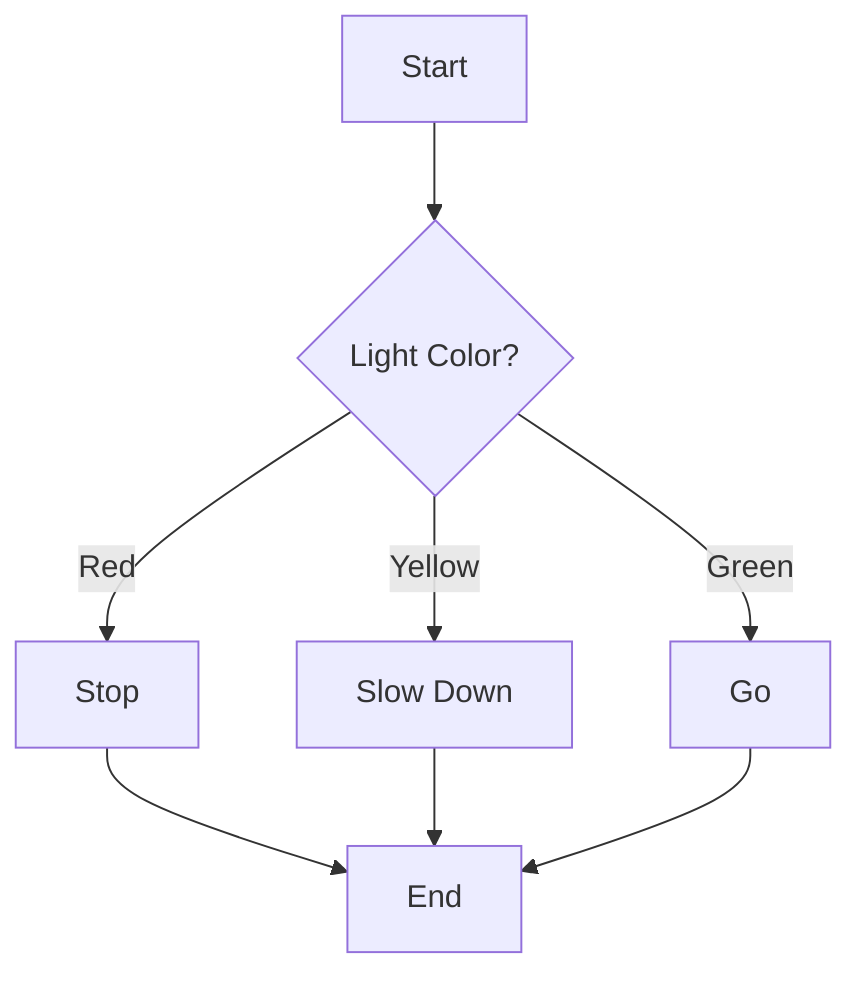
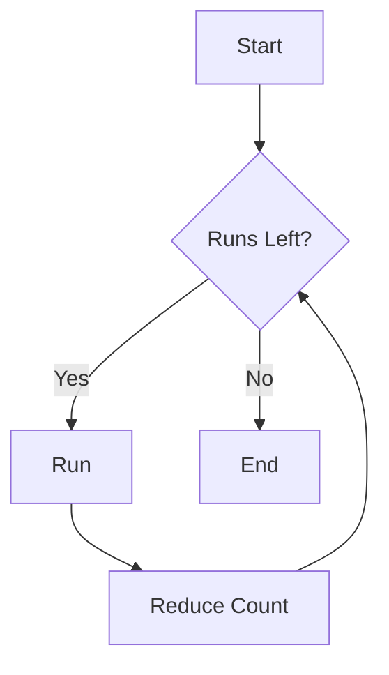
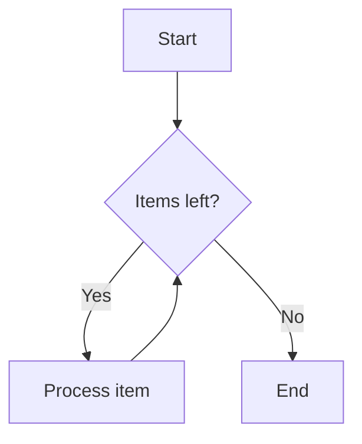
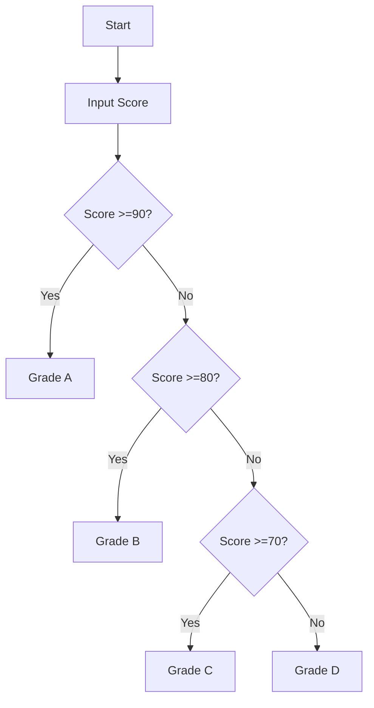
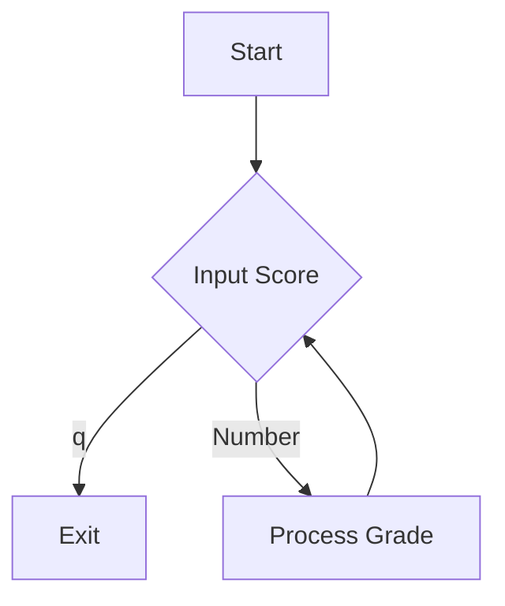
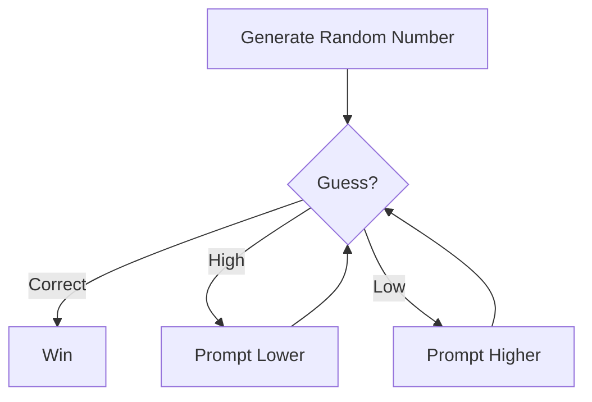
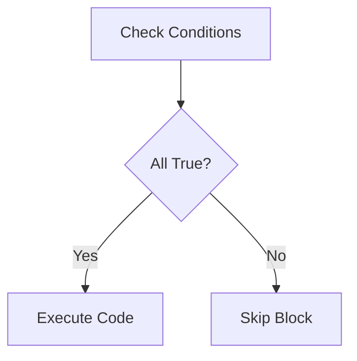
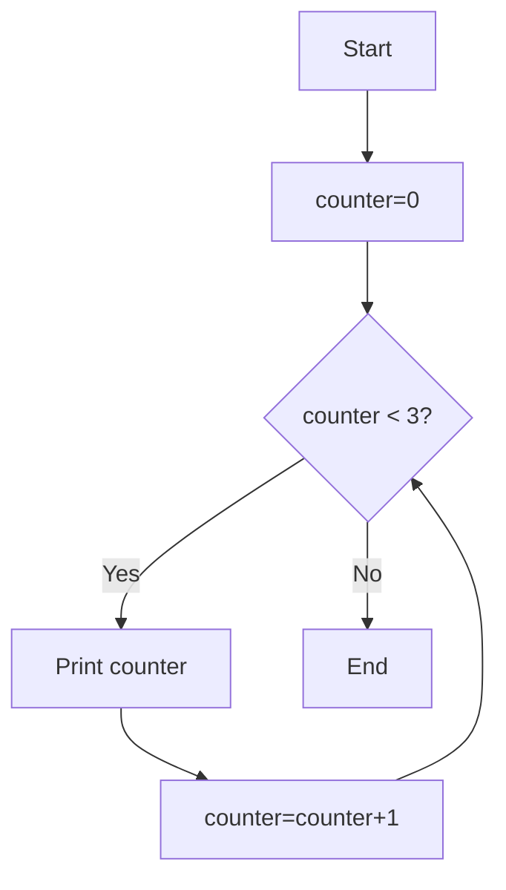
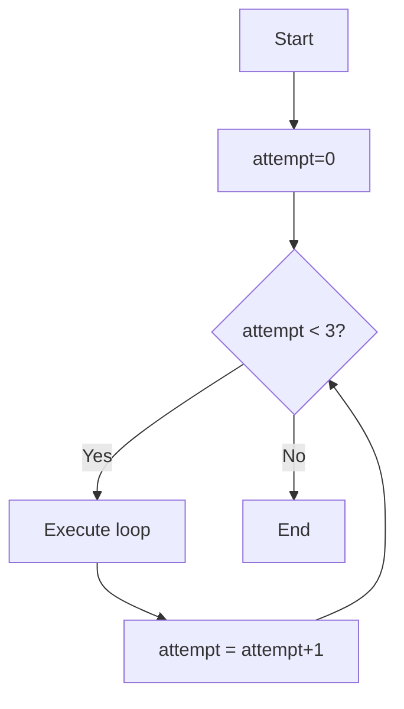

<br>

#### Q: How many of you have learned Python before?

<br>

#### Q: How many of you have learned Linux before?

<br>

---

"GUI" stands for "Graphical User Interface"

"CLI" stands for "Command Line Interface"

Terminal: A terminal is a text-based tool that lets you control a computer or server by typing commands instead of clicking icons. It is a typical CLI.

Termius is a terminal application.

---

<br>

#### Q: What's your intuitive guess about the advantages and disadvantages of GUI and CLI?

<details>
<summary> More </summary>
<div style="padding: 10px; border: 1px solid #eee; border-radius: 4px; margin-top: 8px;">
<br>
<p> &nbsp;&nbsp;&nbsp;&nbsp; GUI: Easy, visual, slow for complex work. </p>
<p> &nbsp;&nbsp;&nbsp;&nbsp; CLI: Fast, powerful, hard for beginners. </p>
<br>
</div>
</details>

<br>

---

Termius is the tool we use to connect to the Linux server.

Four elements for creating a new host in Termius: IP address, Port, Username, Password

Termius offers SFTP for file management (upload/download)

SSH: Secure Shell (SSH) is an encrypted network protocol used to securely access, manage, and transfer files between computers over unsecured networks

SFTP: SSH File Transfer Protocol, also known as Secure File Transfer Protocol 

---

<br>

#### Q: What are the important things when controlling a computer?

<details>
<summary> More </summary>
<div style="padding: 10px; border: 1px solid #eee; border-radius: 4px; margin-top: 8px;">
<br>
<p> &nbsp;&nbsp;&nbsp;&nbsp;Position: "where you are" </p>
<p> &nbsp;&nbsp;&nbsp;&nbsp;Intention: "what you want to do" </p>
<br>
</div>
</details>

<br>


#### Q: What are the two software components closest to users in a computer?

<details>
<summary> More </summary>
<div style="padding: 10px; border: 1px solid #eee; border-radius: 4px; margin-top: 8px;">
<br>
<p> &nbsp;&nbsp;&nbsp;&nbsp;File systems </p>
<p> &nbsp;&nbsp;&nbsp;&nbsp;Application systems </p>
<br>
</div>
</details>

<br>

---

Absolute Path: The full path from the root directory to a file or folder.

* Linux: /home/zhangfeng/download/test.txt

* Windows: D:\download\test.txt

Relative Path: The path from your current working directory to a file or folder.

* Linux: ../download/test.txt

* Windows: ..\test.txt

---

<br>

#### Q: Why do we need "relative path"?

<details>
<summary> More </summary>
<div style="padding: 10px; border: 1px solid #eee; border-radius: 4px; margin-top: 8px;">
<br>
<p> &nbsp;&nbsp;&nbsp;&nbsp; Relative paths are shorter and faster to type than absolute paths. </p>
<p> &nbsp;&nbsp;&nbsp;&nbsp; They are portable (work when folders are moved/copied). They make teamwork and navigation easier, without relying on fixed root locations. </p>
<br>
</div>
</details>

<br>

---

“pwd” Print working directory

“ls” List files in the current directory.

---

“cd” Change directories.

“cd ..” change the current working directory to its parent directory

“cd ~” change the current working directory to your home directory

---

“mkdir” Create directories.

“touch new_file.txt” create an empty file named new_file.txt

---

“less new_file.txt” view the contents of the file named new_file.txt

“cat new_file.txt” print out all contents of the file named new_file.txt

---

“cp original_file.txt copy_file.txt” copy the file named original_file.txt to a new file named copy_file.txt

“cp -r original_folder copy_folder” copy the contents of the folder named original_folder to a new folder named copy_folder

“mv copy_file.txt move_file.txt” move the file named copy_file.txt to a new file named move_file.txt

“mv copy_folder move_folder” move the folder named copy_folder to a new folder named move_folder 

“rm tmp.txt” remove a file named tmp.txt

“rm -r tmp_folder” remove a folder named tmp_folder and all its contents recursively.

---

<br>

#### Q: What differences do you feel between using Windows GUI and Linux CLI?

<br>

---

nano is a text editor that works in the linux terminal.

In nano, "Ctrl + O" and then "press enter", is used to save your work

In nano, “Ctrl + X” is used to exit nano

---

“tab” type the first few letters of a file name or command, then press the Tab key. Linux will automatically complete the rest for you.

“history” You can see all the commands you have run before.


<br>

---

End

<br>

<a id="all"></a>

### Content:

[Section 1. Python Basic Syntax Fundamentals](#s1.0)

[Section 2. Variables & Data Types](#s2.0)

[Section 3. Python Operator System](#s3.0)

[Section 4. String Operations](#s4.0)

<br>

### Q: What makes a good programming language?

<br>

<div style="height: 1000px;">&nbsp;</div>

<a id="s1.0"></a>
# Section 1. Python Basic Syntax Fundamentals

<div align="left">
  <a href="#all">← Prev </a> | <a href="#all"> Home </a> | <a href="#s1.1"> Next →</a>
</div>

<div style="height: 1000px;">&nbsp;</div>


<a id="s1.1"></a>

---

## 1.1. Python Execution Modes (Interactive vs Script)

### Interactive Mode
```python
$ python3
>>> print("Hello World!")
Hello World!
>>> exit()
```
**Features**:
- Immediate feedback
- Good for quick testing
- Type commands directly

### Script Mode
```bash
$ nano hello.py  # Create file using nano
$ python3 hello.py
```
**Features**:
- Save code permanently
- Better for complex programs
- Use text editor (nano/vim)

---

<div align="left">
  <a href="#s1.0">← Prev </a> | <a href="#all"> Home </a> |  <a href="#s1.2"> Next →</a>
</div>

<div style="height: 1000px;">&nbsp;</div>

<a id="s1.2"></a>

---

## 1.2. Core Syntax Rules

### Indentation Rules (4-space principle)
```python
# Correct
if True:
    print("This is properly indented")

# Error
if True:
print("This will cause IndentationError")
```

<br>

### Q: Why do we need "4-space principle"?

<br>

### Code Comments
```python
# Single-line comment

'''
Multi-line comment
Spanning multiple lines
'''

def calculate():
    """Docstring comments for functions"""
```

<br>

### Q: Why do we need "Code Comments"?

<br>

### Statement Separation
```python
# Use semicolon ";". Valid but not recommended
x=1; y=2; print(x+y)

# Preferred (line break)
x = 1
y = 2
print(x + y)
```

---

<div align="left">
  <a href="#s1.1">← Prev </a> |  <a href="#all"> Home </a> | <a href="#s1.3"> Next →</a>
</div>

<div style="height: 1000px;">&nbsp;</div>

<a id="s1.3"></a>

---


## 1.3. Reserved Keywords (35 in Python 3.7)

|          |         |        |         |         |
|----------|---------|--------|---------|---------|
| False    | None    | True   | and     | as      |
| assert   | async   | await  | break   | class   |
| continue | def     | del    | elif    | else    |
| except   | finally | for    | from    | global  |
| if       | import  | in     | is      | lambda  |
| nonlocal | not     | or     | pass    | raise   |
| return   | try     | while  | with    | yield   |

**Important**: These cannot be used as variable/function names!

---

<div align="left">
  <a href="#s1.2">← Prev </a> |  <a href="#all"> Home </a> | <a href="#s1.4"> Next →</a>
</div>

<div style="height: 1000px;">&nbsp;</div>

<a id="s1.4"></a>

---


## 1.4. First Python Program

### Interactive Version
```python
>>> print("Hello World!")
Hello World!
```

### Script Version (hello.py)
```python

# In the file named "hello.py"
print('Hello World!')

```

**Execution Steps**:
1. Login to Linux Server using Termius
2. Create file: `nano hello.py`
3. Write code
4. Save: `Ctrl+O` → Press "enter" → `Ctrl+X`
5. Run: `python3 hello.py`

---

<div align="left">
  <a href="#s1.3">← Prev </a> | <a href="#all"> Home </a> |  <a href="#s1.5"> Next →</a>
</div>

<div style="height: 1000px;">&nbsp;</div>

<a id="s1.5"></a>

---

## 1.5. Common Errors & Debugging

### Error Types
1. **NameError**: 
```python
prin("Missing t")  # NameError
```

2. **IndentationError**:
```python
def test():
print("Missing indent")
```

3. **TypeError**:
```python
"5" + 3  # str + int
```

### Debugging Techniques
1. Read error messages carefully
2. Check line numbers
3. Use print() debugging
4. Validate indentation
5. Test code snippets in interactive mode
6. **AI Assistant Tip**: Use Kimi/ChatGPT to explain errors

---


<div align="left">
  <a href="#s1.4">← Prev </a> |  <a href="#all"> Home </a> | <a href="#s2.0"> Next →</a>
</div>

<div style="height: 1000px;">&nbsp;</div>

<a id="s2.0"></a>


# Section 2. Variables & Data Types


<div align="left">
  <a href="#s1.5">← Prev </a> |  <a href="#all"> Home </a> | <a href="#s2.1"> Next →</a>
</div>

<div style="height: 1000px;">&nbsp;</div>

<a id="s2.1"></a>

---

## 2.1. The Nature of Variables
### Variable
```python
# Think of variables as labeled boxes in warehouse
box_label = "item_count"  # Variable name
box_content = 17          # Stored value
```

### Key Mechanisms
- **Binding**: Variables are references to objects
- **Garbage Collection**: Automatic memory reclaiming
- **Reassignment Dynamics**:
  ```python
  x = 10    # Create object 10, bind to x
  x = "cat" # Create new object, rebind x
  ```

---

<div align="left">
  <a href="#s2.0">← Prev </a> |  <a href="#all"> Home </a> | <a href="#s2.2"> Next →</a>
</div>

<div style="height: 1000px;">&nbsp;</div>

<a id="s2.2"></a>

---


## 2.2. Variable Naming Deep Dive
### Rule Enforcement Demo
```python
# Number('123'), underline ('_'), characters ('abcABC')
# No number at the beginning.

# Valid but discouraged examples
_privateVar = 1
MAX_LIMIT = 100
tempVar2 = 3.14

# Invalid examples (with error simulation)
3attempt = 5              # SyntaxError
special-chars = "text"    # SyntaxError
```

### PEP8 Pro Practices

PEP8: Python Enhancement Proposal 8

```python
# Good vs Better
studentname → student_name
tmpf → temporary_file
calcVal → calculate_value
```

---

<div align="left">
  <a href="#s2.1">← Prev </a> |  <a href="#all"> Home </a> | <a href="#s2.3"> Next →</a>
</div>

<div style="height: 1000px;">&nbsp;</div>

<a id="s2.3"></a>


---


## 2.3. Dynamic Typing in Action
### Demo
```python
dynamic_var = 100          # int
print(type(dynamic_var))   # <class 'int'>

dynamic_var = "Python"     # str
print(type(dynamic_var))   # <class 'str'>

dynamic_var = [1, 2, 3]    # list
print(type(dynamic_var))   # <class 'list'>
```

### Variable Type: Static (c++) vs Dynamic (python)

```c++
// C++ static typing (comparison)
// type_error.cpp
#include <iostream>
int main() {
   int number = 5;       // Type locked
   number = "text";
   std::cout << "The number is: " << number << std::endl;
}
// g++ type_error.cpp -o type_error
```

```python
# Python dynamic typing
number = 5           # int
number = "text"      # Valid
print(number)
```

<br>

### Q: "Insufficient Computing Power" V.S. "Computing Power Redundancy" ?

<br>

---

<div align="left">
  <a href="#s2.2">← Prev </a> |  <a href="#all"> Home </a> | <a href="#s2.4"> Next →</a>
</div>

<div style="height: 1000px;">&nbsp;</div>

<a id="s2.4"></a>

---


## 2.4. Core Data Types

### Four Core Data Types: Integer, Float, String, Boolean 

### Integer Representations

different number systems （different bases）

```python
binary_num = 0b1010     # 10 (binary representation)
octal_num = 0o177       # 127 (octal)
hex_num = 0x1af         # 431 (hex)
number = 33             # 33 (decimal)
```

### Floating-Point Precision
```python
# Demonstration of precision issues
print(0.1 + 0.2 == 0.3)           # False
print(f"{0.1 + 0.2:.17f}")        # 0.30000000000000004, approximately equal to 0.3

# Mitigation strategies
from decimal import Decimal
print(Decimal('0.1') + Decimal('0.2'))  # Exact 0.3
```

### String Definition Variants
```python
s1 = 'Single quotes'
s2 = "Double quotes"
s3 = '''Triple quotes preserve
line breaks and "both" quote types'''
```

### Boolean Variable

```python
A = True
B = False
print(A and B)
print(A or B)
```

---

<div align="left">
  <a href="#s2.3">← Prev </a> |  <a href="#all"> Home </a> | <a href="#s2.5"> Next →</a>
</div>

<div style="height: 1000px;">&nbsp;</div>

<a id="s2.5"></a>

---


## 2.5. Type Conversions
### Conversion Examples
```python
# String to number
age = int("25")
pi = float("3.1415")

# Number to string
price = str(9.99)

# Truthy conversions
bool(0)     # False
bool(1)     # True
bool("")    # False
bool("a")   # True
bool([])    # False
bool([1])   # True
```

### Automatic Conversion Examples
```python
3 + 5.0         # int promoted to float
True + 10       # bool treated as int(1)
"ID:" + str(100)# Required explicit conversion
```

---

<div align="left">
  <a href="#s2.4">← Prev </a> |  <a href="#all"> Home </a> | <a href="#s3.0"> Next →</a>
</div>

<div style="height: 1000px;">&nbsp;</div>

<a id="s3.0"></a>


# Section 3. Python Operator System


<div align="left">
  <a href="#s2.5">← Prev </a> |  <a href="#all"> Home </a> | <a href="#s3.1"> Next →</a>
</div>

<div style="height: 1000px;">&nbsp;</div>

<a id="s3.1"></a>

---

## 3.1. Arithmetic Operators

### Core Operators Table

| Operator | Description             | Example       | Result  |
|----------|-------------------------|---------------|---------|
| `+`      | Addition                | `5 + 3`       | 8       |
| `-`      | Subtraction             | `7 - 2`       | 5       |
| `*`      | Multiplication          | `3 * 4`       | 12      |
| `/`      | True Division           | `10 / 3`      | 3.333...|
| `//`     | Floor Division          | `10 // 3`     | 3       |
| `%`      | Modulus (get remainder) | `10 % 3`      | 1       |
| `**`     | Exponentiation          | `2 ** 3`      | 8       |


---

<div align="left">
  <a href="#s3.0">← Prev </a> | <a href="#all"> Home </a> |  <a href="#s3.2"> Next →</a>
</div>

<div style="height: 1000px;">&nbsp;</div>

<a id="s3.2"></a>

---


## 3.2. Comparison Operators

### Numeric Comparisons
```python
a = 7
b = 5
print(a > b)   # True
print(a == b+2)# True
```

### String Comparison Rules
1. Compare character by character (ASCII values)
2. Shorter strings are considered smaller
3. Case-sensitive comparison

```python
print('Apple' < 'Banana')  # True (A(65) < B(66))
print('cat1' > 'cat')       # True (longer > shorter)
print('cat' > 'CAT')       # True (lowercase > uppercase)
print('10' < '2')          # True (character '1'(49) vs '2'(50))
```

---

<div align="left">
  <a href="#s3.1">← Prev </a> |  <a href="#all"> Home </a> | <a href="#s3.3"> Next →</a>
</div>

<div style="height: 1000px;">&nbsp;</div>

<a id="s3.3"></a>

---


## 3.3. Logical Operators

### Truth Table

| X     | Y     | X and Y | X or Y | not X |
|-------|-------|---------|--------|-------|
| True  | True  | True    | True   | False |
| True  | False | False   | True   | False |
| False | True  | False   | True   | True  |
| False | False | False   | False  | True  |

### Short-Circuiting Demo
```python
def check():
    print("Called!")
    return False

print(True or check())  # Short-circuit, no output
print(False and check())# Short-circuit, no output
```

### Precedence Table

You need to know:

"()" parentheses are not operators but have the highest priority 

| Priority | Operators                     |
|----------|-------------------------------|
| 1        | `**`  Exponentiation          |
| 2        | `+x`, `-x`                    |
| 3        | `*`, `/`, `//`, `%`           |
| 4        | `+`, `-`                      |
| 5        | Comparisons (`<`, `>`, etc)   |
| 6        | `not`                         |
| 7        | `and`                         |
| 8        | `or`                          |

Full list:

| Priority | Operators                     |
|----------|-------------------------------|
| 1        | `**`                          |
| 2        | `+x`, `-x`, `~x`              |
| 3        | `*`, `/`, `//`, `%`           |
| 4        | `+`, `-`                      |
| 5        | `<<`, `>>`                    |
| 6        | `&`                           |
| 7        | `^`                           |
| 8        | `|`                           |
| 9        | Comparisons (`in`, `<`, `>`, etc)|
| 10       | `not`                         |
| 11       | `and`                         |
| 12       | `or`                          |


---

<div align="left">
  <a href="#s3.2">← Prev </a> | <a href="#all"> Home </a> |  <a href="#s3.4"> Next →</a>
</div>

<div style="height: 1000px;">&nbsp;</div>

<a id="s3.4"></a>

---


## 3.4. Assignment Operators

### Chained Assignment
```python
x = y = z = 0  # All variables point to same 0
```

### Compound Operators
```python
counter = 5
counter += 3    # Equivalent to counter = counter + 3
counter **= 2   # 8^2 = 64
```

### Mutable Object Pitfall
```python
list1 = list2 = []
list1.append(5)
print(list2)  # [5] (both reference same list)
```

---

<div align="left">
  <a href="#s3.3">← Prev </a> | <a href="#all"> Home </a> |  <a href="#s3.5"> Next →</a>
</div>

<div style="height: 1000px;">&nbsp;</div>

<a id="s3.5"></a>

---


## 3.5. Precedence Practice

### Challenge Exercise
```python
result = 5 + 3 * 2 ** 2 // (4 % 3) - 1
# Step-by-step evaluation:
# 1. 4%3 = 1
# 2. 2**2 = 4
# 3. 3*4 = 12
# 4. 12//1 = 12
# 5. 5+12 = 17
# 6. 17-1 = 16
```


### AI-Assisted Learning
"Ask Kimi/DouBao to explain why `0.1 + 0.2 != 0.3` in Python and how to properly compare floats."

---

<div align="left">
  <a href="#s3.4">← Prev </a> |  <a href="#all"> Home </a> | <a href="#s4.0"> Next →</a>
</div>

<div style="height: 1000px;">&nbsp;</div>

<a id="s4.0"></a>


# Section 4. String Operations


<div align="left">
  <a href="#s3.5">← Prev </a> |  <a href="#all"> Home </a> | <a href="#s4.1"> Next →</a>
</div>

<div style="height: 1000px;">&nbsp;</div>

<a id="s4.1"></a>

---

## 4.1. Indexing & Slicing
#### Index Types
- Positive Index: `0` to `len(str)-1`
- Negative Index: `-1` (last char) to `-len(str)`

#### Slice Syntax
```python
text = "programming"
print(text[3:7])    # 'gram'
print(text[::-1])   # 'gnimmargorp' (reverse)
print(text[::2])    # 'pormig' (step=2)
```

#### Key Patterns
- `str[start:end]` (end not included)
- `str[start:]`    # till end
- `str[:end]`      # from beginning
- `str[::step]`    # step control

---

<div align="left">
  <a href="#s4.0">← Prev </a> |  <a href="#all"> Home </a> | <a href="#s4.2"> Next →</a>
</div>

<div style="height: 1000px;">&nbsp;</div>

<a id="s4.2"></a>

---

## 4.2. String Methods Library
#### Split & Join
```python
csv = "apple,banana,cherry"
items = csv.split(",")  # ['apple', 'banana', 'cherry']
new_str = "-".join(items)  # "apple-banana-cherry"
```

#### Stripping Methods
```python
s = "   hello world  \t\n"
print(s.strip())    # "hello world"
print(s.lstrip())   # "hello world  \t\n" "\n": line break; "\t": tab
print(s.rstrip())   # "   hello world"
```

#### Search Methods
```python
s = "Python Programming"
print(s.find('thon'))     # 2 (returns -1 if not found)
print(s.index('thon'))   # 2 (raises ValueError if not found)
```

#### Case Conversion
```python
print("Hello".lower())    # 'hello'
print("world".upper())    # 'WORLD'
print("title case".title()) # 'Title Case'
```

<br>

### Q: What are the real-world applications of string operations?

<br>


---

<div align="left">
  <a href="#s4.1">← Prev </a> |  <a href="#all"> Home </a> | <a href="#s4.3"> Next →</a>
</div>

<div style="height: 1000px;">&nbsp;</div>

<a id="s4.3"></a>

---

## 4.3. Formatting Methods
#### %-formatting
```python
name = "Alice"
print("Hello, %s! You have %d messages." % (name, 5))
```

#### str.format()
```python
print("{} + {} = {}".format(2, 3, 2+3))
print("{1} appears before {0}".format("apple", "banana"))
```

#### f-strings (Python 3.6+)
```python
price = 19.99
print(f"Total: ${price * 1.1:.2f}")
print(f"Binary: {42:b}")  # '101010'
```

#### Comparison Table

| Method       | Readability | Performance | Features            |
|--------------|-------------|-------------|---------------------|
| %-formatting | Low         | Medium      | Basic types only    |
| str.format   | Medium      | Medium      | Positional/Keyword  |
| f-strings    | High        | Best        | Expressions, inline |


#### Suggested string combination method for beginner

```python
name = 'John'
number = 5
print("Hello, "+name+"! You have "+ str(number) +" messages.")
```

---

<div align="left">
  <a href="#s4.2">← Prev </a> |  <a href="#all"> Home </a> | <a href="#s4.4"> Next →</a>
</div>

<div style="height: 1000px;">&nbsp;</div>

<a id="s4.4"></a>

---

## 4.4. Escape Characters & Raw Strings
#### Common Escapes
- `\n` Newline
- `\t` Tab
- `\\` Backslash
- `\"` Double quote

#### Raw Strings
```python

r"" is raw string.

path = "C:\new_folder\test.txt"
path_raw = r"C:\new_folder\test.txt"

print(path)
print(path_raw)  # Shows literal backslashes

```

---

<div align="left">
  <a href="#s4.3">← Prev </a> |  <a href="#all"> Home </a> | <a href="#s4.5"> Next →</a>
</div>

<div style="height: 1000px;">&nbsp;</div>

<a id="s4.5"></a>

---

## 4.5. Multi-line Strings
#### Triple-quoted Strings
```python
long_text = """First line
Second line
Third line"""
```

---

<div align="left">
  <a href="#s4.4">← Prev </a> |  <a href="#all"> Home </a> 
</div>

<br>

End


<br>

<a id="all"></a>

### Content:

[Section 1. Control Flow](#s1.0)

[Section 2. Conditionals in Python](#s2.0)

[Section 3. Loop Structures in Python](#s3.0)

[Section 4. Control Flow - Practical Examples](#s4.0)

[Section 5. Special Considerations](#s5.0)


<br>

Control flow determines which code statements run first, which run next, whether to repeat them, and whether to skip them.

<br>

### Q: Why is control flow fundamental to programming?

<br>

### Draw Control Flow: [https://mermaid.live/edit](https://mermaid.live/edit)

<br>

<div style="height: 1000px;">&nbsp;</div>

<a id="s1.0"></a>
# Section 1. Control Flow

<div align="left">
  <a href="#all">← Prev </a> | <a href="#all"> Home </a> | <a href="#s1.1"> Next →</a>
</div>

<div style="height: 1000px;">&nbsp;</div>

<a id="s1.1"></a>

---

## 1.1. Conditional Statements

### Traffic Light Example
```python
light_color = input("Traffic light color: ")

if light_color == "red":
    print("STOP")
elif light_color == "yellow":
    print("SLOW DOWN")
elif light_color == "green":
    print("GO")
else:
    print("INVALID COLOR")
```

---

<div align="left">
  <a href="#s1.0">← Prev </a> | <a href="#all"> Home </a> |  <a href="#s1.2"> Next →</a>
</div>

<div style="height: 1000px;">&nbsp;</div>

<a id="s1.2"></a>

---

## 1.2. Flowchart - Decision Making



---

<div align="left">
  <a href="#s1.1">← Prev </a> | <a href="#all"> Home </a> | <a href="#s1.3"> Next →</a>
</div>

<div style="height: 1000px;">&nbsp;</div>

<a id="s1.3"></a>

---

## 1.3. While Loops

### Morning Run Example
```python
import time
runs_remaining = 3
while runs_remaining > 0:
    time.sleep(1) # suppose you are a superman, 400m in 1 second 
    print("Morning run #"+str(4 - runs_remaining)+" completed!")
    runs_remaining = runs_remaining - 1
print("All runs finished!")
```

---

<div align="left">
  <a href="#s1.2">← Prev </a> | <a href="#all"> Home </a> |  <a href="#s1.4"> Next →</a>
</div>

<div style="height: 1000px;">&nbsp;</div>

<a id="s1.4"></a>

---

## 1.4. Flowchart - Loop Execution



---

<div align="left">
  <a href="#s1.3">← Prev </a> | <a href="#all"> Home </a> |  <a href="#s1.5"> Next →</a>
</div>

<div style="height: 1000px;">&nbsp;</div>

<a id="s1.5"></a>

---

## 1.5. Why Control Flow Matters

1. Programs need to make decisions (handle different situations)
2. Repeat tasks efficiently
3. Make code adaptable

### Automatic Door Control Example
```python
# since we don't have a sensor, we just pretend to be a sensor.

import time

def object_detected():
    # get signal from the sensor
    signal = input('detected(y/n):')
    if signal=='y':
        result=True
        print('detected!')
    else:
        result=False
        print('no object!')
    time.sleep(1)
    return(result)

def keep_open():
    print('open door!')
    # send signal to the door
    time.sleep(1)

def close_door():
    print('close door!')
    # send signal to the door
    time.sleep(1)

sensor_active = True

while sensor_active:
    if object_detected():
        keep_open()
    else:
        close_door()
```

---

<div align="left">
  <a href="#s1.4">← Prev </a> | <a href="#all"> Home </a> |  <a href="#s1.6"> Next →</a>
</div>

<div style="height: 1000px;">&nbsp;</div>

<a id="s1.6"></a>

---

## 1.6. Vending Machine Example

```python
coins = 0
while coins < 5:
    insert_coins = int(input("Insert coin (1-3): "))
    coins = coins + insert_coins
    print("Total inserted: "+str(coins))
print("Here's your drink!")
```

### Question: how can we limit the number of inserted coins each time
### Question: how can we get the extra coins

---

<div align="left">
  <a href="#s1.5">← Prev </a> | <a href="#all"> Home </a> |  <a href="#s1.7"> Next →</a>
</div>

<div style="height: 1000px;">&nbsp;</div>

<a id="s1.7"></a>

---

## 1.7. Common Patterns

### Flag-controlled loops
```python
running = True
while running:
    user_input = input("Continue? (y/n): ")
    if user_input == "n":
        running = False
```

### Counter-controlled loops
```python
attempts = 3
while attempts > 0:
    # code here
    attempts=attempts-1

attempts = 0
while attempts < 10:
    # code here
    attempts=attempts+1
```

---

<div align="left">
  <a href="#s1.6">← Prev </a> | <a href="#all"> Home </a> |  <a href="#s1.8"> Next →</a>
</div>

<div style="height: 1000px;">&nbsp;</div>

<a id="s1.8"></a>

---

## 1.8. Take-home message

1. `if-elif-else` for decisions
2. `while` for repeating tasks
3. Condition evaluation (True/False)
4. Loop control variables (i, counter, flag)
5. Avoid infinite loops!

```python
# Always update condition!
i = 0
while i < 10:
    print(i)
    i = i+1  # Don't forget this!
```

---

<div align="left">
  <a href="#s1.7">← Prev </a> | <a href="#all"> Home </a> |  <a href="#s2.0"> Next →</a>
</div>

<div style="height: 1000px;">&nbsp;</div>

<a id="s2.0"></a>


# Section 2. Conditionals in Python


<div align="left">
  <a href="#s1.8">← Prev </a> |  <a href="#all"> Home </a> | <a href="#s2.1"> Next →</a>
</div>

<div style="height: 1000px;">&nbsp;</div>

<a id="s2.1"></a>

---

## 2.1. `if` Statement Basics

```python
# Basic structure
age = 18
if age >= 18:
    print("You can vote!")
```

- `if` = Program's "what if" question
- Colon `:` is mandatory (show error without colon)
- Indentation = 4 spaces (never mix with Tab)

---

<div align="left">
  <a href="#s2.0">← Prev </a> |  <a href="#all"> Home </a> | <a href="#s2.2"> Next →</a>
</div>

<div style="height: 1000px;">&nbsp;</div>

<a id="s2.2"></a>

---

## 2.2. Indentation Demo

```python
# Correct vs Wrong
if True:
    print("Right")  # ← 4 spaces

if True:
print("Wrong")     # ← No indentation
```

---

<div align="left">
  <a href="#s2.1">← Prev </a> |  <a href="#all"> Home </a> | <a href="#s2.3"> Next →</a>
</div>

<div style="height: 1000px;">&nbsp;</div>

<a id="s2.3"></a>

---

## 2.3. Comparison Operators

```python
height = 175
print(height > 160)  # True
print(height == 170) # False

# Real-life example
bus_height_limit = 200
luggage_height = 210
if luggage_height > bus_height_limit:
    print("Cannot take bus")
```

---

<div align="left">
  <a href="#s2.2">← Prev </a> |  <a href="#all"> Home </a> | <a href="#s2.4"> Next →</a>
</div>

<div style="height: 1000px;">&nbsp;</div>

<a id="s2.4"></a>

---

## 2.4. Logical Operators

```python
# Weather check
is_raining = True
has_umbrella = False

if is_raining and has_umbrella:
    print("Go outside")
else:
    print("Stay home")
```

- `and`: Both must be True
- `or`: At least one True
- `not`: Reverse boolean

---

<div align="left">
  <a href="#s2.3">← Prev </a> |  <a href="#all"> Home </a> | <a href="#s2.5"> Next →</a>
</div>

<div style="height: 1000px;">&nbsp;</div>

<a id="s2.5"></a>

---

## 2.5. Common Mistake Fix

```python
# Wrong
if temperature = 30:
    print("Hot")

# Correct
if temperature == 30:
    print("Hot")
```

- Single `=` is assignment
- Double `==` is comparison

---

<div align="left">
  <a href="#s2.4">← Prev </a> |  <a href="#all"> Home </a> | <a href="#s2.6"> Next →</a>
</div>

<div style="height: 1000px;">&nbsp;</div>

<a id="s2.6"></a>

---

## 2.6. Multi-Condition Flow

```python
age = 15

if age < 13:
    print("Child ticket")
elif age < 18:
    print("Teen ticket")
else:
    print("Adult ticket")
```

---

<div align="left">
  <a href="#s2.5">← Prev </a> |  <a href="#all"> Home </a> | <a href="#s2.7"> Next →</a>
</div>

<div style="height: 1000px;">&nbsp;</div>

<a id="s2.7"></a>

---

## 2.7. Nested Conditions

```python
age = 20
is_student = True

if age < 18:
    print("50% discount")
else:
    if is_student:
        print("30% discount")
    else:
        print("No discount")
```

- Each level needs 4-space indent
- Max 3 nesting levels recommended

---

<div align="left">
  <a href="#s2.6">← Prev </a> |  <a href="#all"> Home </a> | <a href="#s2.8"> Next →</a>
</div>

<div style="height: 1000px;">&nbsp;</div>

<a id="s2.8"></a>

---

## 2.8. Ticket System Flowchart

```python
# Full example
age = 25
is_student = False
has_membership = True

if age < 5:
    print("Free ticket")
elif age < 18:
    print("Child ticket")
elif is_student:
    print("Student discount")
elif has_membership:
    print("Membership discount")
else:
    print("Regular ticket")
```

### Question: what if you are a 19 years old student without membership.
### Question: what if you are a 19 years old student with membership.
### Question: how can we get both the Student discount and the Membership discount

---

<div align="left">
  <a href="#s2.7">← Prev </a> |  <a href="#all"> Home </a> | <a href="#s2.9"> Next →</a>
</div>

<div style="height: 1000px;">&nbsp;</div>

<a id="s2.9"></a>

---

## 2.9. Truth Value Testing

```python
# Common False values:
- False
- None
- 0
- "" (empty string)
- [] (empty list)

name = ""
if not name:
    print("Name is required!")
```

---

<div align="left">
  <a href="#s2.8">← Prev </a> |  <a href="#all"> Home </a> | <a href="#s2.10"> Next →</a>
</div>

<div style="height: 1000px;">&nbsp;</div>

<a id="s2.10"></a>

---

## 2.10. Short-form Conditional Expression (not recommended for beginners)

```python
# Short form
temperature = 28
message = "Hot" if temperature > 25 else "OK"
print(message)

# preferred
temperature = 28
if temperature >25:
    message='Hot'
else:
    message='OK'
print(message)

```

- Use for simple two-way choices
- Not recommended for complex logic

---

<div align="left">
  <a href="#s2.9">← Prev </a> |  <a href="#all"> Home </a> |  <a href="#s3.0"> Next →</a>
</div>

<div style="height: 1000px;">&nbsp;</div>

<a id="s3.0"></a>


# Section 3. Loop Structures in Python


<div align="left">
  <a href="#s2.10">← Prev </a> |  <a href="#all"> Home </a> | <a href="#s3.1"> Next →</a>
</div>

<div style="height: 1000px;">&nbsp;</div>

<a id="s3.1"></a>

---

## 3.1. For Loop Basics

```python
# Like checking a shopping list
groceries = ["apple", "milk", "bread"]
for item in groceries:
    print("Don't forget to buy:", item)
```



---

<div align="left">
  <a href="#s3.0">← Prev </a> |  <a href="#all"> Home </a> | <a href="#s3.2"> Next →</a>
</div>

<div style="height: 1000px;">&nbsp;</div>

<a id="s3.2"></a>

---

## 3.2. The range() Function

**Three usages:**
```python
# Single argument
for num in range(5):
    print(num)  # 0-4

# Two arguments
for num in range(2, 5):
    print(num)  # 2-4

# Three arguments
for num in range(0, 10, 2):
    print(num)  # 0,2,4,6,8
```

---

<div align="left">
  <a href="#s3.1">← Prev </a> |  <a href="#all"> Home </a> | <a href="#s3.3"> Next →</a>
</div>

<div style="height: 1000px;">&nbsp;</div>

<a id="s3.3"></a>

---

## 3.3. String Traversal with Index

```python
word = "hello"
for index, letter in enumerate(word):
    print("Character at position "+str(index)+": "+letter)
```
Output:
```
Character at position 0: h
Character at position 1: e
...
```

---

<div align="left">
  <a href="#s3.2">← Prev </a> |  <a href="#all"> Home </a> | <a href="#s3.4"> Next →</a>
</div>

<div style="height: 1000px;">&nbsp;</div>

<a id="s3.4"></a>

---

## 3.4. While Loop Mechanics

```python
# Like a persistent alarm clock
countdown = 3
while countdown > 0:
    print(countdown)
    countdown = countdown-1
print("Go!")
```

---

<div align="left">
  <a href="#s3.3">← Prev </a> |  <a href="#all"> Home </a> | <a href="#s3.5"> Next →</a>
</div>

<div style="height: 1000px;">&nbsp;</div>

<a id="s3.5"></a>

---

## 3.5. Termination Condition Design

```python
# Dangerous version (for demonstration)
# temperature = 25
# while temperature > 20:
#     print("AC running")
# Forgot to decrease temperature!
```

---

<div align="left">
  <a href="#s3.4">← Prev </a> |  <a href="#all"> Home </a> | <a href="#s3.6"> Next →</a>
</div>

<div style="height: 1000px;">&nbsp;</div>

<a id="s3.6"></a>

---

## 3.6. Safe Loop Writing Technique

**Always write termination first:**
```python
# 1. Set initial value
counter = 0
# 2. Define termination
MAX_ATTEMPTS = 3

while counter < MAX_ATTEMPTS:
    print("Attempt:", counter+1)
    counter = counter + 1
```

---

<div align="left">
  <a href="#s3.5">← Prev </a> |  <a href="#all"> Home </a> | <a href="#s3.7"> Next →</a>
</div>

<div style="height: 1000px;">&nbsp;</div>

<a id="s3.7"></a>

---

## 3.7. Break Statement

```python
# Emergency exit example
passwords = ["123", "admin", "letmein"]
for pwd in passwords:
    if pwd == "admin":
        print("Security alert!")
        break
    print("Checking:", pwd)
```

---

<div align="left">
  <a href="#s3.6">← Prev </a> |  <a href="#all"> Home </a> | <a href="#s3.8"> Next →</a>
</div>

<div style="height: 1000px;">&nbsp;</div>

<a id="s3.8"></a>

---

## 3.8. Continue Statement

```python
# Skip odd numbers
for num in range(10):
    if num % 2 != 0:
        continue
    print(num, "is even")
```

---

<div align="left">
  <a href="#s3.7">← Prev </a> |  <a href="#all"> Home </a> | <a href="#s3.9"> Next →</a>
</div>

<div style="height: 1000px;">&nbsp;</div>

<a id="s3.9"></a>

---

## 3.9. Else Clause in Loops

```python
# Only executes if loop completes normally
numbers = [2, 4, 6]
for n in numbers:
    if n % 2 != 0:
        break
else:
    print("All numbers are even!")
```

---

<div align="left">
  <a href="#s3.8">← Prev </a> |  <a href="#all"> Home </a> | <a href="#s3.10"> Next →</a>
</div>

<div style="height: 1000px;">&nbsp;</div>

<a id="s3.10"></a>

---

## 3.10. Nested Loops: Multiplication Table

```python
for i in range(1, 4):  # Rows
    for j in range(1, 4):  # Columns
        print(str(i)+'x'+str(j)+'='+str(i*j), end="\t")
    print()  # New line after each row
```
Output:
```
1x1=1   1x2=2   1x3=3
2x1=2   2x2=4   2x3=6
3x1=3   3x2=6   3x3=9
```

---

<div align="left">
  <a href="#s3.9">← Prev </a> |  <a href="#all"> Home </a> | <a href="#s3.11"> Next →</a>
</div>

<div style="height: 1000px;">&nbsp;</div>

<a id="s3.11"></a>

---

## 3.11. Understanding Indentation Levels

```python
# Outer loop (level 1)
for x in range(2):
    # Inner loop (level 2)
    for y in range(2):
        # Nested block (level 3)
        if x == y:
            print("Match at "+str(x)+','+str(y))
    # Back to level 1
    print("----")
```

---

<div align="left">
  <a href="#s3.10">← Prev </a> |  <a href="#all"> Home </a> |  <a href="#s4.0"> Next →</a>
</div>

<div style="height: 1000px;">&nbsp;</div>

<a id="s4.0"></a>


# Section 4. Control Flow - Practical Examples


<div align="left">
  <a href="#s3.11">← Prev </a> |  <a href="#all"> Home </a> | <a href="#s4.1"> Next →</a>
</div>

<div style="height: 1000px;">&nbsp;</div>

<a id="s4.1"></a>

---

## 4.1. Smart Grade Rating System

### Basic Structure
```python
score = float(input("Enter score (0-100): "))

if score >= 90:
    print("Grade A")
elif score >= 80:
    print("Grade B")
elif score >= 70:
    print("Grade C")
else:
    print("Grade D")
```



---

<div align="left">
  <a href="#s4.0">← Prev </a> |  <a href="#all"> Home </a> | <a href="#s4.2"> Next →</a>
</div>

<div style="height: 1000px;">&nbsp;</div>

<a id="s4.2"></a>

---

## 4.2. Adding Loop for Multiple Inputs

### Continuous Processing
```python
while True:
    score = input("Enter score (q to quit): ")
    
    if score.lower() == 'q':
        break
        
    # Grade logic here
    print("Grade: " + grade)
```



---

<div align="left">
  <a href="#s4.1">← Prev </a> |  <a href="#all"> Home </a> | <a href="#s4.3"> Next →</a>
</div>

<div style="height: 1000px;">&nbsp;</div>

<a id="s4.3"></a>

---

## 4.3. Number Guessing Game

### Core Game Loop
```python
import random
target = random.randint(1,100)

while True:
    guess = int(input("Guess (1-100): "))
    
    if guess == target:
        print("Correct!")
        break
    elif guess > target:
        print("Too high")
    else:
        print("Too low")
```



---

<div align="left">
  <a href="#s4.2">← Prev </a> |  <a href="#all"> Home </a> | <a href="#s4.4"> Next →</a>
</div>

<div style="height: 1000px;">&nbsp;</div>

<a id="s4.4"></a>

---

## 4.4. Tracking Attempts

### Counter Implementation
```python
attempts = 0
while attempts < 5:
    # Game logic
    attempts = attempts + 1
    
if attempts == 5:
    print("Game Over! Number was", target)
```

---

<div align="left">
  <a href="#s4.3">← Prev </a> |  <a href="#all"> Home </a> | <a href="#s4.5"> Next →</a>
</div>

<div style="height: 1000px;">&nbsp;</div>

<a id="s4.5"></a>

---

## 4.5. Victory/Failure Branches

### Final Conditions
```python
if guess == target:
    print("Victory in " + str(attempts) + " tries!")
else:
    print("Failed! Number was " + str(target))
```

---

<div align="left">
  <a href="#s4.4">← Prev </a> |  <a href="#all"> Home </a> | <a href="#s4.6"> Next →</a>
</div>

<div style="height: 1000px;">&nbsp;</div>

<a id="s4.6"></a>

---

## 4.6. Key Concepts Summary

1. `if-elif-else` for decision making
2. `while` loops for repeated actions
3. `try-except` for basic error handling
4. Counter variables for tracking state
5. Random module for game mechanics

---

<div align="left">
  <a href="#s4.5">← Prev </a> |  <a href="#all"> Home </a> | <a href="#s4.7"> Next →</a>
</div>

<div style="height: 1000px;">&nbsp;</div>

<a id="s4.7"></a>

---

## 4.7. Final Complete Code Demo

### Grade System
```python
while True:
    # quit
    score = input("Enter q to quit: ")    
    if score.lower() == 'q':
        break
    # grade 
    score = float(input("Enter score (0-100): "))
    if score >= 90:
        grade = 'A'
    elif score >= 80:
        grade = 'B'
    elif score >= 70:
        grade = 'C'
    else:
        grade = 'D'
    print("Grade:"+grade)

```

### Guessing Game
```python
import random
target = random.randint(1,100)
attempts = 0

while attempts < 5:
    guess = int(input("Guess (1-100): "))
    if guess == target:
        print("Correct!")
        break
    elif guess > target:
        print("Too high")
    else:
        print("Too low")
    attempts=attempts+1

if guess == target:
    print("Victory in"+str(attempts)+" tries!")
else:
    print("Failed! Number was "+str(target))

```

---

<div align="left">
  <a href="#s4.6">← Prev </a> |  <a href="#all"> Home </a> |  <a href="#s5.0"> Next →</a>
</div>

<div style="height: 1000px;">&nbsp;</div>

<a id="s5.0"></a>


# Section 5. Special Considerations


<div align="left">
  <a href="#s4.7">← Prev </a> |  <a href="#all"> Home </a> | <a href="#s5.1"> Next →</a>
</div>

<div style="height: 1000px;">&nbsp;</div>

<a id="s5.1"></a>

---

## 5.1. Multi-line Conditional Statements

```python
# Recommended style
if (temperature > 100 
    and humidity < 70 
    and is_sunny == True):
    print("Heat warning!")
```



---

<div align="left">
  <a href="#s5.0">← Prev </a> |  <a href="#all"> Home </a> | <a href="#s5.2"> Next →</a>
</div>

<div style="height: 1000px;">&nbsp;</div>

<a id="s5.2"></a>

---

## 5.2. Splitting Long Logical Expressions

```python
# Before
if (num > 0 and num%2 == 0 and num < 100 and name != "admin"):

# After
is_positive_even = num > 0 and num%2 == 0
within_limit = num < 100
valid_user = name != "admin"

if is_positive_even and within_limit and valid_user:
```

---

<div align="left">
  <a href="#s5.1">← Prev </a> |  <a href="#all"> Home </a> | <a href="#s5.3"> Next →</a>
</div>

<div style="height: 1000px;">&nbsp;</div>

<a id="s5.3"></a>

---

## 5.3. Debugging with Print Statements

```python
counter = 0
while counter < 3:
    print("DEBUG: Current counter - " + str(counter))  # Debug line
    counter = counter + 1
```



---

<div align="left">
  <a href="#s5.2">← Prev </a> |  <a href="#all"> Home </a> | <a href="#s5.4"> Next →</a>
</div>

<div style="height: 1000px;">&nbsp;</div>

<a id="s5.4"></a>

---

## 5.4. Using TODO Comments

```python
def calculate_discount(price):
    # TODO: Add seasonal discount logic
    # TODO: Implement user tier system
    return price * 0.9  # Temporary 10% discount
```

---

<div align="left">
  <a href="#s5.3">← Prev </a> |  <a href="#all"> Home </a> | <a href="#s5.5"> Next →</a>
</div>

<div style="height: 1000px;">&nbsp;</div>

<a id="s5.5"></a>

---

## 5.5. Missing Colon Error

```python
# Incorrect
while x < 5
    print(x)
    x = x + 1

# Correct
while x < 5:
    print(x)
    x = x + 1
```

---

<div align="left">
  <a href="#s5.4">← Prev </a> |  <a href="#all"> Home </a> | <a href="#s5.6"> Next →</a>
</div>

<div style="height: 1000px;">&nbsp;</div>

<a id="s5.6"></a>

---

## 5.6. Indentation Error Examples

```python
# Wrong mixing of spaces/tabs

while n > 0:  # Missing indentation
print(n)      # Wrong level
    n = n-1

# Correct

while n > 0:
    print(n)
    n = n-1
```

---

<div align="left">
  <a href="#s5.5">← Prev </a> |  <a href="#all"> Home </a> | <a href="#s5.7"> Next →</a>
</div>

<div style="height: 1000px;">&nbsp;</div>

<a id="s5.7"></a>

---

## 5.7. Floating Point Comparison

```python
# Unreliable
result = 0.1 + 0.2
if result == 0.3:
    print("Equal")

# Safe approach
tolerance = 1e-9
if abs(result - 0.3) < tolerance:
    print("Effectively equal")
```

---

<div align="left">
  <a href="#s5.6">← Prev </a> |  <a href="#all"> Home </a> | <a href="#s5.8"> Next →</a>
</div>

<div style="height: 1000px;">&nbsp;</div>

<a id="s5.8"></a>

---

## 5.8. While Loop Flow Control

```python
# Safe loop pattern
max_retries = 3
attempt = 0

while attempt < max_retries:
    print("Attempt " + str(attempt+1))
    # Your code here
    attempt = attempt + 1
```



---

<div align="left">
  <a href="#s5.7">← Prev </a> |  <a href="#all"> Home </a> 
</div>

<br>

End

<br>

<a id="all"></a>

### Content:

[Section 1. Introduction to Function & Module](#s1.0)

[Section 2. Function Basic Syntax](#s2.0)

[Section 3. Advanced Parameters & Return Values](#s3.0)

[Section 4. Python Modules System](#s4.0)

[Section 5. Practical Python Examples for Beginners](#s5.0)

<br>

<div style="height: 1000px;">&nbsp;</div>

<a id="s1.0"></a>
# Section 1. Introduction to Function & Module

<div align="left">
  <a href="#all">← Prev </a> | <a href="#all"> Home </a> | <a href="#s1.1"> Next →</a>
</div>

<div style="height: 1000px;">&nbsp;</div>

<a id="s1.1"></a>

---

## 1.1. Functions: Like a Microwave Preset Button

### Real-life example:
- Preset buttons = Predefined functions
- "Popcorn" button = `def popcorn_mode()`
- "Beverage" button = `def reheat_drink()`

### Python example:

```python

def popcorn_mode():
    print('heat for 180 seconds')

popcorn_mode()

############################################################

def reheat_drink():
    print('heat for 45 seconds')

reheat_drink()

############################################################

# combined with conditional statement "if-elif"

def start_microwave(preset):
    if preset == "popcorn":
        print('heat for 180 seconds')
    elif preset == "beverage":
        print('heat for 45 seconds')

start_microwave("popcorn")
```

---

<div align="left">
  <a href="#s1.0">← Prev </a> | <a href="#all"> Home </a> |  <a href="#s1.2"> Next →</a>
</div>

<div style="height: 1000px;">&nbsp;</div>

<a id="s1.2"></a>

---

## 1.2. Why do We Need Functions

### Problem without functions:

```python
# Making 3 sandwiches
print("1. Get bread")
print("2. Add filling")
print("3. Close sandwich")
print("------")
print("1. Get bread")
print("2. Add filling")
print("3. Close sandwich")
print("------")
print("1. Get bread")
print("2. Add filling")
print("3. Close sandwich")
```

---

<div align="left">
  <a href="#s1.1">← Prev </a> | <a href="#all"> Home </a> | <a href="#s1.3"> Next →</a>
</div>

<div style="height: 1000px;">&nbsp;</div>

<a id="s1.3"></a>

---

## 1.3. Creating Our First Function

### Solution with functions:

```python
def make_sandwich():
    print("1. Get bread")
    print("2. Add filling")
    print("3. Close sandwich")
    print("------")

make_sandwich()
make_sandwich()
make_sandwich()
```

---

<div align="left">
  <a href="#s1.2">← Prev </a> | <a href="#all"> Home </a> | <a href="#s1.4"> Next →</a>
</div>

<div style="height: 1000px;">&nbsp;</div>

<a id="s1.4"></a>

---

## 1.4. Making Functions Flexible

### Adding parameters:

```python
def make_sandwich(filling):
    print("Making " + str(filling) + " sandwich:")
    print("1. Get bread")
    print("2. Add " + str(filling))
    print("3. Close sandwich")
    print("------")

make_sandwich("ham")
make_sandwich("cheese")
```

---

<div align="left">
  <a href="#s1.3">← Prev </a> | <a href="#all"> Home </a> | <a href="#s1.5"> Next →</a>
</div>

<div style="height: 1000px;">&nbsp;</div>

<a id="s1.5"></a>

---

## 1.5. Modules: Like Game Sound Library

### Real-life example:
- Game sound module = `import sound_effects`
- Ready-to-use sounds = `jump_sound()`, `explosion_sound()`

### Simple Python example:

```python
# sound_module.py
def play_jingle():
    print("🎵 Happy tune playing! 🎵")

# main.py
import sound_module
sound_module.play_jingle()
```

---

<div align="left">
  <a href="#s1.4">← Prev </a> | <a href="#all"> Home </a> | <a href="#s1.6"> Next →</a>
</div>

<div style="height: 1000px;">&nbsp;</div>

<a id="s1.6"></a>

---

## 1.6. Building Our Own Module

### Create `kitchen.py`:

```python
def microwave_beep():
    print("BEEP! BEEP! BEEP!")

def oven_timer():
    print("DING! Food is ready!")
```

### Use it:

```python
import kitchen
kitchen.microwave_beep()
kitchen.oven_timer()
```

---

<div align="left">
  <a href="#s1.5">← Prev </a> | <a href="#all"> Home </a> | <a href="#s1.7"> Next →</a>
</div>

<div style="height: 1000px;">&nbsp;</div>

<a id="s1.7"></a>

---

## 1.7. Example: Cooking Module

### Complete example:

```python
# In cooking_module.py
def prepare_dish(dish_name):
    print("Preparing " + str(dish_name) + "...")
    print("1. Gather ingredients")
    print("2. Follow recipe steps")

# In main program
import cooking_module
cooking_module.prepare_dish("pasta")
cooking_module.prepare_dish("salad")
```

---

<div align="left">
  <a href="#s1.6">← Prev </a> | <a href="#all"> Home </a> | <a href="#s1.8"> Next →</a>
</div>

<div style="height: 1000px;">&nbsp;</div>

<a id="s1.8"></a>

---

## 1.8. Example: Game Sounds

```python
# sound_effects.py
def laser_blast():
    print("PEW! PEW! ")

def power_up():
    print(" ENERGY RESTORED!")

# game.py
import sound_effects
sound_effects.laser_blast()
sound_effects.power_up()
```

---

<div align="left">
  <a href="#s1.7">← Prev </a> | <a href="#all"> Home </a> | <a href="#s1.9"> Next →</a>
</div>

<div style="height: 1000px;">&nbsp;</div>

<a id="s1.9"></a>

---

## 1.9. Key Takeaways

1. Functions are like preset shortcuts
2. Parameters make functions flexible
3. Modules help organize code
4. Import lets reuse code
5. Combine functions/modules for complex programs

---

<div align="left">
  <a href="#s1.8">← Prev </a> | <a href="#all"> Home </a> | <a href="#s2.0"> Next →</a>
</div>

<div style="height: 1000px;">&nbsp;</div>

<a id="s2.0"></a>

# Section 2. Function Basic Syntax

<div align="left">
  <a href="#s1.9">← Prev </a> | <a href="#all"> Home </a> | <a href="#s2.1"> Next →</a>
</div>

<div style="height: 1000px;">&nbsp;</div>

<a id="s2.1"></a>

---

## 2.1. What is a Function?

Like a recipe:
1. Receive ingredients (parameters)
2. Follow steps (code block)
3. Give result (return value)

---

<div align="left">
  <a href="#s2.0">← Prev </a> | <a href="#all"> Home </a> | <a href="#s2.2"> Next →</a>
</div>

<div style="height: 1000px;">&nbsp;</div>

<a id="s2.2"></a>

---

## 2.2. Function Structure

```python
def magic_oven(ingredient):  # Function header
    output = str(ingredient) + " cookie" # Function body
    return(output)
```

### Three essential parts:
1. `def` statement with function name
2. Action-performing code block
3. return the result (optional)

---

<div align="left">
  <a href="#s2.1">← Prev </a> | <a href="#all"> Home </a> | <a href="#s2.3"> Next →</a>
</div>

<div style="height: 1000px;">&nbsp;</div>

<a id="s2.3"></a>

---

## 2.3. Demo 1: Greeting

```python
def greet(name):
    print("Hello, " + str(name))

greet("Alice")  # Output: Hello, Alice!
greet("Bob")    # Output: Hello, Bob!
```

---

<div align="left">
  <a href="#s2.2">← Prev </a> | <a href="#all"> Home </a> | <a href="#s2.4"> Next →</a>
</div>

<div style="height: 1000px;">&nbsp;</div>

<a id="s2.4"></a>

---

## 2.4. Shape-Shifting Greetings (Multiple Parameters)

```python
def flexible_greet(name, greeting):
    print(str(greeting) + ' ' + str(name) + '!')

flexible_greet("Charlie", "Good morning")
flexible_greet("Diana", "Ni hao")
flexible_greet("Eric", "Guten Tag")
```

### Parameters order matters!
`(greeting, name)` vs `(name, greeting)`

---

<div align="left">
  <a href="#s2.3">← Prev </a> | <a href="#all"> Home </a> | <a href="#s2.5"> Next →</a>
</div>

<div style="height: 1000px;">&nbsp;</div>

<a id="s2.5"></a>

---

## 2.5. Calculator Function (Return Value)

```python
def circle_area(radius):
    area = 3.14 * radius ** 2
    return(area)

print(circle_area(5))
print("Pizza area: " + str(circle_area(30)))

pizza_price = circle_area(30) * 0.02
```

---

<div align="left">
  <a href="#s2.4">← Prev </a> | <a href="#all"> Home </a> | <a href="#s2.6"> Next →</a>
</div>

<div style="height: 1000px;">&nbsp;</div>

<a id="s2.6"></a>

---

## 2.6. Common Mistakes

### Case 1: Missing Colon

```python
# Wrong
def bad_function()
    print("Oops")

# Right
def good_function():
    print("Yay!")
```

### Case 2: Wrong Indentation

```python
# Wrong
def messy_function():
print("No indent!")

# Right
def clean_function():
    print("Perfect!")
```

---

<div align="left">
  <a href="#s2.5">← Prev </a> | <a href="#all"> Home </a> | <a href="#s2.7"> Next →</a>
</div>

<div style="height: 1000px;">&nbsp;</div>

<a id="s2.7"></a>

---

## 2.7. Parameter-Free Functions

```python
import datetime

def show_time():
    now = datetime.datetime.now()
    print("Current time: " + str(now.hour) + ':' + str(now.minute))

show_time()
```

---

<div align="left">
  <a href="#s2.6">← Prev </a> | <a href="#all"> Home </a> | <a href="#s2.8"> Next →</a>
</div>

<div style="height: 1000px;">&nbsp;</div>

<a id="s2.8"></a>

---

## 2.8. Multi-Parameter Function (BMI)

```python
def calculate_bmi(weight, height):
    """Calculate Body Mass Index"""
    bmi = weight / (height ** 2)
    return(bmi)

print("BMI:", calculate_bmi(70, 1.75))
print("BMI:", calculate_bmi(65, 1.68))
```

### Health tip:
Normal BMI range: 18.5 - 24.9

### Question: BMI and weight => height

### Question: "x^1/2" vs. "x^(1/2)"

### Question: How can we check the correctness of "BMI and weight => height"?

---

<div align="left">
  <a href="#s2.7">← Prev </a> | <a href="#all"> Home </a> | <a href="#s2.9"> Next →</a>
</div>

<div style="height: 1000px;">&nbsp;</div>

<a id="s2.9"></a>

---

## 2.9. Function Superpowers

1. Reusable code blocks
2. Clear program structure
3. Easy error tracking
4. Team collaboration

---

<div align="left">
  <a href="#s2.8">← Prev </a> | <a href="#all"> Home </a> | <a href="#s3.0"> Next →</a>
</div>

<div style="height: 1000px;">&nbsp;</div>

<a id="s3.0"></a>

# Section 3. Advanced Parameters & Return Values

<div align="left">
  <a href="#s2.9">← Prev </a> | <a href="#all"> Home </a> | <a href="#s3.1"> Next →</a>
</div>

<div style="height: 1000px;">&nbsp;</div>

<a id="s3.1"></a>

---
## 3.0. Parameter vs Argument

A **parameter** is a variable listed inside the parentheses in the function *definition*. It acts as a placeholder for values that will be supplied later when the function is called.

An **argument** is the actual value passed into a function when the function is *called*. It is the real data that fills the parameter placeholder.

<br>

## 3.1. Positional vs Keyword Arguments

### Pizza Ordering System Example

```python
def make_pizza(size, toppings):
    print("Making " + str(size) + "cm pizza with:")
    for topping in toppings:
        print(topping)

# Positional arguments
make_pizza(30, ["mushrooms", "olives"])

# Keyword arguments
make_pizza(toppings=["cheese"], size=20)
```

---

<div align="left">
  <a href="#s3.0">← Prev </a> | <a href="#all"> Home </a> | <a href="#s3.2"> Next →</a>
</div>

<div style="height: 1000px;">&nbsp;</div>

<a id="s3.2"></a>

---

## 3.2. When to Use Keyword Arguments?

1. When passing many parameters
2. When parameters have default values
3. To improve code readability

### Try this bad example:

```python
# Confusing positional arguments
make_pizza(["pepperoni"], 25)
```

---

<div align="left">
  <a href="#s3.1">← Prev </a> | <a href="#all"> Home </a> | <a href="#s3.3"> Next →</a>
</div>

<div style="height: 1000px;">&nbsp;</div>

<a id="s3.3"></a>

---

## 3.3. Default Parameters

### Shipping Cost Calculator

```python
def calculate_shipping(weight, base_fee=5.0):
    price = weight * 1.2 + base_fee
    return(price)

print(calculate_shipping(3.5))       # Uses default base_fee
print(calculate_shipping(2.0, 4.0))
```

---

<div align="left">
  <a href="#s3.2">← Prev </a> | <a href="#all"> Home </a> | <a href="#s3.4"> Next →</a>
</div>

<div style="height: 1000px;">&nbsp;</div>

<a id="s3.4"></a>

---

## 3.4. Multiple Return Values

### Box Dimension Calculator

```python
def box_calculator(length, width, height):
    volume = length * width * height
    surface = 2 * (length*width + length*height + width*height)
    return(volume, surface)  # Returns a tuple!

dimensions = box_calculator(5, 3, 2)
print("Volume: " + str(dimensions[0]) + ", Surface: " + str(dimensions[1]))
```

---

<div align="left">
  <a href="#s3.3">← Prev </a> | <a href="#all"> Home </a> | <a href="#s3.5"> Next →</a>
</div>

<div style="height: 1000px;">&nbsp;</div>

<a id="s3.5"></a>

---

## 3.5. Unpacking Return Values

```python
# Direct unpacking
vol, surf = box_calculator(2, 2, 2)
print("Perfect cube: " + str(vol) + " cubic units")

# Works with different variable names
v, s = box_calculator(1, 3, 5)
```

---

<div align="left">
  <a href="#s3.4">← Prev </a> | <a href="#all"> Home </a> | <a href="#s3.6"> Next →</a>
</div>

<div style="height: 1000px;">&nbsp;</div>

<a id="s3.6"></a>

---

## 3.6. Variable Scope Experiment

```python
temperature = 25  # Global variable

def adjust_temp():
    temperature = 18  # Local variable
    print("Inside: " + str(temperature) + "°C")

adjust_temp()
print("Outside: " + str(temperature) + "°C")  # Still 25
```

---

<div align="left">
  <a href="#s3.5">← Prev </a> | <a href="#all"> Home </a> | <a href="#s3.7"> Next →</a>
</div>

<div style="height: 1000px;">&nbsp;</div>

<a id="s3.7"></a>

---

## 3.7. Global Keyword Demo

```python
score = 0

def update_points():
    global score
    score = score + 10
    print("New score: " + str(score))

update_points()  # Now modifies the global variable

print(score)
```

---

<div align="left">
  <a href="#s3.6">← Prev </a> | <a href="#all"> Home </a> | <a href="#s3.8"> Next →</a>
</div>

<div style="height: 1000px;">&nbsp;</div>

<a id="s3.8"></a>

---

## 3.8. Good Function Names

```python
# Good examples
def calculate_tax(income):
def get_user_profile(id):
def convert_to_fahrenheit(celsius):

# Bad examples
def tax(inc):          # Too vague
def user(id):          # Verb missing
def temp_conv(c):      # Unclear abbreviation
```

---

<div align="left">
  <a href="#s3.7">← Prev </a> | <a href="#all"> Home </a> | <a href="#s3.9"> Next →</a>
</div>

<div style="height: 1000px;">&nbsp;</div>

<a id="s3.9"></a>

---

## 3.9. Function Name Checklist

1. Use underscore separation
2. Be specific but concise
3. Keep under 3 words when possible

---

<div align="left">
  <a href="#s3.8">← Prev </a> | <a href="#all"> Home </a> | <a href="#s3.10"> Next →</a>
</div>

<div style="height: 1000px;">&nbsp;</div>

<a id="s3.10"></a>

---

## 3.10. Summary

Key concepts covered:
1. Argument types (positional/keyword)
2. Default parameter values
3. Returning multiple values
4. Variable scope
5. Naming best practices

---

<div align="left">
  <a href="#s3.9">← Prev </a> | <a href="#all"> Home </a> | <a href="#s4.0"> Next →</a>
</div>

<div style="height: 1000px;">&nbsp;</div>

<a id="s4.0"></a>

# Section 4. Python Modules System

<div align="left">
  <a href="#s3.10">← Prev </a> | <a href="#all"> Home </a> | <a href="#s4.1"> Next →</a>
</div>

<div style="height: 1000px;">&nbsp;</div>

<a id="s4.1"></a>

---

## 4.1. Today's Learning Goals

- Understanding different import methods
- Working with Python standard libraries
- Creating and using custom modules
- Namespace concept

---

<div align="left">
  <a href="#s4.0">← Prev </a> | <a href="#all"> Home </a> | <a href="#s4.2"> Next →</a>
</div>

<div style="height: 1000px;">&nbsp;</div>

<a id="s4.2"></a>

---

## 4.2. Basic Module Import Methods

### Full Module Import

```python
import math

print(math.sqrt(25))  # 5.0
print(math.pi)        # 3.141592653589793
```

![Down Arrow] Key points:
- Access elements with dot notation
- Avoids naming conflicts

### Specific Function Import

```python
from random import randint

lottery = [randint(1, 50) for _ in range(6)]
print("Winning numbers: " + str(lottery))
```

Example output:
```
Winning numbers: [14, 37, 5, 23, 42, 19]
```

![Warning] Be careful with name collisions!

---

<div align="left">
  <a href="#s4.1">← Prev </a> | <a href="#all"> Home </a> | <a href="#s4.3"> Next →</a>
</div>

<div style="height: 1000px;">&nbsp;</div>

<a id="s4.3"></a>

---

## 4.3. Math Library in Action

```python
import math

a = 3
b = 4
c = math.sqrt(a**2 + b**2)
print("The hypotenuse is: " + str(c))
```

Output:
```
The hypotenuse is: 5.0
```

### Question: change f-string (f"The hypotenuse is: {c}") into "+" format.

---

<div align="left">
  <a href="#s4.2">← Prev </a> | <a href="#all"> Home </a> | <a href="#s4.4"> Next →</a>
</div>

<div style="height: 1000px;">&nbsp;</div>

<a id="s4.4"></a>

---

## 4.4. Random Library Fun

```python
from random import choice

participants = ["Alice", "Bob", "Charlie", "Diana"]
winner = choice(participants)
print("Congratulations " + winner + "!")
```

Possible output:
```
Congratulations Charlie!
```

---

<div align="left">
  <a href="#s4.3">← Prev </a> | <a href="#all"> Home </a> | <a href="#s4.5"> Next →</a>
</div>

<div style="height: 1000px;">&nbsp;</div>

<a id="s4.5"></a>

---

## 4.5. Time Library Demo

```python
import time

print("Starting countdown:")
for i in range(5, 0, -1):
    print(i)
    time.sleep(1)

print("Blast off! ")
```

---

<div align="left">
  <a href="#s4.4">← Prev </a> | <a href="#all"> Home </a> | <a href="#s4.6"> Next →</a>
</div>

<div style="height: 1000px;">&nbsp;</div>

<a id="s4.6"></a>

---

## 4.6. Creating Your First Module

1. Create `mymodule.py`:

```python
def greet(name):
    return "Hello " + name + ", from my module!"
```

2. In main program:

```python
import mymodule

print(mymodule.greet("Sarah"))
```

---

<div align="left">
  <a href="#s4.5">← Prev </a> | <a href="#all"> Home </a> | <a href="#s4.7"> Next →</a>
</div>

<div style="height: 1000px;">&nbsp;</div>

<a id="s4.7"></a>

---

## 4.7. Understanding Namespaces

```python
import math
import mymath  # Hypothetical custom math module

print(math.sqrt(16))  # 4.0
print(mymath.sqrt(16)) # Maybe different implementation
```

![Toolbox Analogy] Each module is like a separate toolbox

---

<div align="left">
  <a href="#s4.6">← Prev </a> | <a href="#all"> Home </a> | <a href="#s4.8"> Next →</a>
</div>

<div style="height: 1000px;">&nbsp;</div>

<a id="s4.8"></a>

---

## 4.8. Exploring Third-Party Libraries

```python
# requests example
import requests

response = requests.get("https://www.bioinfo-lab.com/")
print("Status code: " + str(response.status_code))
print("Response time: " + str(response.elapsed.total_seconds()) + "s")
```

---

<div align="left">
  <a href="#s4.7">← Prev </a> | <a href="#all"> Home </a> | <a href="#s4.9"> Next →</a>
</div>

<div style="height: 1000px;">&nbsp;</div>

<a id="s4.9"></a>

---

## 4.9. Module Search Path

```python
import sys

print("Python looks in these locations:")
for path in sys.path:
    print("- " + str(path))
```

---

<div align="left">
  <a href="#s4.8">← Prev </a> | <a href="#all"> Home </a> | <a href="#s4.10"> Next →</a>
</div>

<div style="height: 1000px;">&nbsp;</div>

<a id="s4.10"></a>

---

## 4.10. Import Best Practices

1. Keep imports at top of file
2. Use aliases for long names:

```python
import numpy as np
import pandas as pd
```

---

<div align="left">
  <a href="#s4.9">← Prev </a> | <a href="#all"> Home </a> | <a href="#s5.0"> Next →</a>
</div>

<div style="height: 1000px;">&nbsp;</div>

<a id="s5.0"></a>

# Section 5. Practical Python Examples for Beginners

<div align="left">
  <a href="#s4.10">← Prev </a> | <a href="#all"> Home </a> | <a href="#s5.1"> Next →</a>
</div>

<div style="height: 1000px;">&nbsp;</div>

<a id="s5.1"></a>

---

## 5.1. Roadmap

1. Auto-generated Password Program
2. Simple Calculator
3. Temperature Conversion System

---

<div align="left">
  <a href="#s5.0">← Prev </a> | <a href="#all"> Home </a> | <a href="#s5.2"> Next →</a>
</div>

<div style="height: 1000px;">&nbsp;</div>

<a id="s5.2"></a>

---

## 5.2. Example 1: Password Generator (1/2)

**Problem**: Create random secure passwords

```python
import random

def generate_password(length=8):
    chars = "abcdefghijkmnpqrstuvwxyz23456789"
    this_password = ''
    i = 1
    while(i <= length):
        this_password = this_password + random.choice(chars)
        i = i + 1
    return(this_password)
```

---

<div align="left">
  <a href="#s5.1">← Prev </a> | <a href="#all"> Home </a> | <a href="#s5.3"> Next →</a>
</div>

<div style="height: 1000px;">&nbsp;</div>

<a id="s5.3"></a>

---

## 5.3. Example 1: Password Generator (2/2)

**Usage**:

```python
print(generate_password())   # Example: 'a3x7bk9m'
print(generate_password(12)) # Example: 'wxn58k2q9yr7'
```

### Question: how can we add random uppercase and lowercase characters?

### Hint: random.random(), lower(), upper()

---

<div align="left">
  <a href="#s5.2">← Prev </a> | <a href="#all"> Home </a> | <a href="#s5.4"> Next →</a>
</div>

<div style="height: 1000px;">&nbsp;</div>

<a id="s5.4"></a>

---

## 5.4. Example 2: Simple Calculator (1/2)

**Core logic**:

```python
def calculator(a, b, operator="+"):
    if operator == "+":
        return a + b
    elif operator == "-":
        return a - b
```

### Question: how can we add "*" and "/"?

---

<div align="left">
  <a href="#s5.3">← Prev </a> | <a href="#all"> Home </a> | <a href="#s5.5"> Next →</a>
</div>

<div style="height: 1000px;">&nbsp;</div>

<a id="s5.5"></a>

---

## 5.5. Example 2: Simple Calculator (2/2)

**Using our calculator**:

```python
print(calculator(5, 3))           # 8 (uses default +)
print(calculator(5, 3, "-"))      # 2
print(calculator(2.5, 4, "+"))    # 6.5
```

---

<div align="left">
  <a href="#s5.4">← Prev </a> | <a href="#all"> Home </a> | <a href="#s5.6"> Next →</a>
</div>

<div style="height: 1000px;">&nbsp;</div>

<a id="s5.6"></a>

---

## 5.6. Example 3: Temperature Converter (1/2)

**Conversion formulas**:
```
Celsius to Fahrenheit: (C × 9/5) + 32
```

```python
def c_to_f(c):
    return (c * 9/5) + 32
```

---

<div align="left">
  <a href="#s5.5">← Prev </a> | <a href="#all"> Home </a> | <a href="#s5.7"> Next →</a>
</div>

<div style="height: 1000px;">&nbsp;</div>

<a id="s5.7"></a>

---

## 5.7. Example 3: Temperature Converter (2/2)

**Test conversions**:

```python
print(c_to_f(0))
print(c_to_f(100))
```

### Question: write the function "f_to_c"

### Question: How can we check the correctness of "f_to_c"

---

<div align="left">
  <a href="#s5.6">← Prev </a> | <a href="#all"> Home </a> 
</div>

<br>

End

<br>

<a id="all"></a>

### Content:

[Section 1. Lists](#s1.0)

[Section 2. Tuples](#s2.0)

[Section 3. Dictionaries](#s3.0)

[Section 4. Sets](#s4.0)

[Section 5. Data Structures in Action](#s5.0)

<br>

<div style="height: 1000px;">&nbsp;</div>

<a id="s1.0"></a>
# Section 1. Lists

<div align="left">
  <a href="#all">← Prev </a> | <a href="#all"> Home </a> | <a href="#s1.1"> Next →</a>
</div>

<div style="height: 1000px;">&nbsp;</div>

<a id="s1.1"></a>

---

## 1.1. What is a List?

Like a shopping list that can hold multiple items

```python
# Shopping list example
groceries = ["apples", "milk", "eggs", "bread"]
print("My shopping list:" + str(groceries))
```

---

<div align="left">
  <a href="#s1.0">← Prev </a> | <a href="#all"> Home </a> |  <a href="#s1.2"> Next →</a>
</div>

<div style="height: 1000px;">&nbsp;</div>

<a id="s1.2"></a>

---

## 1.2. Four Ways to Create Lists

[1] Square brackets `[]`

```python
colors = ["red", "green", "blue"]
```

[2] `list()` constructor

```python
numbers = list((1, 2, 3))  # Converts tuple to list
```

---

<div align="left">
  <a href="#s1.1">← Prev </a> |  <a href="#all"> Home </a> | <a href="#s1.3"> Next →</a>
</div>

<div style="height: 1000px;">&nbsp;</div>

<a id="s1.3"></a>

---

## 1.3. More Creation Methods

[3] List comprehension

```python
squares = [x**2 for x in range(5)]
# [0, 1, 4, 9, 16]
```

[4] Convert from string

```python
word = list("hello")
# ['h', 'e', 'l', 'l', 'o']
```

---

<div align="left">
  <a href="#s1.2">← Prev </a> |  <a href="#all"> Home </a> | <a href="#s1.4"> Next →</a>
</div>

<div style="height: 1000px;">&nbsp;</div>

<a id="s1.4"></a>

---

## 1.4. Accessing Elements

Positive indexing:

```python
games = ["Mario", "Zelda", "Pokémon"]
print(games[0])  # Mario
print(games[-1]) # Pokémon (negative index)
```

---

<div align="left">
  <a href="#s1.3">← Prev </a> |  <a href="#all"> Home </a> | <a href="#s1.5"> Next →</a>
</div>

<div style="height: 1000px;">&nbsp;</div>

<a id="s1.5"></a>

---

## 1.5. Slicing Lists

Get sub-lists with `[start:end]`

```python
months = ["Jan", "Feb", "Mar", "Apr", "May"]
print(months[1:3])  # ['Feb', 'Mar']
print(months[:2])   # First two: ['Jan', 'Feb']
print(months[3:])   # Last two: ['Apr', 'May']
```

---

<div align="left">
  <a href="#s1.4">← Prev </a> |  <a href="#all"> Home </a> | <a href="#s1.6"> Next →</a>
</div>

<div style="height: 1000px;">&nbsp;</div>

<a id="s1.6"></a>

---

## 1.6. Adding Items

`append()` and `insert()`

```python
todo = ["wake up"]
todo.append("brush teeth")  # Add to end
todo.insert(1, "make bed")  # Insert at position 1
print(todo)  # ['wake up', 'make bed', 'brush teeth']
```

<br>

### Q: todo.insert(0,'start') ? todo.insert(len(todo),'end1') ? todo.insert(-1,'end2') ?

<br>

---

<div align="left">
  <a href="#s1.5">← Prev </a> |  <a href="#all"> Home </a> | <a href="#s1.7"> Next →</a>
</div>

<div style="height: 1000px;">&nbsp;</div>

<a id="s1.7"></a>

---

## 1.7. Removing Items

`remove()` and `pop()`

```python
pets = ["cat", "dog", "hamster"]
pets.remove("dog")  # Remove by value
last = pets.pop()   # Remove last item
print(pets)         # ['cat']
print(last)         # 'hamster'
```

<br>

### Q: pets=["dog", "bird", "dog", 'cat',"dog"]; pets.remove("dog") ?

<br>

### Q: pets.index('dog')?

<br>

---

<div align="left">
  <a href="#s1.6">← Prev </a> |  <a href="#all"> Home </a> | <a href="#s1.8"> Next →</a>
</div>

<div style="height: 1000px;">&nbsp;</div>

<a id="s1.8"></a>

---

## 1.8. Sorting Lists

`sort()` method

```python
scores = [88, 92, 75, 100]
scores.sort()
print(scores)  # [75, 88, 92, 100]

# Reverse sort
scores.sort(reverse=True)
print(scores)  # [100, 92, 88, 75]
```

---

<div align="left">
  <a href="#s1.7">← Prev </a> |  <a href="#all"> Home </a> | <a href="#s1.9"> Next →</a>
</div>

<div style="height: 1000px;">&nbsp;</div>

<a id="s1.9"></a>

---

## 1.9. Practice: Student Grades System

Store multiple students' scores

```python
students = ["Alice", "Bob", "Charlie"]
scores = [88, 92, 75]
```

---

<div align="left">
  <a href="#s1.8">← Prev </a> |  <a href="#all"> Home </a> | <a href="#s1.10"> Next →</a>
</div>

<div style="height: 1000px;">&nbsp;</div>

<a id="s1.10"></a>

---

## 1.10. Calculate Average

```python
total = sum(scores)
average = total / len(scores)
print("Class average: " + str(average))
# Output: Class average: 85.0
```

<br>

### Q: how to convert the "+" to a f-string format (f"")?

<br>

---

<div align="left">
  <a href="#s1.9">← Prev </a> |  <a href="#all"> Home </a> | <a href="#s1.11"> Next →</a>
</div>

<div style="height: 1000px;">&nbsp;</div>

<a id="s1.11"></a>

---

## 1.11. Sort Scores

Combine data with `zip()`

```python
combined = []
i=0
while i<len(scores):
    combined.append( [scores[i], students[i]] )
    i=i+1

combined.sort()

print("Ranking:")
for one in combined:
    print(str(one[1]) + ": " + str(one[0]))
```

<br>

### Q: sort in reverse order?

<br>

---

<div align="left">
  <a href="#s1.10">← Prev </a> | <a href="#all"> Home </a> |  <a href="#s2.0"> Next →</a>
</div>

<div style="height: 1000px;">&nbsp;</div>

<a id="s2.0"></a>

# Section 2. Tuples

<div align="left">
  <a href="#s1.11">← Prev </a> |  <a href="#all"> Home </a> | <a href="#s2.1"> Next →</a>
</div>

<div style="height: 1000px;">&nbsp;</div>

<a id="s2.1"></a>

---

## 2.1. Tuples vs Lists: Immutability Demo

```python
# Lists are mutable
fruits = ["apple", "banana", "cherry"]
fruits[0] = "avocado"
print(fruits)  # Changes successfully

# Tuples are immutable (unchangeable)
colors = ("red", "green", "blue")


colors[0] = "pink"

# report error
```

Key difference:
📌 Tuples use () while lists use []
📌 Tuple elements cannot be changed after creation

---

<div align="left">
  <a href="#s2.0">← Prev </a> |  <a href="#all"> Home </a> | <a href="#s2.2"> Next →</a>
</div>

<div style="height: 1000px;">&nbsp;</div>

<a id="s2.2"></a>

---

## 2.2. Why Immutability Matters?

Real-life examples of unchangeable data:
- Geographic coordinates (latitude, longitude)
- RGB color codes
- Date components (year, month, day)

```python
# Valid tuple usage
black = (0, 0, 0)
current_position = (37.7749, -122.4194)
```

---

<div align="left">
  <a href="#s2.1">← Prev </a> |  <a href="#all"> Home </a> | <a href="#s2.3"> Next →</a>
</div>

<div style="height: 1000px;">&nbsp;</div>

<a id="s2.3"></a>

---

## 2.3. Tuple Unpacking

Basic unpacking:

```python
dimensions = (1920, 1080)
width, height = dimensions
print("Screen: " + str(width) + "x" + str(height))
```

Swapping variables:

```python
a = 5
b = 10
a, b = b, a
```

---

<div align="left">
  <a href="#s2.2">← Prev </a> |  <a href="#all"> Home </a> | <a href="#s2.4"> Next →</a>
</div>

<div style="height: 1000px;">&nbsp;</div>

<a id="s2.4"></a>

---

## 2.4. Advanced Unpacking Tricks

Ignoring values:

```python
coordinates = (45, -73, 100)
lat, lon, _ = coordinates
```

Multiple assignment:

```python
# Get first and last items
numbers = (3, 1, 4, 1, 5, 9)
first, *middle, last = numbers
```

<br>

### Q: what is the content of "middle" ?

<br>

---

<div align="left">
  <a href="#s2.3">← Prev </a> |  <a href="#all"> Home </a> | <a href="#s2.5"> Next →</a>
</div>

<div style="height: 1000px;">&nbsp;</div>

<a id="s2.5"></a>

---

## 2.5. Single-element Tuple Trap

Common mistake:

```python
not_a_tuple = (42)
print(type(not_a_tuple))  # <class 'int'>
```

Correct way:

```python
proper_tuple = (42,)
print(type(proper_tuple))  # <class 'tuple'>
```

Visual reminder:
❗ Always add comma for single items ❗

<br>

### Q: proper_tuple[0] ? proper_tuple[1] ?

<br>

---

<div align="left">
  <a href="#s2.4">← Prev </a> |  <a href="#all"> Home </a> | <a href="#s2.6"> Next →</a>
</div>

<div style="height: 1000px;">&nbsp;</div>

<a id="s2.6"></a>

---

## 2.6. Returning Multiple Values

Simple example:

```python
def circle_calc(radius):
    area = 3.14 * radius ** 2
    circumference = 2 * 3.14 * radius
    return (area, circumference)

results = circle_calc(5)
print("Area: " + str(results[0]) + ", Circumference: " + str(results[1]))
```

Better usage with unpacking:

```python
area, circ = circle_calc(7)
print("Area is " + str(area) + " units")
```

---

<div align="left">
  <a href="#s2.5">← Prev </a> |  <a href="#all"> Home </a> | <a href="#s2.7"> Next →</a>
</div>

<div style="height: 1000px;">&nbsp;</div>

<a id="s2.7"></a>

---

## 2.7. When to Use Tuples?

Perfect for:
1. Data that shouldn't change (constants)
2. Dictionary keys (unlike lists!)
3. Function return values
4. Protecting important data

```python
# Valid dictionary key
locations = {
    (40.7128, -74.0060): "New York",
    (51.5074, -0.1278): "London"
}
```

---

<div align="left">
  <a href="#s2.6">← Prev </a> |  <a href="#all"> Home </a> | <a href="#s2.8"> Next →</a>
</div>

<div style="height: 1000px;">&nbsp;</div>

<a id="s2.8"></a>

---

## 2.8. Tuple Operations Summary

Essential methods:

```python
my_tuple = (1, 2, 3)

print(len(my_tuple))      # 3
print(2 in my_tuple)      # True
print(my_tuple.index(2))  # 1
print(my_tuple.count(2))  # 1
```

### Remember:
### No append/remove/pop methods!

---

<div align="left">
  <a href="#s2.7">← Prev </a> | <a href="#all"> Home </a> |  <a href="#s3.0"> Next →</a>
</div>

<div style="height: 1000px;">&nbsp;</div>

<a id="s3.0"></a>

# Section 3. Dictionaries

<div align="left">
  <a href="#s2.8">← Prev </a> |  <a href="#all"> Home </a> | <a href="#s3.1"> Next →</a>
</div>

<div style="height: 1000px;">&nbsp;</div>

<a id="s3.1"></a>

---

## 3.1. Phone Book Analogy 📞

```python
# Think of dictionaries like phone contacts:
phone_book = {
    "Alice": "555-1234",
    "Bob": "555-5678",
    "Charlie": "555-9012"
}
print(phone_book["Alice"])  # Outputs: 555-1234
```

---

<div align="left">
  <a href="#s3.0">← Prev </a> |  <a href="#all"> Home </a> | <a href="#s3.2"> Next →</a>
</div>

<div style="height: 1000px;">&nbsp;</div>

<a id="s3.2"></a>

---

## 3.2. Three Ways to Create Dictionaries

### Method 1: Curly Braces {}

```python
student = {"name": "Emma", "age": 20, "major": "CS"}
```

### Method 2: dict() Constructor

```python
colors = dict(red="#FF0000", green="#00FF00")
```

### Method 3: List of Tuples

```python
weekdays = dict([(1, "Mon"), (2, "Tue"), (3, "Wed")])
```

---

<div align="left">
  <a href="#s3.1">← Prev </a> |  <a href="#all"> Home </a> | <a href="#s3.3"> Next →</a>
</div>

<div style="height: 1000px;">&nbsp;</div>

<a id="s3.3"></a>

---

## 3.3. Adding & Changing Entries

```python
animal_sounds = {}
animal_sounds["dog"] = "Woof!"  # Add new entry
animal_sounds["cat"] = "Mew"    # Add another
animal_sounds["cat"] = "Meow"   # Update existing
print(animal_sounds)  # {'dog': 'Woof!', 'cat': 'Meow'}
```

---

<div align="left">
  <a href="#s3.2">← Prev </a> |  <a href="#all"> Home </a> | <a href="#s3.4"> Next →</a>
</div>

<div style="height: 1000px;">&nbsp;</div>

<a id="s3.4"></a>

---

## 3.4. Removing Entries

```python
del animal_sounds["dog"]        # Delete entry
removed = animal_sounds.pop("cat")
print(removed)  # "Meow"
print(animal_sounds)  # Empty now
```

---

<div align="left">
  <a href="#s3.3">← Prev </a> |  <a href="#all"> Home </a> | <a href="#s3.5"> Next →</a>
</div>

<div style="height: 1000px;">&nbsp;</div>

<a id="s3.5"></a>

---

## 3.5. Safe Value Access with get()

```python
grades = {"Math": 90, "Science": 85}
print(grades.get("History", "Subject not found"))
# Outputs: Subject not found
```

---

<div align="left">
  <a href="#s3.4">← Prev </a> |  <a href="#all"> Home </a> | <a href="#s3.6"> Next →</a>
</div>

<div style="height: 1000px;">&nbsp;</div>

<a id="s3.6"></a>

---

## 3.6. Building a Simple Translator

nano translator.py

```python
translator = {
    "hello": "hola",
    "goodbye": "adiós",
    "thank you": "gracias"
}

word = input("Enter English word: ").lower()
translation = translator.get(word, "Translation not available")
print("Spanish: " + str(translation))
```

---

<div align="left">
  <a href="#s3.5">← Prev </a> |  <a href="#all"> Home </a> | <a href="#s3.7"> Next →</a>
</div>

<div style="height: 1000px;">&nbsp;</div>

<a id="s3.7"></a>

---

## 3.7. Handling Unknown Words

```python
if translation == "Translation not available":
    print("Please check spelling!")
    print("Current dictionary words:" + str(list(translator.keys())))
```

---

<div align="left">
  <a href="#s3.6">← Prev </a> |  <a href="#all"> Home </a> | <a href="#s3.8"> Next →</a>
</div>

<div style="height: 1000px;">&nbsp;</div>

<a id="s3.8"></a>

---

## 3.8. Dictionary Methods Summary

```python
my_dict = {"a": 1, "b": 2}
print(my_dict.keys())    # dict_keys(['a', 'b'])
print(my_dict.values())  # dict_values([1, 2])
print(my_dict.items())   # dict_items([('a', 1), ('b', 2)])
```

---

<div align="left">
  <a href="#s3.7">← Prev </a> |  <a href="#all"> Home </a> | <a href="#s3.9"> Next →</a>
</div>

<div style="height: 1000px;">&nbsp;</div>

<a id="s3.9"></a>

---

## 3.9. Real-World Example: Movie Ratings

nano movie_rating.py

```python
movies = {
    "Moana": 7.5,
    "Toy Story": 8.6,
    "Frozen": 8.5
}

movie = input("Enter movie title: ")
print("Rating: " + str(movies.get(movie, "Not in database")) + "/10")
```

---

<div align="left">
  <a href="#s3.8">← Prev </a> |  <a href="#all"> Home </a> | <a href="#s3.10"> Next →</a>
</div>

<div style="height: 1000px;">&nbsp;</div>

<a id="s3.10"></a>

---

## 3.10. Dictionary Power Tips 💡

1. Keys can be numbers/strings/tuples
2. Values can be ANY data type
3. Fast lookup speed
4. Great for organizing related data

```python
mixed_example = {
    1: "Number key",
    (2,3): "Tuple key",
    "list": ["can", "be", "value"]
}
```

---

<div align="left">
  <a href="#s3.9">← Prev </a> | <a href="#all"> Home </a> |  <a href="#s4.0"> Next →</a>
</div>

<div style="height: 1000px;">&nbsp;</div>

<a id="s4.0"></a>

# Section 4. Sets

<div align="left">
  <a href="#s3.10">← Prev </a> |  <a href="#all"> Home </a> | <a href="#s4.1"> Next →</a>
</div>

<div style="height: 1000px;">&nbsp;</div>

<a id="s4.1"></a>

---

## 4.1. What Makes Sets Special?

- **Unique Elements**: Automatically removes duplicates
- **Unordered**: No index-based access
- **Mutable**: Can add/remove elements
- **Math Operations**: Built-in set operations

---

<div align="left">
  <a href="#s4.0">← Prev </a> |  <a href="#all"> Home </a> | <a href="#s4.2"> Next →</a>
</div>

<div style="height: 1000px;">&nbsp;</div>

<a id="s4.2"></a>

---

## 4.2. Automatic Deduplication Demo

```python
# List vs Set comparison
fruits_list = ['apple', 'banana', 'apple', 'orange']
fruits_set = {'apple', 'banana', 'apple', 'orange'}

print("List: " + str(fruits_list))  # Keeps duplicates
print("Set: " + str(fruits_set))    # Auto-removes duplicates
```

---

<div align="left">
  <a href="#s4.1">← Prev </a> |  <a href="#all"> Home </a> | <a href="#s4.3"> Next →</a>
</div>

<div style="height: 1000px;">&nbsp;</div>

<a id="s4.3"></a>

---

## 4.3. Real-World Deduplication Example

```python
# Removing duplicate votes
votes = ['Alice', 'Bob', 'Alice', 'Charlie', 'Bob']
unique_voters = set(votes)

print("Total votes: " + str(len(votes)))
print("Unique voters: " + str(len(unique_voters)))
```

---

<div align="left">
  <a href="#s4.2">← Prev </a> |  <a href="#all"> Home </a> | <a href="#s4.4"> Next →</a>
</div>

<div style="height: 1000px;">&nbsp;</div>

<a id="s4.4"></a>

---

## 4.4. Set Operations: Intersection

```python
# Common elements in both sets
art_students = {'Tom', 'Alice', 'Bob', 'Eve'}
music_students = {'Alice', 'Eve', 'John'}

both = art_students & music_students
print("Students in both clubs: " + str(both))
```

---

<div align="left">
  <a href="#s4.3">← Prev </a> |  <a href="#all"> Home </a> | <a href="#s4.5"> Next →</a>
</div>

<div style="height: 1000px;">&nbsp;</div>

<a id="s4.5"></a>

---

## 4.5. Set Operations: Union

```python
# Combine sets (no duplicates)
week1_customers = {'Alice', 'Bob'}
week2_customers = {'Bob', 'Charlie'}

all_customers = week1_customers | week2_customers
print("All customers: " + str(all_customers))
```

---

<div align="left">
  <a href="#s4.4">← Prev </a> |  <a href="#all"> Home </a> | <a href="#s4.6"> Next →</a>
</div>

<div style="height: 1000px;">&nbsp;</div>

<a id="s4.6"></a>

---

## 4.6. Set Operations: Difference

```python
# Elements in first set not in second
available_colors = {'red', 'blue', 'green'}
used_colors = {'blue', 'yellow'}

remaining = available_colors - used_colors
print("Remaining colors: " + str(remaining))
```

---

<div align="left">
  <a href="#s4.5">← Prev </a> |  <a href="#all"> Home </a> | <a href="#s4.7"> Next →</a>
</div>

<div style="height: 1000px;">&nbsp;</div>

<a id="s4.7"></a>

---

## 4.7. Voting System Case Study

nano vote.py

```python
# Counting unique votes
votes = []
while True:
    vote = input("Enter candidate name (or 'done'): ")
    if vote.lower() == 'done':
        break
    votes.append(vote)

unique_votes = set(votes)
print("Candidates: " + ', '.join(unique_votes))
```

<br>

### Q: how can we get the number of votes? hint: use dict

<br>

---

<div align="left">
  <a href="#s4.6">← Prev </a> |  <a href="#all"> Home </a> | <a href="#s4.8"> Next →</a>
</div>

<div style="height: 1000px;">&nbsp;</div>

<a id="s4.8"></a>

---

## 4.8. Friend Finder System

```python
# Finding common friends
alice_friends = {'Bob', 'Charlie', 'Diana'}
bob_friends = {'Charlie', 'Diana', 'Eve'}

common = alice_friends & bob_friends
print("Common friends: " + str(common))

# Adding new friend
alice_friends.add('Eve')
print("Updated friends: " + str(alice_friends))
```

---

<div align="left">
  <a href="#s4.7">← Prev </a> |  <a href="#all"> Home </a> | <a href="#s4.9"> Next →</a>
</div>

<div style="height: 1000px;">&nbsp;</div>

<a id="s4.9"></a>

---

## 4.9. Set Methods Cheat Sheet

| Method      | Example                     | Description                 |
|-------------|-----------------------------|-----------------------------|
| `add()`     | `s.add('x')`                | Add element                 |
| `remove()`  | `s.remove('x')`             | Remove element              |
| `clear()`   | `s.clear()`                 | Empty the set               |
| `copy()`    | `new_set = s.copy()`        | Create duplicate            |

## List also has "clear()" and "copy()"

---

<div align="left">
  <a href="#s4.8">← Prev </a> |  <a href="#all"> Home </a> | <a href="#s4.10"> Next →</a>
</div>

<div style="height: 1000px;">&nbsp;</div>

<a id="s4.10"></a>

---

## 4.10. Why Use Sets?

1. **Fast membership testing**: `'a' in set`
2. **Mathematical operations**: Easy intersections/unions
3. **Data cleaning**: Quick duplicate removal
4. **Relationship modeling**: Social networks, groups

<br>

### Q: write a program to get all unique letters in your name?

<br>

---

<div align="left">
  <a href="#s4.9">← Prev </a> | <a href="#all"> Home </a> |  <a href="#s5.0"> Next →</a>
</div>

<div style="height: 1000px;">&nbsp;</div>

<a id="s5.0"></a>

# Section 5. Data Structures in Action

<div align="left">
  <a href="#s4.10">← Prev </a> |  <a href="#all"> Home </a> | <a href="#s5.1"> Next →</a>
</div>

<div style="height: 1000px;">&nbsp;</div>

<a id="s5.1"></a>

---

## 5.1. Student Information System Demo

### 0. A demo

```python
a = []
def add():
    a.append(1)

add()
print(a)
```

```python
a = set()
def add():
    a.add(1)

add()
print(a)
```

```python
a = {}
def add():
    a[1]=1

add()
print(a)
```

```python
a=0
def add():
    print(a)

add()
print(a)
```

```python
a=0
def add():
    a=a+1

add()
print(a)
```

<br>

### Q: What happended here ?
### mutable variable: list, dict, set

### Variable "assignment" and "modifying its contents" (mutable) are two different things!
### Assignment = replacing the box → requires global
### Modifying contents = changing what’s inside the box → no global needed


<br>

---

<div align="left">
  <a href="#s5.0">← Prev </a> |  <a href="#all"> Home </a> | <a href="#s5.2"> Next →</a>
</div>

<div style="height: 1000px;">&nbsp;</div>

<a id="s5.2"></a>

---

## 5.2. Storing Students

```python
# Create empty list
students = []

# Create student dictionary
student1 = {
    "name": "Alice",
    "age": 20,
    "major": "Computer Science"
}
students.append(student1)
```

---

<div align="left">
  <a href="#s5.1">← Prev </a> |  <a href="#all"> Home </a> | <a href="#s5.3"> Next →</a>
</div>

<div style="height: 1000px;">&nbsp;</div>

<a id="s5.3"></a>

---

## 5.3. Adding Students

```python
def add_student():
    name = input("Enter name: ")
    age = int(input("Enter age: "))
    major = input("Enter major: ")
    
    new_student = {
        "name": name,
        "age": age,
        "major": major
    }
    students.append(new_student)
    print("Student added!")
```

---

<div align="left">
  <a href="#s5.2">← Prev </a> |  <a href="#all"> Home </a> | <a href="#s5.4"> Next →</a>
</div>

<div style="height: 1000px;">&nbsp;</div>

<a id="s5.4"></a>

---

## 5.4. Sorting Students

<br>

### Q: add two students, order students by age ?

<br>

---

<div align="left">
  <a href="#s5.3">← Prev </a> |  <a href="#all"> Home </a> | <a href="#s5.5"> Next →</a>
</div>

<div style="height: 1000px;">&nbsp;</div>

<a id="s5.5"></a>

---

## 5.5. Word Frequency Analyzer

### 1. Splitting Text

```python
text = "apple banana orange apple pear orange apple ok yes yes ok no no want"
words = text.lower().split()

print(words)
```

---

<div align="left">
  <a href="#s5.4">← Prev </a> |  <a href="#all"> Home </a> | <a href="#s5.6"> Next →</a>
</div>

<div style="height: 1000px;">&nbsp;</div>

<a id="s5.6"></a>

---

## 5.6. Counting Words

```python
word_counts = {}

for word in words:
    if word in word_counts:
        word_counts[word] += 1
    else:
        word_counts[word] = 1

print(word_counts)
```

---

<div align="left">
  <a href="#s5.5">← Prev </a> |  <a href="#all"> Home </a> | <a href="#s5.7"> Next →</a>
</div>

<div style="height: 1000px;">&nbsp;</div>

<a id="s5.7"></a>

---

## 5.7. Finding TOP5 Words

<br>

### Q: How can we get top5 words?

<br>

---

<div align="left">
  <a href="#s5.6">← Prev </a> |  <a href="#all"> Home </a> 
</div>

<br>

End
<br>


<a id="all"></a>

### Content:

[Section 1. File Operations Basics](#s1.0)

[Section 2. `with` Statement](#s2.0)

[Section 3. File System Operations](#s3.0)

[Section 4. Encoding in Python](#s4.0)

[Section 5. Practical Applications](#s5.0)

<br>

<div style="height: 1000px;">&nbsp;</div>

<a id="s1.0"></a>
# Section 1. File Operations Basics

<div align="left">
  <a href="#all">← Prev </a> | <a href="#all"> Home </a> | <a href="#s1.1"> Next →</a>
</div>

<div style="height: 1000px;">&nbsp;</div>

<a id="s1.1"></a>

---

## 1. What is a File?
- Data container stored on disk
- Like a water bottle stores liquid
- Two main types:
  - Text files: Human-readable (`.txt`, `.csv`)
  - Binary files: Special formats (`.jpg`, `.docx`)

<div align="left">
  <a href="#s1.0">← Prev </a> | <a href="#all"> Home </a> | <a href="#s1.2"> Next →</a>
</div>

<div style="height: 1000px;">&nbsp;</div>

<a id="s1.2"></a>

---

## 2. File Paths Explained
```python
# Absolute path (full address)
"/home/student/documents/diary.txt"

# Relative path (from current location)
"../pictures/vacation.jpg"
```
- Think of paths like home addresses for files

<div align="left">
  <a href="#s1.1">← Prev </a> | <a href="#all"> Home </a> | <a href="#s1.3"> Next →</a>
</div>

<div style="height: 1000px;">&nbsp;</div>

<a id="s1.3"></a>

---

## 3. Opening Files: The open() Function
```python
# Modes
f = open("list.txt", "r")   # Read
f = open("new.txt", "w")    # Write (overwrite)
f = open("log.txt", "a")    # Append
```

<div align="left">
  <a href="#s1.2">← Prev </a> | <a href="#all"> Home </a> | <a href="#s1.4"> Next →</a>
</div>

<div style="height: 1000px;">&nbsp;</div>

<a id="s1.4"></a>

---

## 4. Reading Files - The read() Family
```python
file = open("classlist.txt", "r")
print(file.read())       # Read entire file
file.seek(0)            # Reset to beginning

print(file.readline())   # Read first line
file.seek(0)   

print(file.readlines())  # Read all lines as list
file.close()
```

<div align="left">
  <a href="#s1.3">← Prev </a> | <a href="#all"> Home </a> | <a href="#s1.5"> Next →</a>
</div>

<div style="height: 1000px;">&nbsp;</div>

<a id="s1.5"></a>

---

## 5. Writing Files - write() vs writelines()
```python
# Write individual strings
file = open("groceries.txt", "w")
file.write("Milk\n")
file.write("Eggs\nBread\n")
file.close()

# Write multiple lines from list
items = ["Apples\n", "Coffee\n"]
file = open("shopping.txt", "w")
file.writelines(items)
file.close()
```

<div align="left">
  <a href="#s1.4">← Prev </a> | <a href="#all"> Home </a> | <a href="#s1.6"> Next →</a>
</div>

<div style="height: 1000px;">&nbsp;</div>

<a id="s1.6"></a>

---

## 6. Case 1: Read Class List
```python
# File: classlist.txt
# Alice
# Bob
# Charlie

file = open("classlist.txt", "r")
students = file.readlines()
file.close()

for student in students:
    print("Hello " + student.strip() + "!")
```
Output:
```
Hello Alice!
Hello Bob!
Hello Charlie!
```

<div align="left">
  <a href="#s1.5">← Prev </a> | <a href="#all"> Home </a> | <a href="#s1.7"> Next →</a>
</div>

<div style="height: 1000px;">&nbsp;</div>

<a id="s1.7"></a>

---

## 7. Case 2: Create Shopping List
```python
file = open("groceries.txt", "w")
file.write("Shopping List:\n")
file.write("- Milk\n- Eggs\n- Bread")
file.close()
```
File contents:
```
Shopping List:
- Milk
- Eggs
- Bread
```

<div align="left">
  <a href="#s1.6">← Prev </a> | <a href="#all"> Home </a> | <a href="#s1.8"> Next →</a>
</div>

<div style="height: 1000px;">&nbsp;</div>

<a id="s1.8"></a>

---

## 8. Case 3: Append to Diary
```python
# Existing content:
# 2024-03-01: Learned Python basics

file = open("diary.txt", "a")
file.write("\n2024-06-01: Learned file operations!")
file.close()
```
Updated file:
```
2024-03-01: Learned Python basics
2024-06-01: Learned file operations!
```

<div align="left">
  <a href="#s1.7">← Prev </a> | <a href="#all"> Home </a> | <a href="#s1.9"> Next →</a>
</div>

<div style="height: 1000px;">&nbsp;</div>

<a id="s1.9"></a>

---

## 9. Important Reminders
1. Always close files!
2. Double-check file modes
3. Use relative paths for portability
4. Test with small files first

<div align="left">
  <a href="#s1.8">← Prev </a> | <a href="#all"> Home </a> | <a href="#s2.0"> Next →</a>
</div>

<div style="height: 1000px;">&nbsp;</div>

<a id="s2.0"></a>
# Section 2. `with` Statement

<div align="left">
  <a href="#s1.9">← Prev </a> | <a href="#all"> Home </a> | <a href="#s2.1"> Next →</a>
</div>

<div style="height: 1000px;">&nbsp;</div>

<a id="s2.1"></a>

---

## What is `with`?
- Special syntax for resource management
- Makes code cleaner and safer
- Automatically handles cleanup

<div align="left">
  <a href="#s2.0">← Prev </a> | <a href="#all"> Home </a> | <a href="#s2.2"> Next →</a>
</div>

<div style="height: 1000px;">&nbsp;</div>

<a id="s2.2"></a>

---

## Why Use `with`? (1/2)
**Problem without `with`:**
```python
f = open('diary.txt', 'r')
content = f.read()
# What if we forget to close?
# f.close()
```
File remains open if exception occurs!

1. Data may not be fully written to the file (most dangerous!)
2. File handle leakage (exhaustion of file descriptors)
3. The file may be locked and inaccessible to other programs/processes
4. Automatic closing by garbage collection is unreliable

<div align="left">
  <a href="#s2.1">← Prev </a> | <a href="#all"> Home </a> | <a href="#s2.3"> Next →</a>
</div>

<div style="height: 1000px;">&nbsp;</div>

<a id="s2.3"></a>

---

## Why Use `with`? (2/2)
**Solution with `with`:**
```python
with open('diary.txt', 'r') as f:
    content = f.read()
# File automatically closes here!
```
Guaranteed cleanup  
Safer code

<div align="left">
  <a href="#s2.2">← Prev </a> | <a href="#all"> Home </a> | <a href="#s2.4"> Next →</a>
</div>

<div style="height: 1000px;">&nbsp;</div>

<a id="s2.4"></a>

---

## `with` Basic Syntax
```python
with expression as variable:
    # Your code block
```
Real example:
```python
with open('secrets.txt', 'r') as secret_file:
    print(secret_file.read())
```

<div align="left">
  <a href="#s2.3">← Prev </a> | <a href="#all"> Home </a> | <a href="#s2.5"> Next →</a>
</div>

<div style="height: 1000px;">&nbsp;</div>

<a id="s2.5"></a>

---

## Handling Multiple Files
Copy file contents safely:
```python
with open('original.txt', 'r') as src: 
    with open('backup.txt', 'w') as dst:
        dst.write(src.read())
```
Two files managed at once!

<div align="left">
  <a href="#s2.4">← Prev </a> | <a href="#all"> Home </a> | <a href="#s2.6"> Next →</a>
</div>

<div style="height: 1000px;">&nbsp;</div>

<a id="s2.6"></a>

---

## Case 1: Read Config File
Read server configuration:
```python
with open('config.cfg', 'r') as config_file:
    settings = config_file.readlines()

print("Server timeout:", settings[0])
print("Max users:", settings[1])
```

<div align="left">
  <a href="#s2.5">← Prev </a> | <a href="#all"> Home </a> | <a href="#s2.7"> Next →</a>
</div>

<div style="height: 1000px;">&nbsp;</div>

<a id="s2.7"></a>

---

## Case 2: Safe File Copy
Copy cat pictures safely:
```python
with open('cat.jpg', 'rb') as source_cat:
    with open('cat_backup.jpg', 'wb') as backup_cat:
        backup_cat.write(source_cat.read())
```

<div align="left">
  <a href="#s2.6">← Prev </a> | <a href="#all"> Home </a> | <a href="#s2.8"> Next →</a>
</div>

<div style="height: 1000px;">&nbsp;</div>

<a id="s2.8"></a>

---

## Case 3: Program Logging
Record program activity:
```python
with open('app.log', 'a') as log_file:
    log_file.write('Program started\n')
    # Your code here
    log_file.write('Operation completed\n')
```
📝 Logs always get saved!

<div align="left">
  <a href="#s2.7">← Prev </a> | <a href="#all"> Home </a> | <a href="#s2.9"> Next →</a>
</div>

<div style="height: 1000px;">&nbsp;</div>

<a id="s2.9"></a>

---

## `with` Superpowers
1. Automatic cleanup
2. Error-safe operations
3. Cleaner code
4. Multiple resource handling

<div align="left">
  <a href="#s2.8">← Prev </a> | <a href="#all"> Home </a> | <a href="#s2.10"> Next →</a>
</div>

<div style="height: 1000px;">&nbsp;</div>

<a id="s2.10"></a>

---

## When to Use `with`?
- File operations
- Database connections
- Network resources
- Any operation needing cleanup

<div align="left">
  <a href="#s2.9">← Prev </a> | <a href="#all"> Home </a> | <a href="#s2.11"> Next →</a>
</div>

<div style="height: 1000px;">&nbsp;</div>

<a id="s2.11"></a>

---

## Final Demo: Recipe Reader
```python
with open('recipe.txt', 'r') as recipe:
    print("Today's Recipe:")
    for line in recipe:
        print(line.strip())

```
File closed automatically!

<div align="left">
  <a href="#s2.10">← Prev </a> | <a href="#all"> Home </a> | <a href="#s3.0"> Next →</a>
</div>

<div style="height: 1000px;">&nbsp;</div>

<a id="s3.0"></a>
# Section 3. File System Operations

<div align="left">
  <a href="#s2.11">← Prev </a> | <a href="#all"> Home </a> | <a href="#s3.1"> Next →</a>
</div>

<div style="height: 1000px;">&nbsp;</div>

<a id="s3.1"></a>

---

## 01. Path Operations with `os.path`
- **Why check paths?**
  - Avoid errors when working with files
- **Basic methods**:
  ```python
  import os
  
  # Check if file exists
  print(os.path.exists("diary.txt"))  # Output: True/False
  
  # Check file type
  print(os.path.isfile("photos/"))    # Output: False
  print(os.path.isdir("photos/"))     # Output: True
  ```

<div align="left">
  <a href="#s3.0">← Prev </a> | <a href="#all"> Home </a> | <a href="#s3.2"> Next →</a>
</div>

<div style="height: 1000px;">&nbsp;</div>

<a id="s3.2"></a>

---

## 02. Get File Size
- **Measure file content**:
  ```python
  size = os.path.getsize("secrets.txt")
  print("File size: " + str(size) + " bytes") 
  # Output: File size: 8 bytes
  ```
- **Note**: 1024 bytes = 1KB

<div align="left">
  <a href="#s3.1">← Prev </a> | <a href="#all"> Home </a> | <a href="#s3.3"> Next →</a>
</div>

<div style="height: 1000px;">&nbsp;</div>

<a id="s3.3"></a>

---

## 03. Create Directories
- **Make new folders**:
  ```python
  os.mkdir("experiments")  # Simple directory
  os.mkdir("projects/2024") # Error! Parent must exist
  ```
- **Pro tip**: Use `os.makedirs()` for nested folders

<div align="left">
  <a href="#s3.2">← Prev </a> | <a href="#all"> Home </a> | <a href="#s3.4"> Next →</a>
</div>

<div style="height: 1000px;">&nbsp;</div>

<a id="s3.4"></a>

---

## 04. List Directory Contents
- **See what's inside**:
  ```python
  files = os.listdir("photos/")
  print(files)
  # Output: []
  ```
- **Remember**: Returns names only, not full paths

<div align="left">
  <a href="#s3.3">← Prev </a> | <a href="#all"> Home </a> | <a href="#s3.5"> Next →</a>
</div>

<div style="height: 1000px;">&nbsp;</div>

<a id="s3.5"></a>

---

## 05. Rename Files
- **Change names safely**:
  ```python
  # Rename single file
  os.rename("old.txt", "new.txt")
  
  # Rename directory
  os.rename("temp/", "backup/")
  ```

<div align="left">
  <a href="#s3.4">← Prev </a> | <a href="#all"> Home </a> | <a href="#s3.6"> Next →</a>
</div>

<div style="height: 1000px;">&nbsp;</div>

<a id="s3.6"></a>

---

## Case 1: Auto-create Daily Folder
- **Problem**: Need date-based organization
- **Solution**:
  ```python
  from datetime import datetime
  
  today = datetime.now().strftime("%Y%m%d")
  os.mkdir("lab_" + today)
  print("Created: lab_" + today)
  
  ```

<div align="left">
  <a href="#s3.5">← Prev </a> | <a href="#all"> Home </a> | <a href="#s3.7"> Next →</a>
</div>

<div style="height: 1000px;">&nbsp;</div>

<a id="s3.7"></a>

---

## Case 2: Batch Rename Photos

**"replace" function of String**

```python
  a="aaabbb"
  b=a.replace('bbb','ccc')
  print(b)
```

- **Before**: `photo_001.jpg`, `photo_002.jpg`
- **After**: `vacation_001.jpg`, `vacation_002.jpg`
  ```python
  for file in os.listdir("photos/"):
      if file.startswith("photo"):
          new_name = file.replace("photo", "vacation")
          os.rename("photos/" + file, "photos/" + new_name)
  ```

<div align="left">
  <a href="#s3.6">← Prev </a> | <a href="#all"> Home </a> | <a href="#s3.8"> Next →</a>
</div>

<div style="height: 1000px;">&nbsp;</div>

<a id="s3.8"></a>

---

## Case 3: Find All Text Files
- **Goal**: Locate .txt files in directory
  ```python
  text_files = []
  
  for item in os.listdir("text/"):
      if item[len(item)-4:len(item)] =='.txt':   # or use item.endswith('.txt')
          text_files.append(item)
  
  print("Found text files:", text_files)
  # Output: Found text files: ['notes.txt', 'todo.txt']
  ```

<div align="left">
  <a href="#s3.7">← Prev </a> | <a href="#all"> Home </a> | <a href="#s4.0"> Next →</a>
</div>

<div style="height: 1000px;">&nbsp;</div>

<a id="s4.0"></a>
# Section 4. Encoding in Python

<div align="left">
  <a href="#s3.8">← Prev </a> | <a href="#all"> Home </a> | <a href="#s4.1"> Next →</a>
</div>

<div style="height: 1000px;">&nbsp;</div>

<a id="s4.1"></a>

---

## Why Encoding Matters?
- Computers only understand 0s and 1s
- Encoding = Dictionary for text ↔ numbers conversion
- Common encodings: ASCII, UTF-8, GBK

<div align="left">
  <a href="#s4.0">← Prev </a> | <a href="#all"> Home </a> | <a href="#s4.2"> Next →</a>
</div>

<div style="height: 1000px;">&nbsp;</div>

<a id="s4.2"></a>

---

## ASCII: The Basic Alphabet
- 128 characters (English letters, numbers, basic symbols)
- Example:
```python
# ASCII character codes
print(ord('A'))  # Output: 65
print(chr(65))   # Output: 'A'
```

<div align="left">
  <a href="#s4.1">← Prev </a> | <a href="#all"> Home </a> | <a href="#s4.3"> Next →</a>
</div>

<div style="height: 1000px;">&nbsp;</div>

<a id="s4.3"></a>

---

## UTF-8: The Global Standard
- Supports all languages 
- Variable-length encoding (1-4 bytes)
- Python 3's default encoding
```python
# Chinese character in UTF-8
汉字 = "中文"
print(len(汉字.encode('utf-8')))  # Output: 6 (3 bytes per character)
```

<div align="left">
  <a href="#s4.2">← Prev </a> | <a href="#all"> Home </a> | <a href="#s4.4"> Next →</a>
</div>

<div style="height: 1000px;">&nbsp;</div>

<a id="s4.4"></a>

---

## GBK: Chinese Legacy Encoding
- Simplified Chinese standard
- Fixed 2 bytes per Chinese character
- Common in older systems
```python
# Same text in GBK
print(len("中文".encode('gbk')))  # Output: 4 (2 bytes per character)
```

<div align="left">
  <a href="#s4.3">← Prev </a> | <a href="#all"> Home </a> | <a href="#s4.5"> Next →</a>
</div>

<div style="height: 1000px;">&nbsp;</div>

<a id="s4.5"></a>

---

## Setting Encoding Parameters
Always specify encoding when opening files:
```python
# Safe way to open files
file = open('data.txt', 'r', encoding='utf-8')
content = file.read()
file.close()
```

Common error types:
- `UnicodeDecodeError`: Can't decode bytes
- `UnicodeEncodeError`: Can't encode characters

<div align="left">
  <a href="#s4.4">← Prev </a> | <a href="#all"> Home </a> | <a href="#s4.6"> Next →</a>
</div>

<div style="height: 1000px;">&nbsp;</div>

<a id="s4.6"></a>

---

## Handling Encoding Errors
Use `errors` parameter:
```python
# Ignore problematic characters
file = open('data.txt', 'r', encoding='utf-8', errors='ignore')

# Replace errors with ?
file = open('data.txt', 'r', encoding='utf-8', errors='replace')
```

<div align="left">
  <a href="#s4.5">← Prev </a> | <a href="#all"> Home </a> | <a href="#s4.7"> Next →</a>
</div>

<div style="height: 1000px;">&nbsp;</div>

<a id="s4.7"></a>

---

## Case 1: GBK → UTF-8 Conversion
Convert legacy Chinese files:
```python
# Step 1: Read GBK file
source = open('old_data.txt', 'r', encoding='gbk')
content = source.read()
source.close()

# Step 2: Save as UTF-8
target = open('new_data.txt', 'w', encoding='utf-8')
target.write(content)
target.close()
```

<div align="left">
  <a href="#s4.6">← Prev </a> | <a href="#all"> Home </a> | <a href="#s4.8"> Next →</a>
</div>

<div style="height: 1000px;">&nbsp;</div>

<a id="s4.8"></a>

---

## Case 2: Reading Chinese CSV
Handle common data formats:
```python
# data.csv contents:
# 姓名,年龄
# 张三,25
# 李四,30

file = open('data.csv', 'r', encoding='gbk')
for line in file:
    name, age = line.strip().split(',')
    print("Name: " + name + ", Age: " + age)
file.close()

file = open('data.csv', 'r', encoding='utf-8')
for line in file:
    name, age = line.strip().split(',')
    print("Name: " + name + ", Age: " + age)
file.close()
```

<div align="left">
  <a href="#s4.7">← Prev </a> | <a href="#all"> Home </a> | <a href="#s4.9"> Next →</a>
</div>

<div style="height: 1000px;">&nbsp;</div>

<a id="s4.9"></a>

---

## Pro Tips
1. Always check file encoding before processing
2. Use UTF-8 for new projects
3. Test with `chardet` library if unsure
```python
# Detect encoding (install chardet first)
import chardet
rawdata = open('mystery.txt', 'rb').read()
result = chardet.detect(rawdata)
print(result['encoding'])
```

<div align="left">
  <a href="#s4.8">← Prev </a> | <a href="#all"> Home </a> | <a href="#s5.0"> Next →</a>
</div>

<div style="height: 1000px;">&nbsp;</div>

<a id="s5.0"></a>
# Section 5. Practical Applications

<div align="left">
  <a href="#s4.9">← Prev </a> | <a href="#all"> Home </a> | <a href="#s5.1"> Next →</a>
</div>

<div style="height: 1000px;">&nbsp;</div>

<a id="s5.1"></a>

---

## 1. Log Analyzer: Count 404 Errors
```python
def count_404(log_file):
    counter = 0
    f = open(log_file, 'r')
    for line in f:
        if ' 404 ' in line:
            counter += 1
    f.close()
    return counter

# Usage example
print("Total 404 errors:", count_404('nginx.log'))
```

<div align="left">
  <a href="#s5.0">← Prev </a> | <a href="#all"> Home </a> | <a href="#s5.2"> Next →</a>
</div>

<div style="height: 1000px;">&nbsp;</div>

<a id="s5.2"></a>

---

## 2. Log Analyzer: Time Filter
```python
def filter_by_time(log_file, start_time, end_time):
    results = []
    f = open(log_file, 'r')
    for line in f:
        timestamp = line.split('[')[1].split(']')[0]
        if start_time <= timestamp and timestamp <= end_time:
            results.append(line)
    f.close()
    return results

# Example usage
matches = filter_by_time('nginx.log', '01/Jan/2023:12:00', '01/Jan/2023:12:30')
print("Found " + str(len(matches)) + " entries in time range")
```

<div align="left">
  <a href="#s5.1">← Prev </a> | <a href="#all"> Home </a> | <a href="#s5.3"> Next →</a>
</div>

<div style="height: 1000px;">&nbsp;</div>

<a id="s5.3"></a>

---

## 3. Backup Tool: Basic File Copy
```python
import shutil
from datetime import datetime

def simple_backup(source_dir):
    timestamp = datetime.now().strftime("%Y%m%d_%H%M")
    backup_name = "backups/" + source_dir + "_backup_" + timestamp
    shutil.copytree(source_dir, backup_name)
    print("Backup created: " + backup_name)

# Usage
simple_backup('important_files')
```

<div align="left">
  <a href="#s5.2">← Prev </a> | <a href="#all"> Home </a> | <a href="#s5.4"> Next →</a>
</div>

<div style="height: 1000px;">&nbsp;</div>

<a id="s5.4"></a>

---

## 4. Backup Tool: Validate Backup
```python
import os

def verify_backup(source, backup):
    f1=open(source,'r')
    f2=open(backup,'r')
    f1_content=f1.read()
    f2_content=f2.read()
    f1.close()
    f2.close()
    if f1_content==f2_content:
       print('yes')
    else:
       print('no')

# Example usage
verify_backup('nginx.log','nginx_bac.log')
```

<div align="left">
  <a href="#s5.3">← Prev </a> | <a href="#all"> Home </a> | <a href="#s5.5"> Next →</a>
</div>

<div style="height: 1000px;">&nbsp;</div>

<a id="s5.5"></a>

---

## 5. Text Encryption: Caesar Cipher
```python
def caesar_encrypt(text, shift=3):
    encrypted = []
    for char in text:
        encrypted.append(chr(ord(char) + shift))
    return ''.join(encrypted)

# Example
secret = caesar_encrypt("Hello Students!")
print("Encrypted:", secret)
```

<div align="left">
  <a href="#s5.4">← Prev </a> | <a href="#all"> Home </a> | <a href="#s5.6"> Next →</a>
</div>

<div style="height: 1000px;">&nbsp;</div>

<a id="s5.6"></a>

---

## 6. Text Decryption: Caesar Cipher
```python
def caesar_decrypt(ciphertext, shift=3):
    decrypted = []
    for char in ciphertext:
        decrypted.append(chr(ord(char) - shift))
    return ''.join(decrypted)

# Test decryption
print("Decrypted:", caesar_decrypt(secret))
```

<div align="left">
  <a href="#s5.5">← Prev </a> | <a href="#all"> Home </a> | <a href="#s5.7"> Next →</a>
</div>

<div style="height: 1000px;">&nbsp;</div>

<a id="s5.7"></a>

---

## 7. File Encryption Wrapper
```python
def encrypt_file(input_file, output_file):
    f_in = open(input_file, 'r')
    f_out = open(output_file, 'w')
    
    original_text = f_in.read()
    encrypted = caesar_encrypt(original_text)
    f_out.write(encrypted)
    
    f_in.close()
    f_out.close()

# Usage
encrypt_file('nginx.log', 'nginx.log.enc')
```

<div align="left">
  <a href="#s5.6">← Prev </a> | <a href="#all"> Home </a> | <a href="#s5.8"> Next →</a>
</div>

<div style="height: 1000px;">&nbsp;</div>

<a id="s5.8"></a>

---

## 8. File Decryption Wrapper
```python
def decrypt_file(input_file, output_file):
    f_in = open(input_file, 'r')
    f_out = open(output_file, 'w')
    
    encrypted_text = f_in.read()
    decrypted = caesar_decrypt(encrypted_text)
    f_out.write(decrypted)
    
    f_in.close()
    f_out.close()

# Usage
decrypt_file('nginx.log.enc', 'nginx.log.enc.dec')
```

<div align="left">
  <a href="#s5.7">← Prev </a> | <a href="#all"> Home </a> 
</div>

<br>

End

<br>

<a id="all"></a>

### Content:

[Section 1. Errors in Python](#e1.0)

[Section 2. Exception Handling in Python](#e2.0)

[Section 3. Handling Multiple Exceptions](#e3.0)

[Section 4. Exception Handling - finally and else](#e4.0)

[Section 5. Exception Handling in Action](#e5.0)

<br>

<div style="height: 1000px;">&nbsp;</div>

<a id="e1.0"></a>
# Section 1. Errors in Python

<div align="left">
  <a href="#all">← Prev </a> | <a href="#all"> Home </a> | <a href="#e1.1"> Next →</a>
</div>

<div style="height: 1000px;">&nbsp;</div>

<a id="e1.1"></a>

---

## When Coding Meets Real Life

### Example 1: The Missing Classroom
```python
open("non_existent_file.txt") 
# Like searching for classroom 404 that doesn't exist
```

---

### Example 2: Zero Division Drama
```python
total_people = 0
cake_slices = 8 / total_people
# Like preparing cake slices when no one comes to party
```

---

<div align="left">
  <a href="#e1.0">← Prev </a> | <a href="#all"> Home </a> | <a href="#e1.2"> Next →</a>
</div>

<div style="height: 1000px;">&nbsp;</div>

<a id="e1.2"></a>

---

## Meet Python's Error Messages

### The 5 Most Common Errors

1. **SyntaxError**
```python
while True
```

2. **NameError**
```python
print(new_variable)
```

3. **TypeError**
```python
1+'a'
```

4. **FileNotFoundError**
```python
fi=open('okokokokok.txt','r')
```

5. **IndentationError**
```python
while True:
print('yes')
```

---

<div align="left">
  <a href="#e1.1">← Prev </a> | <a href="#all"> Home </a> | <a href="#e1.3"> Next →</a>
</div>

<div style="height: 1000px;">&nbsp;</div>

<a id="e1.3"></a>

---

## Let's Read Error Messages Together!

### Sample Error Stack
```bash
python3 demo.py
```

```python
Traceback (most recent call last):
  File "demo.py", line 3, in <module>
    print(undefined_var)
NameError: name 'undefined_var' is not defined
```

---

<div align="left">
  <a href="#e1.2">← Prev </a> | <a href="#all"> Home </a> | <a href="#e1.4"> Next →</a>
</div>

<div style="height: 1000px;">&nbsp;</div>

<a id="e1.4"></a>

---

## Error Message Breakdown

### What Each Part Means:
1. **Traceback**: Error roadmap
2. **File demo.py**: Where error happened
3. **Line 3**: Exact line number  
4. **NameError**: Error type
5. **undefined_var**: variable leading to error

---

<div align="left">
  <a href="#e1.3">← Prev </a> | <a href="#all"> Home </a> | <a href="#e1.5"> Next →</a>
</div>

<div style="height: 1000px;">&nbsp;</div>

<a id="e1.5"></a>

---

## Question: What's the error here?
```python
def greet():
print("Hello!")  # Missing indentation

greet()
```

---

## Question: What's the error here?
```python
age = "20"
years_to_drive = age - 16
```

---

<div align="left">
  <a href="#e1.4">← Prev </a> | <a href="#all"> Home </a> | <a href="#e2.0"> Next →</a>
</div>

<div style="height: 1000px;">&nbsp;</div>

<a id="e2.0"></a>


# Section 2. Exception Handling in Python


<div align="left">
  <a href="#e1.5">← Prev </a> | <a href="#all"> Home </a> | <a href="#e2.1"> Next →</a>
</div>

<div style="height: 1000px;">&nbsp;</div>

<a id="e2.1"></a>

---

## Basic Try-Except Structure
```python
try:
    # Code that might fail
    result = 10 / 0
except ZeroDivisionError:
    print("Oops! Can't divide by zero!")
```
- `try`: Contains risky code
- `except`: Handles specific errors
- Like seatbelts for your code!

---

<div align="left">
  <a href="#e2.0">← Prev </a> | <a href="#all"> Home </a> | <a href="#e2.2"> Next →</a>
</div>

<div style="height: 1000px;">&nbsp;</div>

<a id="e2.2"></a>

---

## Case: Let's Break a Calculator!

What if someone tries to calculate BMI with zero height?
```python
try:
    weight = 70
    height = 0
    bmi = weight / height
except ZeroDivisionError:
    print("Alert! Did you enter height as zero?")
```
- Catches **specific** error type
- Prevents program crash

---

<div align="left">
  <a href="#e2.1">← Prev </a> | <a href="#all"> Home </a> | <a href="#e2.3"> Next →</a>
</div>

<div style="height: 1000px;">&nbsp;</div>

<a id="e2.3"></a>

---

## Case: File Detective Game

What if student list file is missing?
```python
try:
    with open("ghost_file.txt") as f:
        print(f.read())
except FileNotFoundError:
    print("Pssst... this file doesn't exist!")
```
- `FileNotFoundError` specific handler
- Gives clear feedback

---

<div align="left">
  <a href="#e2.2">← Prev </a> | <a href="#all"> Home </a> | <a href="#e2.4"> Next →</a>
</div>

<div style="height: 1000px;">&nbsp;</div>

<a id="e2.4"></a>

---

## The Safety Net (Catch-All)

When you're not sure what might go wrong:
```python
try:
    magic_number = "100" + 5
except Exception as e:
    print(e)
```
- `Exception` catches all errors
- `as e` stores error details

---

<div align="left">
  <a href="#e2.3">← Prev </a> | <a href="#all"> Home </a> | <a href="#e2.5"> Next →</a>
</div>

<div style="height: 1000px;">&nbsp;</div>

<a id="e2.5"></a>

---

## Friendly Error Messages when building software

Make technical errors human-friendly:
```python
try:
    user_age = int(input("Enter age: "))
except ValueError:
    print("Hey! Numbers only please :)")
```
- Converts confusing errors
- Helps users understand mistakes

---

<div align="left">
  <a href="#e2.4">← Prev </a> | <a href="#all"> Home </a> | <a href="#e2.6"> Next →</a>
</div>

<div style="height: 1000px;">&nbsp;</div>

<a id="e2.6"></a>

---

## Guess: What will happen ?

```python
try:
    guests = int(input("Number of guests: "))
    1+'2'
    sugar_per_person = 50
    total_sugar = sugar_per_person * guests
    print("Needed sugar: "+str(total_sugar)+"g")
except ValueError:
    print("Numbers only for guests please!")
except Exception as e:
    print(e)
```

---

<div align="left">
  <a href="#e2.5">← Prev </a> | <a href="#all"> Home </a> | <a href="#e3.0"> Next →</a>
</div>

<div style="height: 1000px;">&nbsp;</div>

<a id="e3.0"></a>


# Section 3. Handling Multiple Exceptions


<div align="left">
  <a href="#e2.6">← Prev </a> | <a href="#all"> Home </a> | <a href="#e3.1"> Next →</a>
</div>

<div style="height: 1000px;">&nbsp;</div>

<a id="e3.1"></a>

---

## Basic Exception Handling
```python
try:
    num = int(input("Enter number: "))
except ValueError:
    print("Numbers only please!")
```

---

<div align="left">
  <a href="#e3.0">← Prev </a> | <a href="#all"> Home </a> | <a href="#e3.2"> Next →</a>
</div>

<div style="height: 1000px;">&nbsp;</div>

<a id="e3.2"></a>

---

## Handling Different Error Types

### Multiple except Blocks
```python
try:
    age = int(input("Age: "))
    print(str(100/age))
except ValueError:
    print("Numbers only!")  
except ZeroDivisionError:
    print("Age can't be zero!") 
```

### Question: What will happen if we input 0 ? string ? 4 ? 

---

<div align="left">
  <a href="#e3.1">← Prev </a> | <a href="#all"> Home </a> | <a href="#e3.3"> Next →</a>
</div>

<div style="height: 1000px;">&nbsp;</div>

<a id="e3.3"></a>

---

### How It Works
- First checks for `ValueError`
- Then checks for `ZeroDivisionError`
- Only one except block executes

---

<div align="left">
  <a href="#e3.2">← Prev </a> | <a href="#all"> Home </a> | <a href="#e3.4"> Next →</a>
</div>

<div style="height: 1000px;">&nbsp;</div>

<a id="e3.4"></a>

---

## Handling Cases Together

### Tuple-style Catching
```python
try:
    with open("grades.txt") as f:
        print(f.read())
except (FileNotFoundError, PermissionError):
    print("File problem! Check if:")
    print("- File exists")
    print("- You have access")
```

---

<div align="left">
  <a href="#e3.3">← Prev </a> | <a href="#all"> Home </a> | <a href="#e3.5"> Next →</a>
</div>

<div style="height: 1000px;">&nbsp;</div>

<a id="e3.5"></a>

---

## Grade Calculator: Base Code
```python
try:
    total = float(input("Total points: "))
    earned = float(input("Earned points: "))
    percentage = (earned/total)*100
except ValueError:
    print("Numbers only!")
except ZeroDivisionError:
    print("Total can't be zero!")
```

### Question: Change it into Tuple-style ? 

---

<div align="left">
  <a href="#e3.4">← Prev </a> | <a href="#all"> Home </a> | <a href="#e3.6"> Next →</a>
</div>

<div style="height: 1000px;">&nbsp;</div>

<a id="e3.6"></a>

---

## Practice Example: Pet Age
```python
try:
    human_years = int(input("Dog's age: "))
    dog_years = human_years * 7
    print("Dog age: " + str(dog_years))
except ValueError:
    print("Enter whole number!")
except Exception:
    print("Something unexpected happened!")
```

### Question: Change it into Tuple-style ? Do we really need to do that?

---

<div align="left">
  <a href="#e3.5">← Prev </a> | <a href="#all"> Home </a> | <a href="#e4.0"> Next →</a>
</div>

<div style="height: 1000px;">&nbsp;</div>

<a id="e4.0"></a>


# Section 4: Exception Handling - finally and else


<div align="left">
  <a href="#e3.6">← Prev </a> | <a href="#all"> Home </a> | <a href="#e4.1"> Next →</a>
</div>

<div style="height: 1000px;">&nbsp;</div>

<a id="e4.1"></a>

---

## finally

### Always Executes!
- Runs **whether exceptions occur or not**
- Perfect for cleanup operations
- Example situations:
  - Closing files
  - Releasing database connections
  - Freeing network resources

---

<div align="left">
  <a href="#e4.0">← Prev </a> | <a href="#all"> Home </a> | <a href="#e4.2"> Next →</a>
</div>

<div style="height: 1000px;">&nbsp;</div>

<a id="e4.2"></a>

---

## File Handling with `finally`

### Guess: What will happen?
```python
try:
    file = open("diary.txt", "r")
    print(file.read())
except FileNotFoundError:
    print("Diary not found!")
finally:
    file.close()  # This always runs
    print("File handler cleaned up")
```

---

<div align="left">
  <a href="#e4.1">← Prev </a> | <a href="#all"> Home </a> | <a href="#e4.3"> Next →</a>
</div>

<div style="height: 1000px;">&nbsp;</div>

<a id="e4.3"></a>

---

## The Special `else` Clause

### Runs Only When...
- No exceptions occurred in `try` block
- Useful for separating success logic
```python
try:
    result = 10 / num
except ZeroDivisionError:
    print("Can't divide by zero!")
else:
    print("Result is " + str(result))  # Only if successful
```

---

<div align="left">
  <a href="#e4.2">← Prev </a> | <a href="#all"> Home </a> | <a href="#e4.4"> Next →</a>
</div>

<div style="height: 1000px;">&nbsp;</div>

<a id="e4.4"></a>

---

## Why Use `else`? 
- Makes code clearer than putting code at end of `try` block
- Avoids catching unexpected exceptions
- Example before/after comparison:

```python
# Without else
try:
    config = open("settings.cfg")
    # More code here...
    # Could accidentally catch exceptions from this code

# With else
try:
    config = open("settings.cfg")
except:
    #...
else:
    # Safe code here
```

---

<div align="left">
  <a href="#e4.3">← Prev </a> | <a href="#all"> Home </a> | <a href="#e4.5"> Next →</a>
</div>

<div style="height: 1000px;">&nbsp;</div>

<a id="e4.5"></a>

---

## Question: who can explain the following program?

## Real-World Example: Safe Config Loader
```python
config_file = False
try:
    config_file = open("game_config.cfg")
except FileNotFoundError:
    print("⚠ Config file missing!")
else:
    settings = config_file.read()
    print(" Game configuration loaded!")
finally:
    if config_file:
        config_file.close()
    print("Resource cleanup completed")
```

---

<div align="left">
  <a href="#e4.4">← Prev </a> | <a href="#all"> Home </a> | <a href="#e4.6"> Next →</a>
</div>

<div style="height: 1000px;">&nbsp;</div>

<a id="e4.6"></a>

---

## Common Patterns

### Resource Management Trio
1. `try`: Attempt risky operation
2. `except`: Handle known errors
3. `else`: Process success case
4. `finally`: Cleanup resources

---

<div align="left">
  <a href="#e4.5">← Prev </a> | <a href="#all"> Home </a> | <a href="#e4.7"> Next →</a>
</div>

<div style="height: 1000px;">&nbsp;</div>

<a id="e4.7"></a>

---

## Question: who can explain the following function?
```python
def safe_divide(a, b):
    try:
        result = a / b
    except ZeroDivisionError:
        print("Division by zero!")
    else:
        print("Result is " + str(result))
    finally:
        print("Operation complete")

safe_divide(10, 2)
safe_divide(5, 0)
```

---

<div align="left">
  <a href="#e4.6">← Prev </a> | <a href="#all"> Home </a> | <a href="#e5.0"> Next →</a>
</div>

<div style="height: 1000px;">&nbsp;</div>

<a id="e5.0"></a>


# Section 5. Exception Handling in Action


<div align="left">
  <a href="#e4.7">← Prev </a> | <a href="#all"> Home </a> | <a href="#e5.1"> Next →</a>
</div>

<div style="height: 1000px;">&nbsp;</div>

<a id="e5.1"></a>

---

## 1 Network Requests: Connection Timeout
```python
import requests
try:
    response = requests.get("https://www.baidu.com", timeout=3)
except requests.exceptions.ConnectTimeout:
    print("Oops! Connection took too long!")
```

**What happens:**
- Waits 3 seconds for connection
- Shows message if server doesn't respond

---

<div align="left">
  <a href="#e5.0">← Prev </a> | <a href="#all"> Home </a> | <a href="#e5.2"> Next →</a>
</div>

<div style="height: 1000px;">&nbsp;</div>

<a id="e5.2"></a>

---

## 2 Retry
```python
import time,requests
wait_time=3

for attempt in range(3):
    try:
        requests.get("https://www.baidu.com",timeout=3)
        break
    except Exception:
        print("Attempt " + str(attempt+1) + " failed")
        time.sleep(wait_time)
```

### Question: How can we dynamically change the wait-time? 
First time: 3s
Second time: 2s
Third time: 1s

---

<div align="left">
  <a href="#e5.1">← Prev </a> | <a href="#all"> Home </a> | <a href="#e5.3"> Next →</a>
</div>

<div style="height: 1000px;">&nbsp;</div>

<a id="e5.3"></a>

---

## 3 Checking Duplicate Usernames
```python
existing_users = ["alice", "bob", "charlie"]

try:
    new_user = input("Choose username: ")
    if new_user in existing_users:
        raise ValueError("Username taken!")
except ValueError as e:
    print(e)
```

### Question: How can we use while-loop to add multiple users? 

---

<div align="left">
  <a href="#e5.2">← Prev </a> | <a href="#all"> Home </a> | <a href="#e5.4"> Next →</a>
</div>

<div style="height: 1000px;">&nbsp;</div>

<a id="e5.4"></a>

---

## 4 Password Strength Check (Use "raise" to define error)
```python
def check_password(pwd):
    if len(pwd) < 8:
        raise Exception("Password too short!")
    if not any(c.isdigit() for c in pwd):
        raise Exception("Add numbers!")

   
try:
    check_password("weak")
except Exception as e:
    print("Weak password: "+str(e))
```

---

<div align="left">
  <a href="#e5.3">← Prev </a> | <a href="#all"> Home </a> | <a href="#e5.5"> Next →</a>
</div>

<div style="height: 1000px;">&nbsp;</div>

<a id="e5.5"></a>

---

## 5 Fahrenheit Input Validation
```python
try:
    fahr = float(input("Enter Fahrenheit: "))
except ValueError:
    print("Numbers only please!")
else:
    celsius = (fahr - 32) * 5/9
    print(str(fahr) + "F = " + str(round(celsius, 1)) + "C")
```

### Question: celsius to fahrenheit? 

---

<div align="left">
  <a href="#e5.4">← Prev </a> | <a href="#all"> Home </a> | <a href="#e5.6"> Next →</a>
</div>

<div style="height: 1000px;">&nbsp;</div>

<a id="e5.6"></a>

---

## 6 Temperature Range Check (use "raise")
```python
try:
    temp = float(input("Enter temp (-100 to 212F): "))
    if not (-100 <= temp <= 212):
        raise ValueError("Unrealistic temperature!")
except ValueError as e:
    print("Invalid input: " + str(e))
```

---

### Question: put "Range Check" into the "Fahrenheit-to-Celsius"? 

---

<div align="left">
  <a href="#e5.5">← Prev </a> | <a href="#all"> Home </a> 
</div>

<br>

End

<br>

<a id="all"></a>

### Content:

[Section 1. Understanding Libraries, Packages, and Modules](#s1.0)

[Section 2. Python Standard Library](#s2.0)

[Section 3. Third-Party Libraries and pip](#s3.0)

[Section 4. Practical Application - Weather Reporter](#s4.0)

[Section 5. Practical Application - File Backup Helper](#s5.0)

<br>

<div style="height: 1000px;">&nbsp;</div>

<a id="s1.0"></a>
# Section 1. Understanding Libraries, Packages, and Modules

<div align="left">
  <a href="#all">← Prev </a> | <a href="#all"> Home </a> | <a href="#s1.1"> Next →</a>
</div>

<div style="height: 1000px;">&nbsp;</div>

<a id="s1.1"></a>

---

## 1.1. Core Concepts

### Library
- Focusing on the function
- May include multiple packages and modules
- Collection of reusable code

### Package
- A folder containing multiple modules
- Organizes related modules together

### Module
- A single `.py` file
- Contains functions, classes, and variables
- Basic unit of code organization

---

<div align="left">
  <a href="#s1.0">← Prev </a> | <a href="#all"> Home </a> | <a href="#s1.2"> Next →</a>
</div>

<div style="height: 1000px;">&nbsp;</div>

<a id="s1.2"></a>

---

## 1.2. Python Standard Library

### Pre-installed Tools
- Comes with every Python installation
- No additional installation required
- Examples: `math`, `random`, `datetime`, `os`

### Basic Usage Example
```python
import math
print("Pi is approximately " + str(math.pi))
print("Square root of 16: " + str(math.sqrt(16)))
```

### Discovering Available Modules
```python
help('modules')
```

---

<div align="left">
  <a href="#s1.1">← Prev </a> | <a href="#all"> Home </a> | <a href="#s1.3"> Next →</a>
</div>

<div style="height: 1000px;">&nbsp;</div>

<a id="s1.3"></a>

---

## 1.3. Three Import Methods

### Method 1: Full Import
Get the whole toolbox:
```python
import math
print("2^5 = " + str(math.pow(2, 5)))
```

### Method 2: Specific Import
Grab just what you need:
```python
from random import randint
print("Random dice roll: " + str(randint(1, 6)))
```

### Method 3: Alias Import
Make it short:
```python
import pandas as pd
data = {'Birds': ['Eagle', 'Penguin'], 'Speed': [320, 8]}
df = pd.DataFrame(data)
print(df)
```

---

<div align="left">
  <a href="#s1.2">← Prev </a> | <a href="#all"> Home </a> | <a href="#s1.4"> Next →</a>
</div>

<div style="height: 1000px;">&nbsp;</div>

<a id="s1.4"></a>

---

## 1.4. Import Method Comparison

### Why Different Import Methods?

| Method | Advantage | Use Case |
|--------|-----------|----------|
| **Full Import** | Prevents name conflicts | Large libraries, avoid namespace pollution |
| **Specific Import** | Cleaner code, less typing | Only need 1-2 functions from module |
| **Alias Import** | Saves typing long names | Frequently used libraries like pandas/numpy |

### Mixed Import Styles
Combine different approaches:
```python
from math import sqrt as sq
print("Square root of 121: " + str(sq(121)))
```

---

<div align="left">
  <a href="#s1.3">← Prev </a> | <a href="#all"> Home </a> | <a href="#s2.0"> Next →</a>
</div>

<div style="height: 1000px;">&nbsp;</div>

<a id="s2.0"></a>

# Section 2. Python Standard Library

<div align="left">
  <a href="#s1.4">← Prev </a> | <a href="#all"> Home </a> | <a href="#s2.1"> Next →</a>
</div>

<div style="height: 1000px;">&nbsp;</div>

<a id="s2.1"></a>

---

## 2.1. Core Standard Library Modules

### Essential Modules
- `math` - Mathematical functions
- `time` - Time-related functions
- `random` - Random number generation
- `os` - Operating system interface
- `datetime` - Date and time manipulation
- `shutil` - High-level file operations

#### Learn to use "help()" for self-study.

---

<div align="left">
  <a href="#s2.0">← Prev </a> | <a href="#all"> Home </a> | <a href="#s2.2"> Next →</a>
</div>

<div style="height: 1000px;">&nbsp;</div>

<a id="s2.2"></a>

---

## 2.2. datetime Module

### Current Time
```python
import datetime

now = datetime.datetime.now()
print("Current time: " + str(now))
```
Output format: Year/Month/Day Hour:Minute:Second.Microsecond

### Time Calculation with timedelta
```python
future_date = now + datetime.timedelta(days=3)
print("Date after 3 days: " + str(future_date.date()))
```

### timedelta Parameters
- `days`
- `hours`
- `minutes`
- `seconds`
- `weeks`

---

<div align="left">
  <a href="#s2.1">← Prev </a> | <a href="#all"> Home </a> | <a href="#s3.0"> Next →</a>
</div>

<div style="height: 1000px;">&nbsp;</div>

<a id="s3.0"></a>

# Section 3. Third-Party Libraries and pip

<div align="left">
  <a href="#s2.2">← Prev </a> | <a href="#all"> Home </a> | <a href="#s3.1"> Next →</a>
</div>

<div style="height: 1000px;">&nbsp;</div>

<a id="s3.1"></a>

---

## 3.1. Introduction to Third-Party Libraries

### What are Third-Party Libraries?
- Extra tools you can download
- Massive collection at PyPI.org
- Extend Python's capabilities

### Popular Examples
- `pandas` - Data manipulation and analysis
- `requests` - HTTP library for web communication
- `numpy` - Numerical computing

---

<div align="left">
  <a href="#s3.0">← Prev </a> | <a href="#all"> Home </a> | <a href="#s3.2"> Next →</a>
</div>

<div style="height: 1000px;">&nbsp;</div>

<a id="s3.2"></a>

---

## 3.2. pip Package Manager

### Checking pip Version
```bash
$ pip3 --version
pip 24.0 from ... (python 3.7)
```

### Key Features
- Built-in tool for package management
- Comes with Python 3.4+
- Main commands: install, uninstall, list

### Installing Packages
```bash
$ pip3 install requests
Collecting requests...
Successfully installed requests-2.31.0
```

### Listing Installed Packages
```bash
$ pip3 list
Package    Version
---------- -------
pip        21.2.4
requests   2.31.0
setuptools 57.4.0
```

#### pip3 freeze

#### pip3 install requests==2.31.0

#### pip3 show requests

---

<div align="left">
  <a href="#s3.1">← Prev </a> | <a href="#all"> Home </a> | <a href="#s3.3"> Next →</a>
</div>

<div style="height: 1000px;">&nbsp;</div>

<a id="s3.3"></a>

---

## 3.3. Package Installation Optimization

### Using Mirrors for Speed
```bash
$ pip3 install -i https://pypi.tuna.tsinghua.edu.cn/simple pandas
```

### Popular Mirrors
- Tsinghua University
- AliCloud
- University of Science and Technology of China

### Permanent Mirror Configuration
```bash
$ pip3 config set global.index-url https://pypi.tuna.tsinghua.edu.cn/simple
```
Creates `~/.config/pip/pip.conf` file

---

<div align="left">
  <a href="#s3.2">← Prev </a> | <a href="#all"> Home </a> | <a href="#s3.4"> Next →</a>
</div>

<div style="height: 1000px;">&nbsp;</div>

<a id="s3.4"></a>

---

## 3.4. Using requests Library

### Basic GET Request
```python
import requests

response = requests.get("https://www.baidu.com")
print("Status Code: " + str(response.status_code))
print("Response Text: " + response.text[:100] + "...")
```

### Real-World Weather Example
```python
import requests

city = "Beijing"
url = "http://wttr.in/" + city + "?format=3"
response = requests.get(url)
print("Weather in " + city + ": " + response.text)
```

### Upgrading Packages
```bash
$ pip3 install --upgrade requests
$ pip3 install requests==2.31.0
```

---

<div align="left">
  <a href="#s3.3">← Prev </a> | <a href="#all"> Home </a> | <a href="#s4.0"> Next →</a>
</div>

<div style="height: 1000px;">&nbsp;</div>

<a id="s4.0"></a>

# Section 4. Practical Application - Weather Reporter

<div align="left">
  <a href="#s3.4">← Prev </a> | <a href="#all"> Home </a> | <a href="#s4.1"> Next →</a>
</div>

<div style="height: 1000px;">&nbsp;</div>

<a id="s4.1"></a>

---

## 4.1. Project Overview

### Goal
Combine web data fetching and time handling to create a weather reporting tool.

### Required Libraries
1. `requests` - Fetch weather data from websites
2. `datetime` - Handle current time display

---

<div align="left">
  <a href="#s4.0">← Prev </a> | <a href="#all"> Home </a> | <a href="#s4.2"> Next →</a>
</div>

<div style="height: 1000px;">&nbsp;</div>

<a id="s4.2"></a>

---

## 4.2. Time Display Function

### Current Time Formatting
```python
import datetime

current_time = datetime.datetime.now()
formatted_time = current_time.strftime("%H:%M")
print("Hello! It's " + formatted_time + " now!")
```

### Time Zone Consideration
When using datetime, be aware of your system's time zone settings. The example uses local system time.

---

<div align="left">
  <a href="#s4.1">← Prev </a> | <a href="#all"> Home </a> | <a href="#s4.3"> Next →</a>
</div>

<div style="height: 1000px;">&nbsp;</div>

<a id="s4.3"></a>

---

## 4.3. Weather Data Function

### Fetching Weather Data
```python
import requests

def get_weather(city):
    url = "http://wttr.in/" + city + "?format=%t+%C"
    response = requests.get(url)
    return response.text

print(get_weather("London"))
```

### API Format Options
- `%t` - Temperature
- `%C` - Weather condition
- `%h` - Humidity
- `%w` - Wind speed

---

<div align="left">
  <a href="#s4.2">← Prev </a> | <a href="#all"> Home </a> | <a href="#s4.4"> Next →</a>
</div>

<div style="height: 1000px;">&nbsp;</div>

<a id="s4.4"></a>

---

## 4.4. Complete Weather Reporter

### Combined Function
```python
import datetime
import requests

def get_weather(city):
    url = "http://wttr.in/" + city + "?format=%t+%C"
    response = requests.get(url)
    return response.text

def weather_report(city):
    time_now = datetime.datetime.now().strftime("%H:%M")
    weather = get_weather(city)
    return "[" + time_now + "] Weather in " + city + ": " + weather

print(weather_report("NewYork"))
```

### Potential Issues
If you are in Beijing but checking New York weather, the time displayed will be Beijing Time, not local New York time.

---

<div align="left">
  <a href="#s4.3">← Prev </a> | <a href="#all"> Home </a> | <a href="#s5.0"> Next →</a>
</div>

<div style="height: 1000px;">&nbsp;</div>

<a id="s5.0"></a>

# Section 5. Practical Application - File Backup Helper

<div align="left">
  <a href="#s4.4">← Prev </a> | <a href="#all"> Home </a> | <a href="#s5.1"> Next →</a>
</div>

<div style="height: 1000px;">&nbsp;</div>

<a id="s5.1"></a>

---

## 5.1. Project Overview

### Goal
Automate file copying operations for backup purposes.

### Required Libraries
1. `os` - Handle file paths and directory operations
2. `shutil` - High-level file operations (copy, move, etc.)

---

<div align="left">
  <a href="#s5.0">← Prev </a> | <a href="#all"> Home </a> | <a href="#s5.2"> Next →</a>
</div>

<div style="height: 1000px;">&nbsp;</div>

<a id="s5.2"></a>

---

## 5.2. Directory Management

### Checking and Creating Directories
```python
import os

my_folder = "documents"
if not os.path.exists(my_folder):
    os.makedirs(my_folder)
    print("Created " + my_folder + "!")
```

### Path Operations
```python
# Join path components
full_path = os.path.join("backup", "file.txt")
print(full_path)
```

---

<div align="left">
  <a href="#s5.1">← Prev </a> | <a href="#all"> Home </a> | <a href="#s5.3"> Next →</a>
</div>

<div style="height: 1000px;">&nbsp;</div>

<a id="s5.3"></a>

---

## 5.3. File Backup Script

### Copying Specific File Types
```python
import os
import shutil

def backup_files(src_folder, dst_folder):
    # Create destination if it doesn't exist
    if not os.path.exists(dst_folder):
        os.makedirs(dst_folder)
    
    # Copy all .txt files
    for file in os.listdir(src_folder):
        if file.endswith(".txt"):
            src_path = os.path.join(src_folder, file)
            dst_path = os.path.join(dst_folder, file)
            shutil.copy2(src_path, dst_path)
            print("Copied " + file + "!")

# Usage example
backup_files("notes", "backup")
```

### shutil.copy2() vs shutil.copy()
- `copy2()` - Preserves metadata (timestamps, permissions)
- `copy()` - Only copies file content

---

<div align="left">
  <a href="#s5.2">← Prev </a> | <a href="#all"> Home </a> 
</div>

<br>

### Pro Tip: Explore Libraries!
- Standard library documentation: [docs.python.org/3/library](https://docs.python.org/3/library)
- PyPI for new discoveries: [pypi.org](https://pypi.org/)
- Remember: Great programmers stand on the shoulders of giants 🏗

<br>

End

## What is Multi-tasking?

### Definition
Multi-tasking allows your program to perform multiple operations concurrently, improving efficiency when dealing with I/O-bound or external processes.

### Three Approaches in Python
```python
# Threading: For I/O-bound tasks (network, disk)
import threading

# Subprocess: For running external programs
import subprocess

# Multiprocessing: For CPU-bound tasks (not covered here)
import multiprocessing
```

### When to Use Which
- **Threading**: Multiple tasks waiting for responses (web scraping, file downloads)
- **Subprocess**: Launching external applications (system commands, other programs)
- **Multiprocessing**: CPU-intensive calculations (data processing, computations)
---

<br>
<br>
<br>
<br>

---

## Threading vs Subprocess: Key Differences

### Threading
```python
# Threads share the same memory space
shared_list = []

def add_item(item):
    shared_list.append(item)  # All threads access this list

# Memory is shared, communication is easy but risky
```

### Subprocess
```python
# Subprocesses run in isolated memory spaces
# Communication requires explicit channels (pipes, files, stdout)

# No shared memory, completely isolated
```

### Comparison Table

| Feature | Threading | Subprocess |
|---------|-----------|------------|
| Memory | Shared | Isolated |
| Speed | Fast startup | Slower startup |
| Use Case | I/O-bound tasks | External programs |
| Overhead | Low | Higher |
| Communication | Direct (risky) | Pipes/files |

---

<br>
<br>
<br>
<br>

## Threading

### Doing multiple tasks seemingly "at the same time"


```python
# Simple sequential vs concurrent comparison
import time

def task(name, duration):
    print(f"Task {name} started")
    time.sleep(duration)
    print(f"Task {name} completed")

# Sequential execution
task("A", 2)
task("B", 1)
```


### Blocking vs Non-blocking
**Blocking**:
- Wait until resource becomes available
- Nothing else can happen meanwhile

**Non-blocking**:
- Try to use resource, move on if busy
- Check back later or get notified

```python
from threading import Thread
import time

def blocking_task():
    print("Blocking task started")
    time.sleep(5)
    print("Blocking task finished")

# Blocking

blocking_task()

this_thread=Thread(target=blocking_task)
this_thread.start()
this_thread.is_alive()
this_thread.join()
this_thread.is_alive()

# Non-blocking

this_thread=Thread(target=blocking_task)
this_thread.start()
print("Main thread continues working")
this_thread.is_alive()

this_thread.is_alive()


## Give arguments
from threading import Thread
import time

def blocking_task(sleepTime=5):
    print("Blocking task started")
    print("Sleep time is:"+str(sleepTime))
    time.sleep(sleepTime)
    print("Blocking task finished")


this_thread=Thread(target=blocking_task,args=(15,))
this_thread.start()
this_thread.is_alive()

this_thread.join()

this_thread.is_alive()


## Get Results
from threading import Thread
import queue
import time

def blocking_task(q, sleepTime=5):
    print("Blocking task started")
    print("Sleep time is:"+str(sleepTime))
    time.sleep(sleepTime)
    print("Blocking task finished")
    result=sleepTime*2
    q.put(result)

q=queue.Queue()
this_thread=Thread(target=blocking_task,args=(q,3))
this_thread.start()
this_thread.is_alive()

this_thread.join()

this_thread.is_alive()

result=q.get()
print(result)


```

<br>
<br>
<br>

## Self-study: "subprocess" library in Python3 (real parallel computing)

<br>
<br>
<br>


