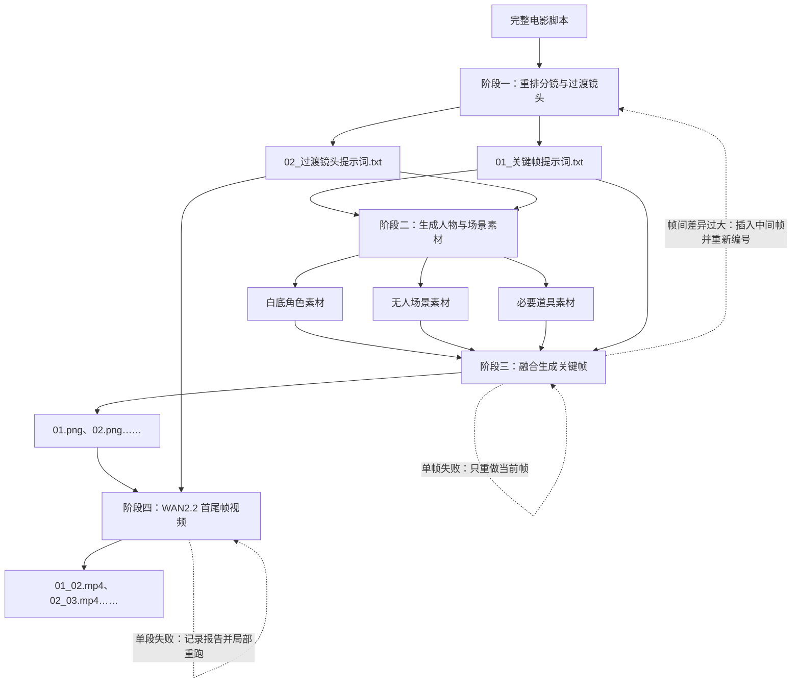
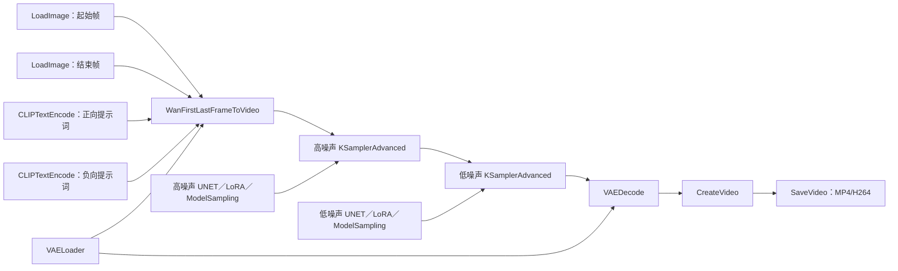

# film-wan22-start2end 详细说明

## 1. 这是什么

`film-wan22-start2end` 是一个面向电影、短剧和微电影脚本的自动化生产 Skill。它把完整剧本依次转换为：

1. 关键帧分镜提示词；
2. WAN2.2 首尾帧过渡提示词；
3. 白底人物、无人场景及必要道具素材；
4. 连续编号的关键帧图片；
5. 每对相邻关键帧之间的过渡视频。

其核心目标是建立一条可检查、可返工、可断点续跑的生产流水线，而不是一次性生成后无法定位错误。



---

## 2. 主要能力

### 2.1 按视觉变化重新分镜

不直接沿用剧本原自然段，而是根据以下变化设置关键帧：

- 场景或时间改变；
- 人物位置和关系改变；
- 关键动作产生结果；
- 景别、机位或镜头设计明显改变；
- 一个过渡片段无法自然承载的复杂剧情变化。

如果一段过渡同时包含多次换场、多人复杂交互或数个连续事件，Skill 会插入中间关键帧，而不是要求 WAN2.2 一次完成过多变化。

### 2.2 保持角色和场景连续性

在生成图片前先建立连续性描述，固定：

- 角色姓名、年龄段、脸型和发型；
- 服装、配饰和关键道具；
- 场景时代、布局和光线；
- 整体视觉风格和色调。

后续提示词复用这些描述，降低角色换脸、服装变化、道具变形和场景漂移。

### 2.3 双提示词体系

Skill 区分两类提示词：

- **关键帧提示词**：描述静态画面，包括景别、机位、构图、人物姿态、表情、环境和光线。
- **过渡提示词**：描述从起始帧到结束帧的运动，包括动作顺序、节奏、运镜、环境变化和结束状态。

### 2.4 本地 ComfyUI 批处理

视频阶段优先调用本地 ComfyUI API，不依赖鼠标点击。自动化脚本可以：

- 检查输入和编号；
- 启动离线的 ComfyUI；
- 等待既有队列空闲；
- 上传首尾帧；
- 注入提示词和生成参数；
- 逐段提交任务；
- 轮询执行历史；
- 下载并规范命名 MP4；
- 写入生成报告；
- 跳过已经存在的视频。

---

## 3. 交付文件与目录

### 3.1 Skill 包

```text
film-wan22-start2end.skill
```

该文件为可转移的 Skill 压缩包，包含：

```text
film-wan22-start2end/
├── SKILL.md
├── assets/
│   ├── wan22_start2end_api.json
│   └── wan22_start2end_fast_api.json
├── references/
│   ├── api_reference.md
│   └── prompt_spec.md
└── scripts/
    ├── convert_ui_workflow.py
    └── generate_videos.py
```

各文件职责：

| 文件 | 用途 |
|---|---|
| `SKILL.md` | 四阶段执行流程、验收标准和恢复规则 |
| `prompt_spec.md` | 分镜原则、提示词格式和命名规范 |
| `api_reference.md` | ComfyUI 路径、节点映射、参数和故障处理 |
| `convert_ui_workflow.py` | 把 ComfyUI UI 工作流转换为 API 工作流 |
| `generate_videos.py` | 批量执行首尾帧视频生成 |
| `wan22_start2end_api.json` | 默认 20 步高质量 API 工作流 |
| `wan22_start2end_fast_api.json` | 4 步 LoRA 快速 API 工作流 |

### 3.2 默认生产目录

在当前 Windows 用户桌面下生成：

```text
桌面/
├── 脚本/
│   ├── 01_关键帧提示词.txt
│   └── 02_过渡镜头提示词.txt
├── 素材/
│   ├── 角色_01_名称.png
│   ├── 角色_02_名称.png
│   ├── 场景_01_名称.png
│   ├── 场景_02_名称.png
│   └── 道具_01_名称.png
├── 分镜/
│   ├── 01.png
│   ├── 02.png
│   └── 03.png
└── 影像/
    ├── 01_02.mp4
    ├── 02_03.mp4
    └── 生成报告.json
```

如果用户指定项目目录，则在该目录下建立同名四个子目录。

---

## 4. 四阶段详细流程

## 阶段一：重排分镜与过渡镜头

### 输入

完整电影、短剧或微电影脚本。

### 处理

1. 通读脚本，提取角色、场景、时代、道具、视觉风格和剧情因果。
2. 建立角色与场景连续性表。
3. 按视觉状态变化设置关键帧。
4. 为每个关键帧编写静态画面提示词。
5. 为每对相邻关键帧编写动态过渡提示词。
6. 检查编号和对应关系。

### 输出一：关键帧提示词

文件：`脚本\01_关键帧提示词.txt`

严格格式：

```text
【关键帧 01】
角色：林默、纸人
场景：旧宅书房
提示词：电影写实风格，雨夜旧宅书房，中近景，略低机位，林默坐在……

【关键帧 02】
角色：纸人
场景：旧宅书房
提示词：同一旧宅书房，特写，桌面上的纸人……
```

关键帧提示词重点包括：

- 整体风格；
- 场景和时间；
- 景别和机位；
- 构图；
- 人物外观、姿态和表情；
- 关键道具；
- 光线、色调和镜头质感。

静态关键帧提示词不写“缓慢移动”“逐渐变成”等运动过程。

### 输出二：过渡提示词

文件：`脚本\02_过渡镜头提示词.txt`

严格格式：

```text
【过渡 01】
首尾帧：01 -> 02
提示词：镜头固定，林默的手指从桌面缓慢收拢，纸人被带起并靠近镜头；动作连续自然，最后准确停在结束帧构图。无切镜，无额外人物，无字幕。

【过渡 02】
首尾帧：02 -> 03
提示词：镜头从纸人特写缓慢拉远并轻微向右横移……
```

过渡提示词重点包括：

- 主体动作；
- 动作先后与节奏；
- 镜头固定、推、拉、摇、移、跟或环绕；
- 环境和光影变化；
- 结束状态；
- 身份、五官、手指、服装和道具稳定性。

### 阶段验收

- 使用 UTF-8 编码；
- 关键帧从 01 连续编号；
- 过渡从 01 连续编号；
- 第 N 条过渡只连接 N 与 N+1；
- 关键帧数量为 N 时，过渡数量必须为 N−1。

---

## 阶段二：生成人物和场景素材

### 人物素材

主角和配角分别生成独立图片：

- 单人正面图；
- 纯白背景；
- 无文字；
- 默认全身、自然站立；
- 双手完整可见；
- 外观与连续性表一致。

命名示例：

```text
角色_01_林默.png
角色_02_纸人.png
```

### 场景素材

主场景和附属场景均生成无人背景：

- 不出现人物；
- 不出现人形剪影；
- 不出现字幕和水印；
- 画幅与后续关键帧一致。

命名示例：

```text
场景_01_旧宅书房.png
场景_02_雨夜巷道.png
```

### 道具素材

剧情关键道具可生成白底单物体图片，用于稳定材质、尺寸和结构。

```text
道具_01_旧怀表.png
```

### 素材映射

生成工具返回图片 URL 后，需要：

1. 下载到本地 `素材` 目录；
2. 检查文件存在且非空；
3. 读取图片，核对白底、无人、身份和完整性；
4. 保存 URL 与本地文件的对应关系。

如果后续只剩余本地图片，则通过 `FileBatchUpload` 获取参考图 URL。

---

## 阶段三：生成全部关键帧

### 处理过程

1. 读取两个 TXT 和素材映射。
2. 根据关键帧条目选择必要角色、场景和道具参考图。
3. 使用 `image_edit` 融合参考图与关键帧提示词。
4. 每个条目只保留一张最终图片。
5. 按顺序保存到 `分镜` 目录。
6. 逐张读取并验收。

### 命名要求

```text
01.png
02.png
03.png
……
```

不保留：

```text
01 (1).png
01_副本.png
最终版2.png
```

### 单帧验收内容

- 与提示词一致；
- 人物身份、服装和年龄一致；
- 场景布局连续；
- 手部和道具结构正常；
- 画幅和视觉风格统一；
- 构图适合作为视频首尾帧。

### 两种返工路径

- **单张图片不合格**：只重生成当前帧。
- **相邻帧差异过大**：返回阶段一插入中间帧，并同步重排后续编号和过渡提示词。

---

## 阶段四：生成 WAN2.2 过渡影像

### 工作流来源

原始 UI 工作流：

```text
ComfyUI\user\default\workflows\首尾帧_wan2_2_start2end.json
```

Skill 已包含转换后的两套 API 工作流，因此正常情况下不需要手工操作 ComfyUI 界面。

### 两种生成模式

| 模式 | UI 节点状态 | 特点 |
|---|---:|---|
| 默认高质量模式 | `mode=0` | 20 步采样，质量优先 |
| 快速模式 `--fast` | `mode=4` | 高/低噪声 LightX2V 4-steps LoRA，速度优先 |

两组不能混合执行。

### 默认参数

除非用户明确指定，不擅自修改原工作流参数：

```text
宽度：640
高度：640
帧数：81
帧率：16 fps
批量大小：1
输出：MP4 / H264
```

自定义参数限制：

- 宽度和高度必须为 16 的倍数；
- 帧数必须为 `4n+1`，例如 17、49、81；
- 帧率必须大于 0。

---

## 5. ComfyUI 内部节点流程



### 参数映射

批处理脚本通过节点类型和图连接定位参数，不依赖固定节点编号：

| 参数 | 节点位置 |
|---|---|
| 起始关键帧 | `WanFirstLastFrameToVideo.start_image` 所连接的 `LoadImage` |
| 结束关键帧 | `WanFirstLastFrameToVideo.end_image` 所连接的 `LoadImage` |
| 正向提示词 | `WanFirstLastFrameToVideo.positive` 所连接的 `CLIPTextEncode.text` |
| 宽、高、帧数 | `WanFirstLastFrameToVideo.width/height/length` |
| 输出帧率 | `CreateVideo.fps` |
| 随机种子 | 只修改 `add_noise=enable` 的 `KSamplerAdvanced.noise_seed` |
| 输出格式 | `SaveVideo` 固定为 MP4/H264 |

### 模型需求

目标电脑需要具备：

- `wan2.2_i2v_high_noise_14B_fp8_scaled.safetensors`
- `wan2.2_i2v_low_noise_14B_fp8_scaled.safetensors`
- `umt5_xxl_fp8_e4m3fn_scaled.safetensors`
- `wan_2.1_vae.safetensors`

快速模式还需要：

- `wan2.2_i2v_lightx2v_4steps_lora_v1_high_noise.safetensors`
- `wan2.2_i2v_lightx2v_4steps_lora_v1_low_noise.safetensors`

---

## 6. 安装与导入

### 方法一：导入 Skill 包

将桌面上的 `film-wan22-start2end.skill` 复制到目标电脑，通过目标环境的 Skill 导入功能安装。

### 方法二：手动安装

该 `.skill` 文件为压缩包。解压后，将完整文件夹：

```text
film-wan22-start2end
```

放入目标环境的：

```text
workspace/.user_skills/
```

安装后应能看到：

```text
workspace/.user_skills/film-wan22-start2end/SKILL.md
```

### 目标电脑准备

1. 安装可运行的 ComfyUI；
2. 准备上述 WAN2.2 模型；
3. 确认本地 API 可访问；
4. 如果路径不同，通过 `--comfy-root` 指定；
5. 首次使用时先执行 dry-run，再生成一段短视频测试。

---

## 7. 使用方法

### 7.1 直接通过自然语言调用

示例：

```text
用 film-wan22-start2end 处理这个完整电影脚本。
```

快速测试：

```text
用 film-wan22-start2end 处理这个剧本，视频阶段使用快速模式。
```

只执行某一阶段：

```text
只把这个剧本整理成关键帧提示词和 WAN2.2 过渡提示词。
```

```text
根据桌面脚本和素材，只重新生成第 05 张关键帧。
```

```text
只重新生成第 3 和第 6 段过渡视频，不覆盖其他片段。
```

### 7.2 当前电脑默认命令

在 Skill 目录中执行：

```powershell
$python = 'D:\projects\ComfyUI_windows_portable_nvidia_cu126\ComfyUI_windows_portable\python_embeded\python.exe'

& $python '.\scripts\generate_videos.py' --dry-run
& $python '.\scripts\generate_videos.py'
```

快速模式：

```powershell
& $python '.\scripts\generate_videos.py' --fast --dry-run
& $python '.\scripts\generate_videos.py' --fast
```

### 7.3 指定 ComfyUI 路径

适用于迁移到其他电脑：

```powershell
$comfyRoot = 'D:\ComfyUI_windows_portable'
$python = Join-Path $comfyRoot 'python_embeded\python.exe'

& $python '.\scripts\generate_videos.py' `
  --comfy-root $comfyRoot `
  --dry-run
```

### 7.4 指定画幅和时长

```powershell
& $python '.\scripts\generate_videos.py' `
  --width 832 `
  --height 480 `
  --length 81 `
  --fps 16
```

关键帧图片也应提前统一为相同画幅，避免视频阶段发生构图拉伸。

### 7.5 单段重跑

```powershell
& $python '.\scripts\generate_videos.py' --only 1,3,6
```

如果目标 MP4 已存在，默认会跳过。明确需要覆盖时：

```powershell
& $python '.\scripts\generate_videos.py' --only 3 --overwrite
```

---

## 8. `generate_videos.py` 参数表

| 参数 | 作用 | 默认值 |
|---|---|---|
| `--frames-dir` | 关键帧目录 | `桌面\分镜` |
| `--prompts` | 过渡提示词 TXT | `桌面\脚本\02_过渡镜头提示词.txt` |
| `--output-dir` | 视频输出目录 | `桌面\影像` |
| `--comfy-root` | ComfyUI 便携版根目录 | 原电脑安装路径 |
| `--workflow` | 自定义 API 工作流 JSON | 内置默认或快速工作流 |
| `--fast` | 使用 4 步 LoRA 快速组 | 关闭 |
| `--server` | ComfyUI API 地址 | `http://127.0.0.1:8188` |
| `--width` | 视频宽度，16 的倍数 | 保留工作流值 |
| `--height` | 视频高度，16 的倍数 | 保留工作流值 |
| `--length` | 帧数，必须为 `4n+1` | 保留工作流值 |
| `--fps` | 输出帧率 | 保留工作流值 |
| `--seed` | 基础随机种子 | `2026` |
| `--only` | 只执行指定过渡编号 | 全部 |
| `--overwrite` | 覆盖已存在的视频 | 关闭 |
| `--continue-on-error` | 单段失败后继续 | 关闭，默认停止 |
| `--timeout` | 单段视频等待秒数 | `7200` |
| `--queue-timeout` | 等待其他队列的秒数 | `7200` |
| `--startup-timeout` | ComfyUI 启动等待秒数 | `180` |
| `--report` | 自定义报告路径 | `影像\生成报告.json` |
| `--dry-run` | 只校验，不访问网络或 GPU | 关闭 |

---

## 9. 断点续跑与安全行为

### 默认跳过已有视频

如果 `01_02.mp4` 已存在且非空，再次运行时会跳过该段，不会自动覆盖。

### 唯一上传文件名

每次批处理使用唯一文件名上传关键帧，避免覆盖其他项目的 ComfyUI 输入图片。

### 不抢占既有队列

脚本检测到其他任务正在运行或排队时，会等待队列空闲：

- 不取消已有任务；
- 不插入优先执行；
- 不并行抢占显存。

### 每段写入报告

`生成报告.json` 记录：

- 起始帧和结束帧；
- 使用的过渡提示词；
- 随机种子；
- `prompt_id`；
- 输出文件；
- 当前状态；
- 文件大小；
- 失败原因。

状态包括：

```text
pending
running
success
skipped
failed
```

### 失败策略

默认遇到错误即停止，防止系统性错误在整批任务中重复发生。

明确希望继续其余段落时：

```powershell
--continue-on-error
```

---

## 10. 常见问题与处理

| 问题 | 建议处理 |
|---|---|
| 提示词文件无法解析 | 检查是否使用独立一行的 `【过渡 01】`，以及是否包含 `首尾帧：01 -> 02` 和非空提示词 |
| 关键帧编号错误 | 确保从 01 连续编号，没有缺号或重复 |
| 过渡数量不匹配 | N 张关键帧应有 N−1 条过渡 |
| ComfyUI 400 错误 | 检查 API 工作流和节点连接；原 UI 工作流更新后重新转换，不要盲目重复提交 |
| CUDA OOM | 等待其他任务结束，减小尺寸或帧数，或使用快速模式；不要并行生成 |
| 等待超时 | 先检查 ComfyUI 控制台和队列，确认任务仍运行后再增加 `--timeout` |
| 历史中没有 MP4 | 检查 `SaveVideo` 节点和 ComfyUI `output\video` 目录 |
| 角色换脸或服装变化 | 回到素材和关键帧阶段，加强统一参考图与连续性描述 |
| 相邻帧变化不自然 | 插入中间关键帧，减少单个片段承载的动作和换场 |
| 迁移后找不到 ComfyUI | 使用 `--comfy-root` 指定目标电脑的实际安装目录 |
| 视频已存在但未重新生成 | 默认行为是跳过；明确需要覆盖时添加 `--overwrite` |

---

## 11. 工作流更新后重新转换

只有在原始 UI 工作流被修改后才需要执行：

```powershell
$python = 'D:\projects\ComfyUI_windows_portable_nvidia_cu126\ComfyUI_windows_portable\python_embeded\python.exe'
$source = 'D:\projects\ComfyUI_windows_portable_nvidia_cu126\ComfyUI_windows_portable\ComfyUI\user\default\workflows\首尾帧_wan2_2_start2end.json'

& $python '.\scripts\convert_ui_workflow.py' `
  $source '.\assets\wan22_start2end_api.json' --node-mode 0

& $python '.\scripts\convert_ui_workflow.py' `
  $source '.\assets\wan22_start2end_fast_api.json' --node-mode 4
```

迁移到其他电脑时，需要同步调整上述路径。

---

## 12. 完成验收标准

一次完整生产任务应满足：

- 四个生产目录齐全；
- 两个 TXT 均可解析；
- 素材覆盖全部角色、场景和必要道具；
- 关键帧从 01 连续编号且全部非空；
- 视频数量等于关键帧数量减一；
- 视频命名为 `01_02.mp4`、`02_03.mp4` 等；
- 报告中的成功、跳过和失败数量与实际文件一致；
- 抽检视频开头、结尾、运动连续性和结构稳定性；
- 失败片段能够根据报告定位并局部重跑。

---

## 13. 当前边界

该 Skill 当前负责：

- 剧本到分镜提示词；
- 人物、场景和道具素材；
- 首尾关键帧；
- 相邻关键帧之间的 WAN2.2 过渡片段。

它目前不自动负责：

- 将全部 MP4 合并为一部完整电影；
- 对白配音、背景音乐和音效；
- 自动字幕；
- 片头片尾；
- 最终调色和剪辑包装。

这些步骤可以在过渡片段验收后继续添加。

---

## 14. 验证状态

打包前已完成：

- Skill 结构和元数据校验；
- 默认组 16 个节点、快速组 18 个节点的 API schema 校验；
- 提示词解析测试；
- `--only` 单段选择测试；
- 已存在文件的断点续跑测试；
- 压缩包内 7 个文件的逐一哈希校验。

打包时 ComfyUI 仍有其他任务运行，因此没有插入真实 GPU 出片测试。迁移或首次正式使用时，建议先用快速模式生成一段短视频，确认目标电脑的模型、显存和路径配置正常。
