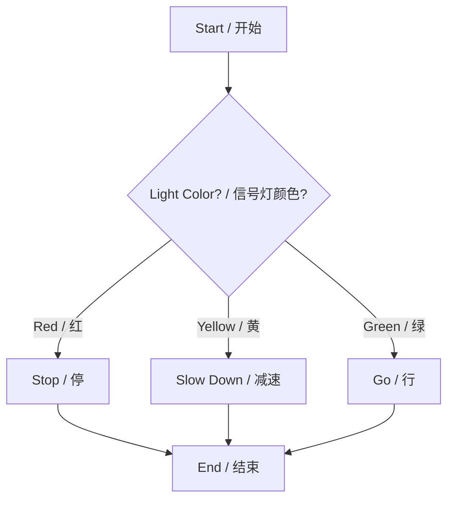
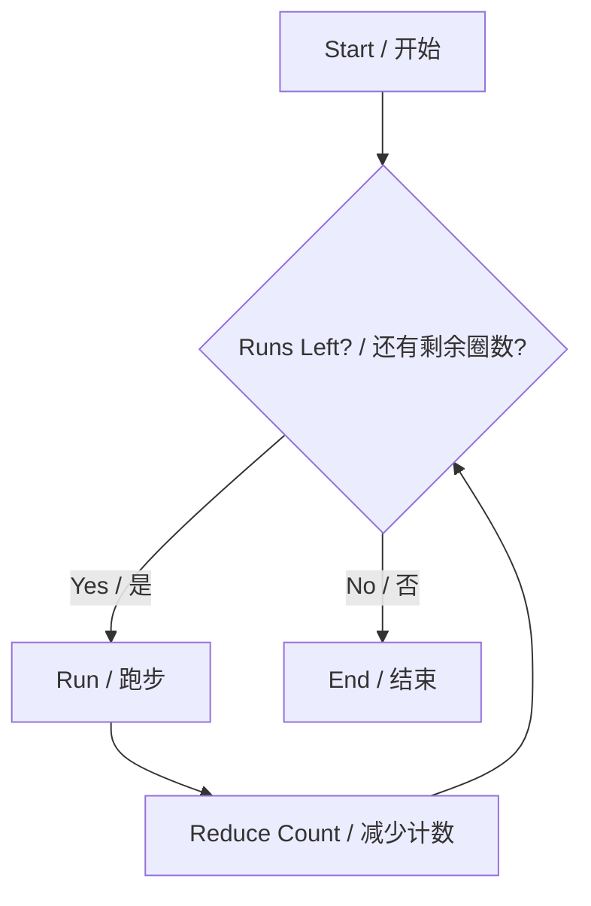

# Control Flow

# 控制流

Control flow is the heart of any program—it determines which code statements run first, which run next, whether to repeat them, and whether to skip them based on specific conditions.

控制流是任何程序的核心——它决定了哪些代码语句先运行，哪些后运行，是否需要重复执行，以及是否需要根据特定条件跳过某些语句。

> **Q: Why is control flow fundamental to programming?**
> **问：为什么控制流对编程至关重要？**
> 
> **Answer / 回答**: Without control flow, a program is just a rigid, top-to-bottom sequence of steps that does the exact same thing every time. Control flow gives programs "intelligence" or "logic." It allows a program to make decisions based on user input, handle errors gracefully, and repeat tasks efficiently. It turns a static script into a dynamic, interactive application.
> 如果没有控制流，程序只不过是一个死板的、自上而下的步骤序列，每次都执行完全相同的操作。控制流赋予了程序“智能”或“逻辑”。它允许程序根据用户输入做出决策，优雅地处理错误，并高效地重复任务。它将静态脚本变成了动态的交互式应用程序。

*(Note: You can draw and visualize control flow charts using the [Mermaid Live Editor](https://mermaid.live/edit))*
*(注：您可以使用 [Mermaid Live Editor](https://mermaid.live/edit) 来绘制和可视化控制流图)*

---

<br>

---

## Section 1: Control Flow Overview / 第一章：控制流概览

This section introduces the high-level concepts of how programs make decisions and repeat actions.
本章将介绍程序如何做出决策和重复操作的高层概念。

### 1.1 Conditional Statements / 条件语句

Conditionals allow programs to take different paths based on different situations.
条件语句允许程序根据不同的情况采取不同的执行路径。

**Traffic Light Example / 交通信号灯示例:**
```python
light_color = input("Traffic light color (red/yellow/green): ")

if light_color == "red":
    print("STOP")
elif light_color == "yellow":
    print("SLOW DOWN")
elif light_color == "green":
    print("GO")
else:
    print("INVALID COLOR")
```

<br>

### 1.2 Flowchart - Decision Making / 流程图 - 决策过程



<br>

### 1.3 While Loops / While 循环

Loops allow us to repeat a block of code as long as a condition remains true.
只要条件保持为真，循环就允许我们重复执行一段代码。

**Morning Run Example / 晨跑示例:**
```python
import time
runs_remaining = 3

while runs_remaining > 0:
    time.sleep(1) # Suppose you are superman, 400m in 1 second / 假设你是超人，1秒跑400米
    print("Morning run #" + str(4 - runs_remaining) + " completed!")
    runs_remaining = runs_remaining - 1

print("All runs finished!")
```

<br>

### 1.4 Flowchart - Loop Execution / 流程图 - 循环执行



<br>

### 1.5 Why Control Flow Matters / 为什么控制流很重要

Control flow matters because it enables programs to:
1. Make decisions to handle different situations.
2. Repeat tasks efficiently without writing the same code over and over.
3. Make code highly adaptable to real-world scenarios.

控制流之所以重要，是因为它使程序能够：
1. 做出决策以处理不同的情况。
2. 高效地重复任务，而无需一遍遍地编写相同的代码。
3. 使代码高度适应现实世界的场景。

**Automatic Door Control Example / 自动门控制示例:**
```python
# Since we don't have a physical sensor, we simulate one using input()
# 因为我们没有物理传感器，所以使用 input() 来模拟一个

import time

def object_detected():
    signal = input('Detected object? (y/n): ')
    if signal == 'y':
        print('Detected!')
        result = True
    else:
        print('No object!')
        result = False
    time.sleep(1)
    return result

def keep_open():
    print('Opening door! / 开门！')
    time.sleep(1)

def close_door():
    print('Closing door! / 关门！')
    time.sleep(1)

sensor_active = True

# Infinite monitoring loop / 无限监控循环
while sensor_active:
    if object_detected():
        keep_open()
    else:
        close_door()
        # You could add logic here to set sensor_active = False to exit the program
        # 你可以在这里添加逻辑将 sensor_active 设为 False 以退出程序
```

<br>

### 1.6 Vending Machine Example / 自动售货机示例

```python
coins = 0
while coins < 5:
    insert_coins = int(input("Insert coin (1-3): "))
    coins = coins + insert_coins
    print("Total inserted: " + str(coins))
print("Here's your drink!")
```

> **Questions and Solutions / 思考与解答:**
> 
> **Q: How can we limit the number of inserted coins each time?**
> **问：我们如何限制每次投入的硬币数量（只能是 1-3 之间）？**
> **A**: Add an `if` statement to check the input *before* adding it to the total:
> **答**: 在将输入加到总数之前，添加一个 `if` 语句来验证输入：
> ```python
> if 1 <= insert_coins <= 3:
>     coins = coins + insert_coins
> else:
>     print("Invalid coin! Please insert 1, 2, or 3.")
> ```
> 
> **Q: How can we get the extra coins (change) back?**
> **问：我们如何找零（退回多余的硬币）？**
> **A**: After the loop finishes, calculate the difference between the total coins and the cost (5):
> **答**: 在循环结束后，计算总硬币数与商品价格（5）之间的差额：
> ```python
> change = coins - 5
> if change > 0:
>     print("Here is your change: " + str(change))
> ```

<br>

### 1.7 Common Patterns / 常见模式

**Flag-controlled loops / 标志控制循环:** Use a boolean variable (True/False) to start/stop the loop.
使用布尔变量（真/假）作为标志来启动/停止循环。
```python
running = True
while running:
    user_input = input("Continue? (y/n): ")
    if user_input == "n":
        running = False
```

**Counter-controlled loops / 计数器控制循环:** Use a number to track how many times the loop has run.
使用一个数字来跟踪循环执行的次数。
```python
attempts = 3
while attempts > 0:
    # Do something / 执行某些操作
    attempts = attempts - 1
```

<br>

### 1.8 Take-home Message / 核心要点

1. Use `if-elif-else` for decisions. / 使用 `if-elif-else` 做决策。
2. Use `while` for repeating tasks. / 使用 `while` 重复任务。
3. Pay attention to Condition evaluation (True/False). / 注意条件评估（真/假）。
4. Use loop control variables (i, counter, flag). / 善用循环控制变量（i, 计数器, 标志）。
5. **Avoid infinite loops!** Always remember to update your condition inside the loop. / **避免死循环！** 永远记得在循环内部更新你的条件变量。

---

<br>

## Section 2: Conditionals in Python / 第二章：Python 中的条件语句

### 2.1 `if` Statement Basics / `if` 语句基础

Think of `if` as the program's "what if" question. The colon `:` is mandatory, and the code block must be indented with exactly 4 spaces.
把 `if` 想象成程序的“如果怎样”问题。冒号 `:` 是必须的，且代码块必须严格缩进 4 个空格。

```python
age = 18
if age >= 18:
    print("You can vote!") # Must be indented! / 必须缩进！
```

<br>

### 2.2 Indentation Demo / 缩进演示

Never mix tabs and spaces. Always stick to the 4-space rule.
永远不要混用 Tab 键和空格。始终坚持 4 空格原则。

```python
# Correct / 正确
if True:
    print("Right")  # ← 4 spaces / 4 个空格

# Wrong / 错误 (Will raise IndentationError / 会抛出缩进错误)
# if True:
# print("Wrong")    # ← No indentation / 没有缩进
```

<br>

### 2.3 Comparison Operators / 比较运算符

Used to compare two values. / 用于比较两个值。

```python
height = 175
print(height > 160)  # True
print(height == 170) # False

# Real-life example / 现实生活案例
bus_height_limit = 200
luggage_height = 210
if luggage_height > bus_height_limit:
    print("Cannot take bus / 无法上车")
```

<br>

### 2.4 Logical Operators / 逻辑运算符

Used to combine multiple conditions. / 用于组合多个条件。
* `and`: Both must be True / 必须两边都为真
* `or`: At least one must be True / 至少有一边为真
* `not`: Reverses the boolean value / 反转布尔值

```python
is_raining = True
has_umbrella = False

if is_raining and has_umbrella:
    print("Go outside / 可以出门")
else:
    print("Stay home / 留在家里")
```

<br>

### 2.5 Common Mistake Fix / 常见错误修正

Mixing up assignment and comparison is the most common beginner mistake.
混淆“赋值”和“比较”是初学者最常犯的错误。

```python
# Wrong / 错误: Single '=' is for assignment! (Will cause SyntaxError here)
# if temperature = 30:
#     print("Hot")

# Correct / 正确: Double '==' is for comparison!
temperature = 30
if temperature == 30:
    print("Hot")
```

<br>

### 2.6 Multi-Condition Flow (`elif`) / 多条件分支

Use `elif` (else if) when you have more than two mutually exclusive outcomes.
当你有两个以上互斥的结果时，使用 `elif` (else if)。

```python
age = 15

if age < 13:
    print("Child ticket / 儿童票")
elif age < 18:
    print("Teen ticket / 青少年票")
else:
    print("Adult ticket / 成人票")
```

<br>

### 2.7 Nested Conditions / 嵌套条件

You can put `if` statements inside other `if` statements. However, try to limit nesting to 3 levels max for readability.
你可以把 `if` 语句放在另一个 `if` 语句里面。但是，为了保证代码可读性，建议嵌套层数最多不超过 3 层。

```python
age = 20
is_student = True

if age < 18:
    print("50% discount")
else:
    # This is level 2 / 这是第二层
    if is_student:
        print("30% discount")
    else:
        print("No discount")
```

<br>

### 2.8 Ticket System Logic / 售票系统逻辑解析

```python
age = 25
is_student = False
has_membership = True

if age < 5:
    print("Free ticket")
elif age < 18:
    print("Child ticket")
elif is_student:
    print("Student discount")
elif has_membership:
    print("Membership discount")
else:
    print("Regular ticket")
```

> **Questions and Solutions / 思考与解答:**
> 
> **Q: What if you are a 19-year-old student without membership?**
> **A:** The code prints `"Student discount"`. Because `age < 5` is False, `age < 18` is False, but `is_student` is True. The `elif` catches it and stops checking the rest.
> **答：** 输出 `"Student discount"`。因为年龄不满足前两个条件，但 `is_student` 为真，程序在此截断并跳出。
> 
> **Q: What if you are a 19-year-old student WITH membership?**
> **A:** It STILL prints `"Student discount"`. The `if-elif` chain executes only the *first* condition that evaluates to True. Once `elif is_student` triggers, it ignores the membership check entirely!
> **答：** 仍然输出 `"Student discount"`。`if-elif` 链只会执行**第一个**满足的分支。一旦验证为学生，就会完全忽略后面的会员检查！
> 
> **Q: How can we get BOTH the Student discount and the Membership discount?**
> **A:** You must structure the code differently. Either use consecutive independent `if` statements to accumulate a discount variable, or combine them:
> **答：** 必须改变代码结构。要么使用连续独立的 `if` 语句来累加折扣变量，要么使用逻辑运算符组合它们：
> ```python
> # Solution using combination / 使用组合逻辑的解决方案:
> if is_student and has_membership:
>     print("Super Discount: Student + Member!")
> elif is_student:
>     print("Student discount")
> # ...
> ```

<br>

### 2.9 Truth Value Testing / 真值测试

In Python, many objects can be evaluated in a boolean context.
在 Python 中，许多对象都可以直接放在布尔上下文中进行评估。

* **Common False values (假值):** `False`, `None`, `0`, `""` (empty string), `[]` (empty list).
* Everything else is generally True.

```python
name = ""
# Because name is empty, it acts like False. 'not False' becomes True.
# 因为 name 是空的，所以它相当于 False。'not False' 就变成了 True。
if not name:
    print("Name is required! / 必须输入名字！") 
```

<br>

### 2.10 Short-form Conditional Expression / 简写条件表达式（三元运算符）

Useful for simple variable assignments, but can make complex logic hard to read.
对于简单的变量赋值很有用，但会使复杂的逻辑变得难以阅读（不推荐初学者滥用）。

```python
temperature = 28

# Short form (Ternary operator) / 简写形式（三元运算符）
message = "Hot" if temperature > 25 else "OK"
print(message)

# Preferred for beginners (More readable) / 推荐初学者的写法（更易读）
if temperature > 25:
    message = 'Hot'
else:
    message = 'OK'
print(message)
```

---

<br>

## Section 3: Loop Structures in Python / 第三章：Python 中的循环结构

### 3.1 For Loop Basics / For 循环基础

A `for` loop is used to iterate over a sequence (like a list, string, or range). Think of it like going through a shopping list item by item.
`for` 循环用于遍历一个序列（如列表、字符串或范围）。把它想象成逐项检查购物清单。

```python
groceries = ["apple", "milk", "bread"]
for item in groceries:
    print("Don't forget to buy:", item)
```

<br>

### 3.2 The `range()` Function / `range()` 函数

`range()` generates a sequence of numbers. It is incredibly common in `for` loops.
`range()` 会生成一个数字序列。它在 `for` 循环中极为常见。

```python
# 1 Argument: Ends at 4 (5 is exclusive) / 1 个参数：到 4 结束（不包含 5）
for num in range(5):
    print(num)  # 0, 1, 2, 3, 4

# 2 Arguments: Start at 2, End at 4 / 2 个参数：从 2 开始，到 4 结束
for num in range(2, 5):
    print(num)  # 2, 3, 4

# 3 Arguments: Start, End, Step (jump size) / 3 个参数：开始，结束，步长
for num in range(0, 10, 2):
    print(num)  # 0, 2, 4, 6, 8
```

<br>

### 3.3 String Traversal with Index / 带有索引的字符串遍历

Use `enumerate()` when you need both the character and its position (index).
当你同时需要字符及其位置（索引）时，使用 `enumerate()`。

```python
word = "hello"
for index, letter in enumerate(word):
    print("Character at position " + str(index) + ": " + letter)
```

<br>

### 3.4 While Loop Mechanics / While 循环机制

Like a persistent alarm clock, it keeps running until the condition becomes False.
就像一个持续响铃的闹钟，它会一直运行直到条件变为 False。

```python
countdown = 3
while countdown > 0:
    print(countdown)
    countdown = countdown - 1  # Crucial! / 这一步至关重要！
print("Go!")
```

<br>

### 3.5 Termination Condition Design / 终止条件设计

**Dangerous Example / 危险示例（死循环）:**
```python
# temperature = 25
# while temperature > 20:
#     print("AC running")
# Forgot to decrease temperature! This will run forever! 
# 忘了降低温度！这将永远运行下去！
```

<br>

### 3.6 Safe Loop Writing Technique / 安全编写循环的技巧

Always write your initial value and termination logic *first*, before filling in the rest of the code.
始终*优先*编写初始值和终止逻辑，然后再填写其余代码。

```python
# 1. Set initial value / 设定初始值
counter = 0
# 2. Define termination limit / 定义终止限制
MAX_ATTEMPTS = 3

while counter < MAX_ATTEMPTS:
    print("Attempt:", counter + 1)
    
    # 3. ALWAYS update the counter / 永远记得更新计数器
    counter = counter + 1
```

<br>

### 3.7 The `break` Statement / `break` 语句

`break` acts as an emergency exit. It instantly breaks out of the *entire* loop.
`break` 就像紧急出口。它会立即跳出*整个*循环。

```python
passwords = ["123", "admin", "letmein"]
for pwd in passwords:
    if pwd == "admin":
        print("Security alert! Access blocked.")
        break  # Loop ends immediately here / 循环在此立刻结束
    print("Checking:", pwd)
```

<br>

### 3.8 The `continue` Statement / `continue` 语句

`continue` skips the rest of the *current* iteration and jumps back to the top of the loop to continue with the next item.
`continue` 会跳过*当前*迭代的剩余部分，直接回到循环顶部，继续处理下一个项目。

```python
# Skip odd numbers, print only evens / 跳过奇数，只打印偶数
for num in range(10):
    if num % 2 != 0: # If odd / 如果是奇数
        continue     # Skip to next number / 跳到下一个数字
    print(num, "is even")
```

<br>

### 3.9 The `else` Clause in Loops / 循环中的 `else` 子句

A unique Python feature. The `else` block runs ONLY if the loop completes normally (without hitting a `break`).
这是 Python 独有的特性。只有当循环正常完成（没有触发 `break`）时，`else` 块才会执行。

```python
numbers = [2, 4, 6]
for n in numbers:
    if n % 2 != 0:
        print("Found an odd number!")
        break
else:
    # Runs because the loop finished without breaking
    # 因为循环没有被中断地完成了，所以这行会执行
    print("All numbers are even!") 
```

<br>

### 3.10 Nested Loops: Multiplication Table / 嵌套循环：乘法表

```python
for i in range(1, 4):      # Outer loop (Rows) / 外层循环（行）
    for j in range(1, 4):  # Inner loop (Columns) / 内层循环（列）
        print(str(i) + 'x' + str(j) + '=' + str(i*j), end="\t")
    print()  # New line after each row / 每行结束后换行
```

<br>

### 3.11 Understanding Indentation Levels / 理解缩进层级

```python
# Outer loop (level 1 / 第一层)
for x in range(2):
    # Inner loop (level 2 / 第二层)
    for y in range(2):
        # Nested block (level 3 / 第三层)
        if x == y:
            print("Match at " + str(x) + ',' + str(y))
    # Back to level 1 / 回到第一层
    print("----")
```

---

<br>

## Section 4: Control Flow - Practical Examples / 第四章：控制流实战案例

### 4.1 Smart Grade Rating System / 智能成绩评级系统

**Basic Structure / 基础结构:**
```python
score = float(input("Enter score (0-100): "))

if score >= 90:
    print("Grade A")
elif score >= 80:
    print("Grade B")
elif score >= 70:
    print("Grade C")
else:
    print("Grade D")
```

<br>

### 4.2 Adding Loop for Multiple Inputs / 添加循环以处理多次输入

Wrapping the logic in a `while True` loop allows the program to run continuously until the user types 'q'.
将逻辑包装在 `while True` 循环中，程序可以连续运行，直到用户输入 'q'。

```python
while True:
    score_input = input("Enter score (q to quit): ")
    
    if score_input.lower() == 'q':
        break # Exit the loop / 退出循环
        
    score = float(score_input)
    if score >= 90:
        print("Grade A")
    # ... (rest of logic) ...
```

<br>

### 4.3 Number Guessing Game (Core) / 猜数字游戏（核心逻辑）

```python
import random
target = random.randint(1, 100)

while True:
    guess = int(input("Guess (1-100): "))
    
    if guess == target:
        print("Correct!")
        break
    elif guess > target:
        print("Too high")
    else:
        print("Too low")
```

<br>

### 4.4 Tracking Attempts & Win/Loss / 追踪尝试次数与胜负判断

Let's combine concepts to create a complete, robust game.
让我们结合所有概念，创建一个完整且健壮的游戏。

**Final Complete Code Demo / 最终完整代码演示:**
```python
import random
target = random.randint(1, 100)
attempts = 0
max_attempts = 5

print("Welcome to the Guessing Game! You have 5 tries.")

while attempts < max_attempts:
    guess = int(input("Guess (1-100): "))
    attempts = attempts + 1
    
    if guess == target:
        print("Correct!")
        break # Exit loop early if they win / 如果猜中，提前跳出循环
    elif guess > target:
        print("Too high")
    else:
        print("Too low")

# Outside the loop, check if they won or lost
# 在循环外部，检查最终是赢是输
if guess == target:
    print("Victory in " + str(attempts) + " tries!")
else:
    print("Game Over! Failed! Number was " + str(target))
```

---

<br>

## Section 5: Special Considerations / 第五章：特殊注意事项

### 5.1 Multi-line Conditional Statements / 多行条件语句

When conditions get too long, wrap them in parentheses `()` and break them across lines for readability.
当条件变得太长时，将它们用括号 `()` 括起来，并跨行换行以提高可读性。

```python
# Recommended style / 推荐风格
if (temperature > 100 
    and humidity < 70 
    and is_sunny == True):
    print("Heat warning!")
```

<br>

### 5.2 Splitting Long Logical Expressions / 拆分冗长的逻辑表达式

It is often better to calculate complex logic in separate boolean variables first.
通常更好的做法是先在独立的布尔变量中计算复杂的逻辑。

```python
# Hard to read / 难以阅读
# if (num > 0 and num%2 == 0 and num < 100 and name != "admin"):

# Professional approach / 专业的做法
is_positive_even = (num > 0 and num % 2 == 0)
within_limit = (num < 100)
valid_user = (name != "admin")

if is_positive_even and within_limit and valid_user:
    print("Access granted.")
```

<br>

### 5.3 Debugging with Print Statements / 使用 Print 语句进行调试

If your loop isn't acting right, print your variables!
如果你的循环行为异常，把变量打印出来看看！

```python
counter = 0
while counter < 3:
    print("DEBUG: Current counter ->", counter)  # Debug line / 调试行
    counter = counter + 1
```

<br>

### 5.4 Using TODO Comments / 使用 TODO 注释

Use `# TODO:` to mark code that needs to be finished later. Professional IDEs will highlight these.
使用 `# TODO:` 来标记稍后需要完成的代码。专业的 IDE 会高亮显示这些注释。

```python
def calculate_discount(price):
    # TODO: Add seasonal discount logic / TODO: 添加季节性折扣逻辑
    # TODO: Implement user tier system / TODO: 实现用户等级系统
    return price * 0.9  # Temporary 10% discount / 临时的 9 折优惠
```

<br>

### 5.5 Syntax Errors to Watch Out For / 需要注意的语法错误

**1. Missing Colon / 缺失冒号:**
```python
# Incorrect / 错误
# while x < 5
#     print(x)

# Correct / 正确
while x < 5:
    print(x)
    x = x + 1
```

**2. Indentation Errors / 缩进错误:**
```python
# Wrong mixing of levels / 错误的层级混用
# while n > 0:  
# print(n)      # Python doesn't know this belongs to the loop! (Python不知道这属于循环！)
#     n = n - 1

# Correct / 正确
while n > 0:
    print(n)
    n = n - 1
```

<br>

### 5.6 Floating Point Comparison / 浮点数比较

**Never** use `==` to compare floating-point decimals. Because computers calculate in binary, `0.1 + 0.2` actually equals `0.30000000000000004`.
**永远不要**使用 `==` 来直接比较浮点小数。由于计算机在底层使用二进制进行计算，`0.1 + 0.2` 实际上等于 `0.30000000000000004`。

```python
# Unreliable / 不靠谱的做法
result = 0.1 + 0.2
if result == 0.3:
    print("Equal") # This will NOT print! / 这行不会被打印！

# Safe approach (Tolerance testing) / 安全的做法（误差容忍测试）
tolerance = 1e-9 # 0.000000001
if abs(result - 0.3) < tolerance:
    print("Effectively equal / 结果等效相等")
```
